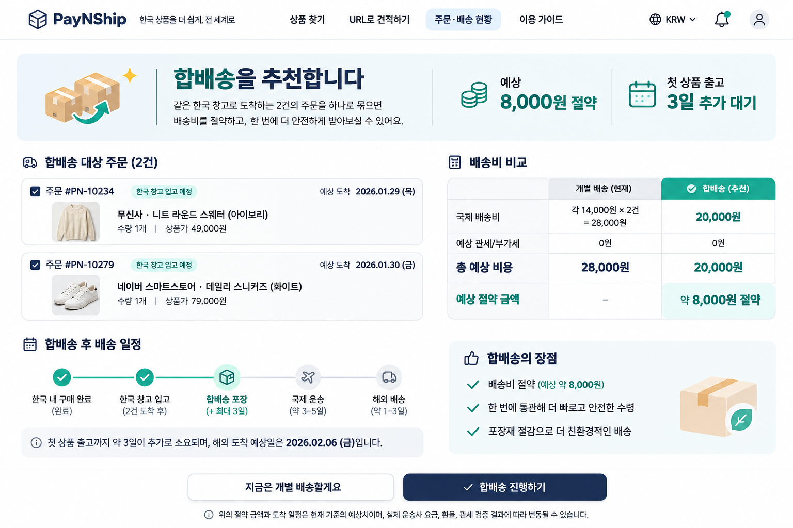
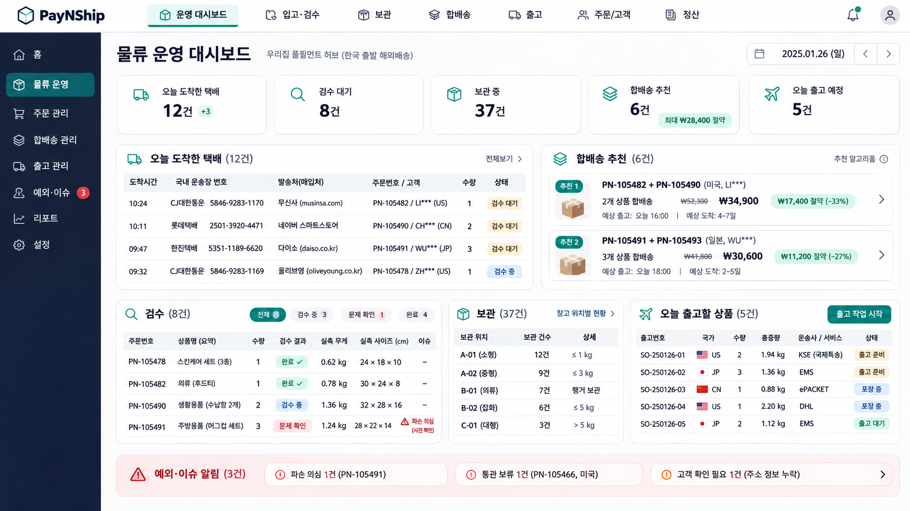
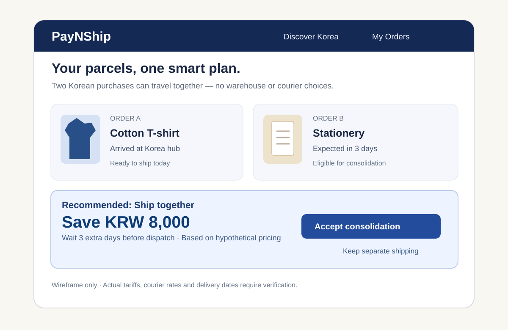
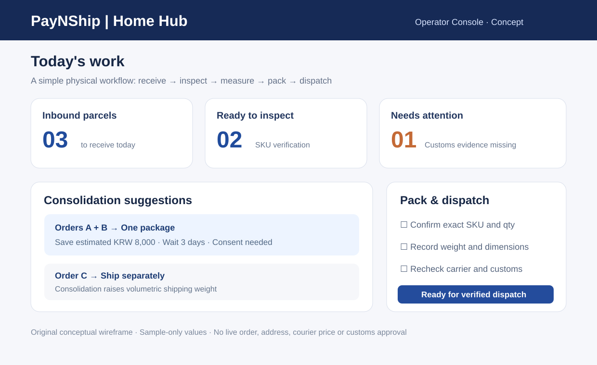

# 첫 번째 학습 단위 — 합배송 추천 TDD

**이 문서는 프로그래밍 초심자가 결과를 먼저 보고 코드와 테스트를 순서대로 이해하도록 만든 교재다.** [제품/사업 방향](PRODUCT_VISION_COMPILER_AND_MD.md), [개발자 역할과 TDD 계약](TDD_AGENT_DEVELOPMENT_CONTRACT.md), [집에서 하는 물류](HOME_HUB_AND_CONSOLIDATION_SRS.md)과 함께 읽는다.

## 1. 고객 문제가 무엇이었나?

한 해외 고객이 같은 주소로 보낼 한국 상품 두 개를 따로 주문했다. 주문 A는 오늘 집(HOME_HUB)에 도착했고 B는 3일 후 도착할 예정이다. 개별 배송은 34,000원, B까지 기다렸다 합배송하면 국제배송 + 합포장 요금이 26,000원이라는 **가상 테스트 데이터**를 받았다고 하자.

고객에게는 **8,000원 절약, 첫 상품 3일 더 대기**를 함께 보여줘야 한다. 고객이 동의하지 않았으면 그저 제안만 하고 배송을 지연시켜서는 안 된다. 사업주는 웹페이지에서 배송사를 직접 고르는 대신, 실제 계약상 가능한 조합의 계산 결과를 이해하고 집에서 입고·검수·포장 작업을 수행한다.

아래 SVG는 편집 가능한 구조 참고용이며, 위 PNG 두 장이 **대화에서 생성한 원본 이미지**다.

두 그림은 **독자 작성 SVG 개념 시안**으로, 실제 PayNShip 배포 화면이 아니며 가상의 가격/주문을 사용한다. 기존 저장소의 상품 실사진은 \`features/storefront/catalog/references.json\`에서 원본 출처와 경로를 확인하라. 대화에서 보았던 실시간 검색 이미지 원본을 무단으로 복제한 것이 아니다.

## 2. 네가 볼 소스 파일 2개

- **테스트(기대 동작):** \`lib/compiler/consolidation/__tests__/recommend.test.ts\`.
- **실제 알고리즘:** \`lib/compiler/consolidation/recommend.ts\`.

지금 단계는 **순수 추천 함수의 첫 번째 수직 슬라이스**다. 이미 검증된 후보 플랜을 받아 무엇을 추천할지 결정한다. **실제 박스 조합 생성/운송사 요금 API/관세사 연결/자택 스캔/결제/배송 화면은 이 코드로 아직 구현되지 않았다.** 후속 단계에서 같은 엔진을 확장해야 한다. 견적 승인과 진짜 배송 실행에 연결하면 안 된다.

## 3. 테스트부터 읽기: RED → GREEN → REFACTOR

### Case A: 합배송이 저렴할 때

\`\`\`ts
// 합배송 후보: 이미 동일 수취인/상품/관세/운임이 검증됐다는 가상 fixture
const separatePrice = 54_000;
const combinedPrice = 32_000;
// 기대 결과: 합배송을 권장하고 22,000원 절약 표시
\`\`\`

테스트에서는 \`toMatchObject({ recommendedPlanId:'all', estimatedCustomerSavingsKrw: 22000 })\`처럼 비교한다.

### Case B: 오래 기다려야 할 때

\`\`\`ts
const separatePrice = 34_000;
const waitAndCombinePrice = 26_000;
const extraWaitDays = 3;
// 기대: 8,000원 절감 + 3일 추가 대기 + 고객 동의가 필요함
\`\`\`

**핵심 원리:** 절약액과 고객의 기다리는 시간을 별도로 반환해야 한다. "합배송 추천" 하나의 boolean으로는 충분하지 않다.

### Case C: 서로 다른 고객이나 상품

\`recipientKey\`가 다르거나, SKU·옵션·수량을 나타내는 \`manifestFingerprint\`가 다른 후보는 다른 주문의 물품을 섞거나 다른 품목 가격을 비교할 위험이 있으므로 제외한다.

### Case D: 세관/운송사·DDP 미검증

후보의 \`customsVerified\`, \`carrierRateVerified\`, \`costComponentsVerified\`, \`ddpVerified\`(필요한 경우), \`legallyEligible\`, \`meetsPromisedDelivery\`가 명시적으로 검증되지 않으면 아무리 가격이 싸도 선택하지 않는다. 운임 유효기간이 지난 경우도 제외한다.

## 4. 실제 코드를 이해하기 위한 다섯 개념

**함수(function):** 같은 입력 데이터가 들어오면 같은 결과를 계산하는 작은 업무 단위.

**타입(interface):** \`ConsolidationPlan\`이 반드시 가져야 할 데이터의 모양. 예: 요금, 목적지 수취인, 추가 대기일, DDP 검증 상태.

**순수 함수(pure function):** DB나 쇼핑몰과 통신하지 않으며 비밀/시간을 몰래 읽지 않는다. \`recommendConsolidation(input)\`은 외부에서 받은 현재시각 \`nowIso\`와 후보 요금만으로 결정한다.

**제약 조건(constraint):** 금액과 무관하게 불가능한 후보를 제거하는 규칙. 다른 고객/불법/만료 운임/배송기한 위반을 제거한다.

**최적화(optimization):** 남은 적격 후보 중 고객 총 부담액이 가장 적은 것을 고른다. 동일 금액이면 대기시간이 적은 후보를 우선한다.

## 5. 실행 방법

\`\`\`bash
git clone https://github.com/DongHeeKw/paynship-dh2.git
cd paynship-dh2
npm ci
npx vitest run lib/compiler/consolidation/__tests__/recommend.test.ts
npm run type-check
\`\`\`

**주의:** 브랜치 코드가 main에 반영된 후 실행하는 명령이다. Node.js 24+를 사용하라. \`npm ci\`는 설치된 package-lock을 기준으로 한다. Docker, 3PL 계약, Shopify/관세사 실제 인증키 없이 첫 순수 함수 테스트는 실행 가능해야 한다.

테스트 결과를 보고 다음 실험을 해보면 학습에 좋아.

1. 테스트에서 합배송 가격을 \`32_000\`에서 \`65_000\`으로 수정하면 별도배송이 선택되어야 한다. 기대결과를 테스트에 맞게 바꿔 확인.
2. \`additionalWaitDays\`를 3으로 바꾸면 고객 동의가 필요한지 확인.
3. \`ddpVerified\`를 false로 바꾸고 DDP가 필수인 요청에서 제외되는지 확인.
4. \`carrierRateExpiresAt\`를 지나간 날로 바꾸면 \`REVIEW_REQUIRED\` 또는 다른 안전한 후보가 남는지 확인.

이 실습에서는 실제 고객 운임/세금 데이터나 자택 주소를 사용하지 않는다.

## 6. 코드가 하지 않는 것과 다음 기능

**아직 하지 않음:** 국내 판매처 자동구매, 다중 주문 후보 파티션 생성, 실제 입고/포장 측정, 나라별 HS/관세 Golden Test, 실운송 계약 요금표, 도착 예상일 예측, 자동 출고, 로그인 홈/운영 대시보드 렌더링, 고객 동의의 DB 저장.

**다음 TDD 순서:** (1) 주문 여러 개에서 같은 수취인의 배송 후보 자동 탐색 → (2) 별도/전체/부분/대기 포장 후보 생성 → (3) 자택 입고·포장 실측 → (4) 국가별 통관/DDP 자격이 실제로 검증된 후보만 평가 → (5) 운송사 요금·고객 동의·견적과 주문·배송 실제 기록 연결 → (6) 화면 구현.

후속 PR도 반드시 TDD 증거, 변경 전후, 데이터보존, 고객에게 보이는 가격/대기시간과 운영자 액션을 보고한다.

## 7. 기술 부채와 검증 요구

\`manifestFingerprint\`는 초기 **정확한 주문 구성의 동일성 표시자**이므로 실제 사업 구현에서 임의 문자열을 클라이언트가 선언하게 두면 안 된다. 서버가 승인된 주문아이템들의 \`exactSKU/variant/quantity\`를 표준화하고 충돌에 강한 fingerprint를 생성·검증해야 한다. \`recipientKey\`도 서버가 인증된 고객/실수취인/주소의 비식별 참조에서 생성해야 한다.

\`customsVerified: true\`나 \`ddpVerified: true\`는 단순 외부 입력으로 신뢰하면 안 된다. 실제 상품별 관세사/법령/운송사 계약 evidence와 유효일, 승인자, 금액을 검증한 뒤 내부에서만 부여해야 한다. 테스트의 boolean은 이 **결정 함수가 어떤 결과를 내는지 확인하기 위한 통제된 fixture**다.

요컨대 지금 코드는 **전체 컴파일러가 아니라, 그 안에 들어갈 테스트 가능한 의사결정의 핵**이다. 실서비스 출시 근거는 아님.

## 후속 구현

위 내용은 첫 선택기 단계 기록이다. 후보 생성·운임 계산·시나리오 화면의 후속 구현과 한계는 [Step 2](LEARNING_STEP_02_PLAN_COMPILER.md)를 참고한다. 실제 동의/출고/DB/국가별 승인 연동은 여전히 미구현이다.
