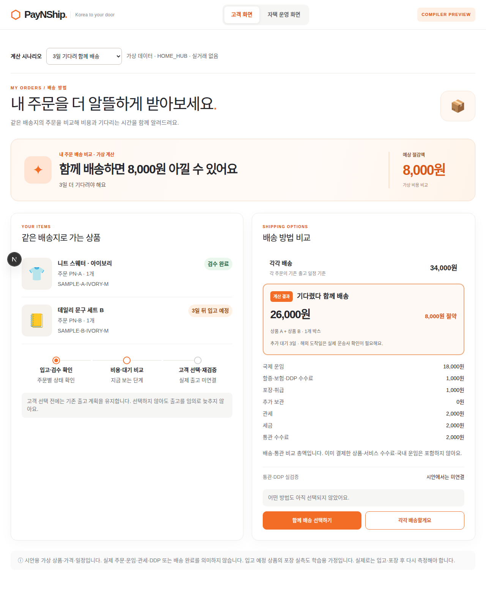
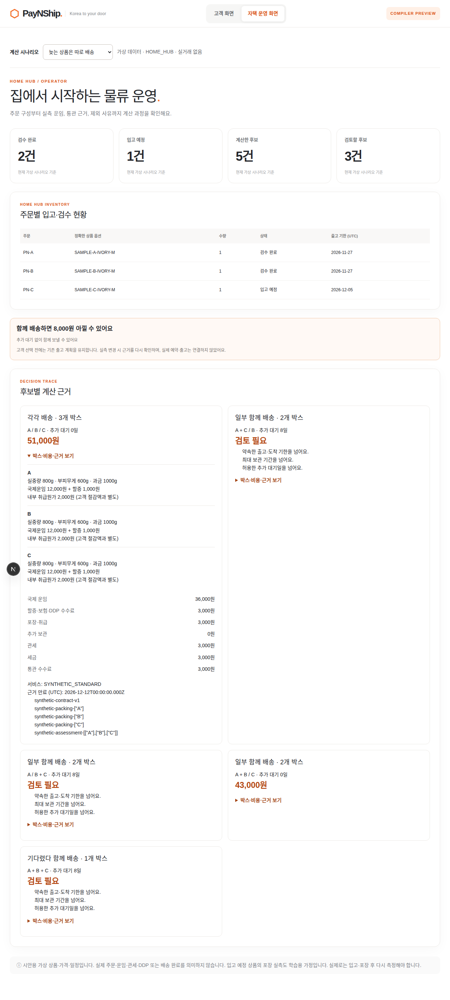

# 두 번째 학습 — 주문에서 배송 후보를 직접 계산하기

2026-11-22 · 로컬 계산/화면 구현 · 실거래 미연결

## 고객에게 달라진 결과

이전: 이미 만든 두 가격을 선택기에 넣고 화면에 34,000/26,000/8,000원을 따로 적었다.
이후: 주문 → 모든 배송 조합 → 박스별 운임/할증/포장/보관 → 조합에 맞는 통관 평가 → 비교/추천 → 고객·운영자 화면이 같은 결과를 사용한다.

가상 주문 A는 오늘, B는 3일 후 입고한다. 따로 배송하면 34,000원, 기다렸다 함께 보내면 26,000원이다. 고객에게 **8,000원 절약 + 3일 추가 대기**를 함께 표시한다. 큰 박스 시나리오에서는 각각 배송, 근거가 없거나 만료되면 “배송비를 확인하고 있어요”로 바뀐다. 시안 선택은 실제 동의 저장이나 예약이 아니다.

## 계산 범위와 정직한 제한

- `HOME_HUB`, 동일 owner/recipient/address/country의 1~4개 주문 라인. 하나라도 다르면 전체 검토 상태로 반환하며 다른 사람의 물품을 조용히 제외하고 가격을 비교하지 않는다.
- 4개 라인의 모든 15개 파티션을 생성한다. 한 라인의 수량을 분할하지 않는다. 포장 형상은 알고리즘으로 추측하지 않고 각 그룹의 외부 실측 스냅샷을 요구한다.
- 최대 4개 서비스, **한 계획 안에서는 동일 서비스**를 사용한다. 최저가는 이 유한 후보 집합 내의 최저가다. 박스마다 다른 서비스, 판매처 선택, 여러 허브의 전역 최적화는 아직 없다.
- 실제/부피무게의 큰 값과 서비스별 최소중량·올림 단위를 적용한다. mm/gram 단위와 BigInt로 경계 계산을 한다. 기본운임뿐 아니라 연료·원격지·픽업·피크·보험·DDP 수수료를 포함한다.
- 비교 금액은 **남은 배송·통관 고객 부담액**이다. 이미 결제한 상품·15% 서비스 수수료·국내 운임은 불변 공통비로 제외한다. 새 상품 구매의 총도착가 계산기라고 주장하지 않는다. 내부 취급원가는 별도로 기록하며 회사 마진을 고객 절감액으로 바꾸지 않는다.
- 대기는 각 상품의 원래 준비시점 대비 추가일이다. 최대 추가대기, 저장 기한, 출고 기한, 서비스 운송일을 더한 배송 기한을 확인한다. 비용 동률·대기 동률이면 기존 separate 계획을 유지한다.
- 전체 파티션의 적법성/수입자/DDP 평가와 세액을 요구한다. 개별 박스 승인만 합쳐 분할의 적법성을 주장하지 않는다. 정확한 SKU/수량/원산지/신고가/수취인 참조/포장/운임 스냅샷이 바뀌면 기존 평가 키가 맞지 않는다.
- `assessmentKey`는 비교용 직렬화 키다. 암호학적 서명이나 인증 토큰이 아니다. 운영 승인 근거를 로드하는 인증된 서버 어댑터는 미구현이다. `INTERNAL_SNAPSHOT` 이름만으로 신뢰하지 않으며 공개 입력/API와 결제에 연결하지 않는다.
- 모든 결과는 `executionAllowed: false`. fixture는 `SYNTHETIC_TEST_DATA`이며 법률 세율이나 관세사 Golden Test가 아니다. 입고 전 상품의 실측 데이터도 가상 가정이다. 실제 입고/검수/포장/재견적을 대체하지 않는다.
- `maxWaitDays`는 후보 탐색 범위이며 고객 동의가 아니다. 실제 동의·거절·만료 저장, 입고 DB, 운송사 계약, 국가별 법정 세액 계산, 자동 출고·추적은 후속 작업이다. TC-CON-01~18 전체 완료 또는 MC/DC 완료를 주장하지 않는다.

## 코드 읽는 순서

1. [기대 결과 테스트](../../lib/compiler/consolidation/__tests__/compile.test.ts): 입력을 바꾸면 어떤 결과가 나와야 하는가?
2. [계약](../../lib/compiler/consolidation/contracts.ts): 누락·음수·중복·과도한 입력을 어떻게 막는가?
3. [후보 생성](../../lib/compiler/consolidation/partitions.ts)과 [운임 계산](../../lib/compiler/consolidation/rate.ts): 그룹과 비용은 각각 독립 책임이다.
4. [컴파일러](../../lib/compiler/consolidation/compile.ts): 제약과 증거를 검사한 후 기존 선택기에 전달한다.
5. [React 화면](../../components/consolidation/ConsolidationPreview.tsx): 계산 결과만 받아 렌더링한다. 상품·운임·세율 계산을 클릭 핸들러에 넣지 않는다.

용어 세 개: **파티션**=상품을 빠짐없이 나눈 박스 조합, **과금중량**=운송사가 요금을 매기는 중량, **스냅샷**=한 시점의 근거를 보존한 입력.

## 실행과 작은 실습

```bash
npx vitest run lib/compiler/consolidation components/consolidation
PAYNSHIP_DEV_PREVIEW=1 npm run dev
# http://localhost:3000/dev/consolidation
# 가상 외부 연결 없이 격리된 브라우저 시험:
npx playwright test --config scripts/ci/consolidation.playwright.config.ts
```

시나리오 선택에서 “늦는 상품은 따로 배송”을 고른 뒤 운영 화면을 연다. A+B / C가 선택되고 A+B+C는 기한/보관/대기 제한으로 제외되는지 확인한다. 각 카드에서 과금중량·항목별 비용·근거를 펼쳐 본다. “큰 박스 실측 후 재계산”은 같은 상품도 박스가 커지면 각각 배송이 유리해질 수 있음을 보여준다.

`fixtures.ts`의 합포장 치수를 바꾸는 실습에서는 테스트용 평가가 새 입력에 맞게 생성된다. 반면 테스트에서 생성된 입력의 치수만 바꾸면 과거 평가는 무효가 된다. **실제 서버는 fixture처럼 승인을 자동 생성하면 안 된다.** 초기화는 시나리오 전환/새로고침; DB 변경 없음.

## RED → GREEN → REFACTOR 증거

- 첫 엔진 RED: `compile.test.ts` 실행 시 `Cannot find module '../compile'`, 1 suite 실패. 당시 구현 파일 없음.
- UI RED: 시나리오 전환·선택 초기화·누락 근거·운영자 근거 조회 3개 실패. 기존 화면에 시나리오 입력이 없었다.
- 접근 RED: middleware의 일반 `/dev/*` redirect 때문에 로컬 성공/production·flag·외부host 거부 4개 실패. 동일한 `devPreviewAllowed` gate에 정확한 경로를 추가했다.
- 동률 RED: 비용·대기가 같은 `all`이 ID 정렬로 선택되어 테스트 1개 실패. 기존 별도배송 유지 우선순위를 추가했다.
- GREEN/정리: 입력 계약·조합·운임·계획 평가·카피·React 책임을 분리. 기존 `.test.tsx` 누락을 고쳐 실제 컴포넌트 테스트가 CI에 포함된다.

최종 실행 결과는 아래 검증 기록을 참고한다. 로컬 임시 로그는 `/tmp/paynship-*.log`에 저장하며 저장소에 민감한 환경 출력은 넣지 않는다.

## 검증 기록

| 실제 실행 | 결과 |
| --- | --- |
| `npm run test:ci` | PASS — 70개 파일, 692개 테스트 (compiler/UI/access 관련 6개 파일, 57개 포함) |
| `npm run type-check` | PASS — 마지막 build 종료 후 순차 실행 |
| `npm run build` | PASS — 기존 `lib/admin/cache.ts:247` unused eslint-disable 경고 1개 |
| `npm run docs:check`, `git diff --check` | PASS |
| `npx playwright test --config scripts/ci/consolidation.playwright.config.ts` | PASS — Chromium desktop/mobile 4개, 화면 캡처·가로 넘침·page error 확인 |
| `npm run app:test` | PASS — 기존 preview 격리/준비 6개 |
| `npm run product:evidence:test` | PASS — 기존 상품 추출/옵션/보안 회귀 18개 |
| `npm run ops:check` | FAIL — 앱 URL·PII 키·Redis·결제/배송 credentials·운영자 매핑 누락, DATABASE_URL 형식 오류. 실서비스 출시 차단 |
| GitHub hosted CI / PG16 migration·RLS / ZAP / 실결제·관세사·운송사 | NOT RUN |

처음 브라우저/preview helper 실행은 sandbox의 subprocess 제한으로 실패하여 허용된 외부 실행 환경에서 다시 통과했다. build와 동시에 시작한 type-check는 Next가 재생성하는 `.next/types` 파일 경합으로 실패했고, build 종료 후 순차 실행으로 통과했다. 중단된 중간 검사 대신 위 최종 실행 결과를 기준으로 한다.

기존 CI의 PostgreSQL baseline·checksum ledger·RLS smoke 절차를 유지했다. 추가 Chromium job은 격리 snapshot/가상 데이터만 사용한다. 원본 이미지 Git blob SHA는 기존 `e570446abbeacd17abf0beb9fea468281fee4a7d` / `cf22ed00c8bb7b5d2fbda650f6881f5ca7d4396c`와 동일함을 확인했다.

## 다음 실제 서비스 단계

운영자 권한으로 검증된 입고·검수/실측을 기록하는 저장소와 append-only 근거 로더, 국가/경로별 승인된 Golden Vector, 실제 운임 어댑터가 필요하다. 이후 만료/가격악화/동시 변경을 검증하는 동의 저장과 출고 workflow를 연결한다. 지금 UI를 유료 checkout에 연결하지 않는다.

## 실제 로컬 화면 캡처

아래는 위 Playwright 시나리오를 실행해 촬영한 가상 데이터 화면이다. 기존 생성 원본 PNG와 별도 파일이다.





설계 참고는 [토스 선언적 코드](https://toss.tech/article/frontend-declarative-code)와 [Frontend Fundamentals 품질 기준](https://frontend-fundamentals.com/code-quality/code/)을 읽고 적용했다. 계산은 순수 함수, 화면은 결과 렌더링, 데이터 예시는 별도 fixture로 책임을 나눴다.
