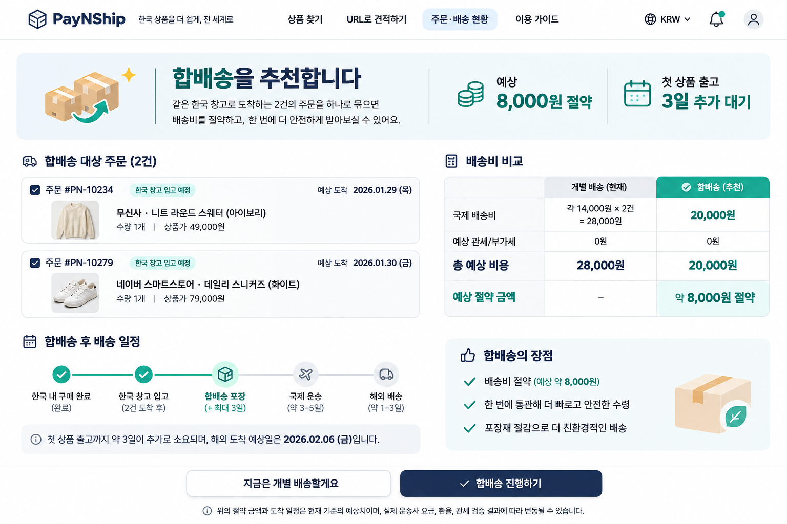
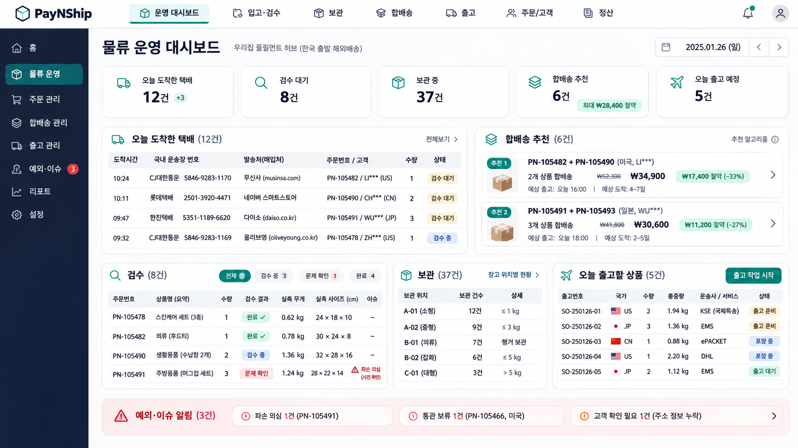

# PayNShip white + orange UI: customer consolidation and Home Hub

**Status: code implemented as gated local preview, not a customer production page (2026-11-22).**

The established PayNShip identity is **white canvas with orange highlights**. The earlier navy/teal imagery was conceptual only, and is superseded by these actual Next.js preview components. No global palette replacement is needed; the preview uses a **scoped CSS Module**, avoiding unrequested changes to checkout and the live storefront.

## 원본 생성 이미지 — 실제 PNG 그대로 보존

이번 대화에서 생성·표시한 **원본 2개를 픽셀 수정·재생성 없이 원본 PNG 파일로 커밋**했다. 기존 SVG 와이어프레임과 혼동하지 말 것.





파일 경로:
- `documents/2027/assets/images/paynship-consolidation-original.png` — Git blob SHA `e570446abbeacd17abf0beb9fea468281fee4a7d`.
- `documents/2027/assets/images/paynship-home-hub-original.png` — Git blob SHA `cf22ed00c8bb7b5d2fbda650f6881f5ca7d4396c`.

**디자인 기준은 원본 PNG**이며, React 컴포넌트는 별도의 구현 초안이다. 원본과 구현의 차이는 시각 테스트로 점진적으로 줄이되, 원본 파일을 덮어쓰지 않는다.

## Where to look

- `app/dev/consolidation/page.tsx` — only serves a mock, local/dev-gated page through existing `devPreviewAllowed`; never available on the public release.
- `components/consolidation/ConsolidationPreview.tsx` — two screen modes, toggles and illustrative no-side-effect selection state.
- `components/consolidation/ConsolidationPreview.module.css` — responsive white/orange visual language, focus styles, reduced-motion support.
- `lib/compiler/consolidation/presentation.ts` — **business decision → friendly Korean benefit copy**. This pure function doesn't approve shipping or customize real tax data.
- `lib/compiler/consolidation/__tests__/presentation.test.ts` and `components/consolidation/__tests__/ConsolidationPreview.test.tsx` — copy, consent and no-false-approval regression.

## Start (development workstation)

```bash
npm ci
PAYNSHIP_DEV_PREVIEW=1 npm run dev
# open http://localhost:3000/dev/consolidation
npx vitest run lib/compiler/consolidation/__tests__/presentation.test.ts components/consolidation/__tests__/ConsolidationPreview.test.tsx
npm run type-check
npm run build
```

If the development-preview security gate rejects your environment, follow the existing `lib/dev-preview/access.ts` rules. Never disable production gating for a convenience demo.

## Exact wording contract

| Compiler state | Customer title | Customer action |
|---|---|---|
| Verified saving positive | **함께 배송하면 8,000원 아낄 수 있어요** (synthetic example) | Compare options and explicitly consent |
| Saving positive and delayed | **함께 배송하면 N원 아낄 수 있어요** + “3일 더 기다려야 해요” | Savings and wait time together |
| Separate cheaper or same | **따로 보내는 게 더 유리해요** | Keep separate delivery |
| Missing real rate/tax | **배송비를 확인하고 있어요** | No verified saving or payment CTA |

The customer experience avoids a jargon-first "합배송을 추천합니다"; the operator view can still use business terms (e.g. consolidation) in internal planning. No false urgency or automatic shipping decision.

## Screen structure and visual rules

- Bright white `#ffffff` canvas, white cards, warm neutral borders `#ece9e5`, orange `#f36d27` highlights and `#fff0e6` pale orange for emphasis.
- The orange is used for **savings, selected shipping option, clear actions and warning visibility**, not all elements at once.
- Desktop: large savings hero + left item timeline/right shipping comparison; operator: inbound counts, inventory exception, opportunity and pack/dispatch process.
- Mobile: one-column panels, vertical actions, scrollable wide inbound table, no sidebar overlay hiding tasks.
- Main navigation offers customer/operator visual mode switch in the **local preview only**.
- Actions are **illustrative UI selection**, not persisted consent, carrier booking, shipment or payment.
- An explicit synthetic-data disclaimer is shown in both views. Dates, duty-free claims and live carrier choices must not be invented.

## What still needs real implementation (do not mistake UI for commerce)

- Login owner scope: show only signed-in customer's own same-destination orders.
- HOME_HUB inventory/arrival/inspection/packing DB and actual admin authorization.
- Connect generated separate/all/partial/wait plans to authenticated real evidence. The bounded local compiler now generates and evaluates candidates; live evidence loading remains unimplemented.
- Real source rate cards and per-parcel dimensional weight, country customs rule versions, exact products, importer-of-record and DDP eligibility.
- Quote state transitions, savings baseline proof, customer consent stored securely, signed tracking, customs and refund.
- Translation for US English / CN simplified Chinese / JP Japanese with correct customs costs.
- First-party screenshot and Playwright UI tests across mobile/desktop before replacing any real route.

**Agent:** next task is to connect verified server-derived candidate results to UI, not use the synthetic sample booleans in checkout. See [HOME_HUB SRS](HOME_HUB_AND_CONSOLIDATION_SRS.md) and [AGENTS](../../AGENTS.md).

## 계산에 연결된 로컬 화면 (2026-11-22)

[Step 2](LEARNING_STEP_02_PLAN_COMPILER.md): 6개 시나리오에서 같은 순수 계산 결과를 고객/운영 화면에 표시한다. 고정 가격 문구를 제거하고 배송·통관 비교 총액/항목별 비용/기다리는 시간/박스 구성/제외 사유를 렌더링한다. 시나리오 변경 시 이전 시안 선택은 초기화한다. 가격 미확인에는 절감액과 선택 CTA가 없다. 원본 PNG 2개는 수정하지 않았다.

Middleware도 정확한 `/dev/consolidation` 경로에 기존 development + 명시적 flag + loopback host gate를 적용한다. production/flag 없음/외부 host는 404이며 private/no-store이다. Chromium desktop/mobile 시나리오는 `e2e/consolidation.spec.ts`, 격리 실행 설정은 `scripts/ci/consolidation.playwright.config.ts`이다.
