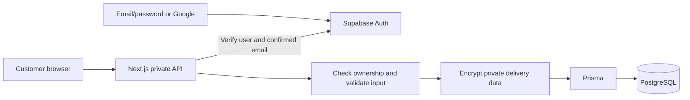

# PayNShip: a beginner's guide to the product, login and database

Updated: 2026-11-12. This guide describes **paynship-dh2**, the repository connected to `DongHeeKw/paynship-dh2`. A working screen does not prove that real accounts, payments or shipping are configured. See [implementation status](../Features/STATUS.md).

## What the business does

PayNShip helps an overseas customer purchase an item from a Korean shop and receive it abroad. The customer provides a product link. The team reviews the product and destination, prepares a quote, verifies payment, buys the item, receives and packs it in Korea, and arranges shipping.

| Screen | Meaning | Without login |
| --- | --- | --- |
| Home and `/purchase` | Prepare a product link, options, quantity and destination | Visitors can prepare a draft before creating an account. |
| `/orders` | The customer's submitted requests, quotes and progress | Visitors see an explanatory example; real requests require login. |
| `/orders/[id]` | One purchase's details, events and support conversation | Only the authenticated owner can access real records. |
| `/settings/delivery` | Saved recipient, address and customs information | Visitors see a field preview. Reading and saving private information requires login. |
| `/demo` | Fictional products, customers and shipment statuses from separate Supabase demo tables | Public educational data only; these are not real accounts or orders. |

Delivery details describe **who receives a parcel and where**. Delivery status describes **what has actually happened to a shipment**, inside its request. These are different things.

The guest journey is useful: understand the service, prepare a product and decide whether to continue. Login is needed when saving private data or submitting a request. A draft stays in the same browser tab for up to 24 hours; it contains product fields, not delivery addresses or identity numbers.

```text
Product draft → sign in → delivery details → submit request
    → review → quote → verified payment → purchase in Korea
    → warehouse → shipping → verified delivery event
```

Submitting a request does not charge a card or order from the retailer. A valid URL does not prove stock, price, customs eligibility or shipping availability. This repository retains its existing destination list and country policies; selecting a country is not an approval. See the [product specification](../PRODUCT_SPECIFICATION.md).

## Review the screens without a real account

For Vercel, open the deployment for **DongHeeKw/paynship-dh2** and review `/`, `/purchase`, `/orders`, `/settings/delivery`, `/login` and `/signup`. The guest examples explain the service without creating private records. `/demo` needs its existing synthetic Supabase tables; it displays setup information if they are unavailable.

For an interactive fictional customer flow on your development computer, install Node.js 24 and use a separate local checkout if a service is already running from the current one:

```bash
npm install
PAYNSHIP_DEV_PREVIEW=1 npm run dev -- --hostname 127.0.0.1 --port 3100
```

Open `http://127.0.0.1:3100/dev/preview`. Choose the example product explicitly, enter fictional delivery information, submit a sample request and inspect its details. Changes in this preview live in browser memory and reset on refresh. It does not require real login, PostgreSQL, payment or shipping configuration. The route is deliberately unavailable on Vercel production/preview deployments because they run in production mode.

The PowerShell equivalent and the existing `/demo` SQL instructions are in the [deployment guide](Deployment/DEPLOYMENT.md). The separate public `/demo` reads only `demo_products`, `demo_customers` and `demo_shipments`; those fixtures cannot log in. Do not add real customer information to those publicly readable tables.

## How login and the database connect

The page is the visible form. **Authentication** establishes who the customer is. **Authorization** checks which records that customer may access. **Persistence** saves data between visits.



The email/password and Google flows use Supabase Auth. Passwords are not stored in the application's `User` table or logs. Signup displays an email-confirmation step; private APIs independently verify the user and confirmed email. Google errors remain visible and recoverable. Apple and Naver are not connected, and password recovery is still a launch task.

The server obtains the customer ID from the verified session. It never trusts a customer ID sent by the browser as proof of ownership. The browser does not receive database administrator credentials.

| Model | Responsibility |
| --- | --- |
| `User` | Application identity associated with the authenticated customer; no password column |
| `DeliveryProfile` | The customer's encrypted recipient/address profile |
| `PurchaseRequest` | Product, options, quantity, destination, owner, quote, payment references and status |
| `PurchaseEvent` | Recorded changes and their source |
| `PurchaseSupportTicket` | Private questions and replies attached to a request |
| `PurchaseQuota` / `PurchaseWebhookReceipt` | Usage limits and protection against duplicate provider notifications |

Each submitted request keeps its own encrypted delivery snapshot. Editing a saved profile does not silently change an existing request. The schema also preserves older models; their presence does not mean retired features are active. See [security](SECURITY.md).

## Connect real login and storage in this order

1. **Use an owned test environment.** Check that you are configuring the intended Supabase project and the Vercel project linked to `DongHeeKw/paynship-dh2`. Do not copy secrets into chat, screenshots or Git.
2. **Enable email signup with email confirmation.** Configure confirmation-email delivery and test it with your own account. Supabase handles credentials; you do not build a password table. Follow the [email/password documentation](https://supabase.com/docs/guides/auth/passwords) and [SMTP setup](https://supabase.com/docs/guides/auth/auth-smtp).
3. **Configure the correct return address.** Set `NEXT_PUBLIC_APP_URL` to the actual origin for that deployment. Configure Supabase's Site URL and allowed `/auth/callback` redirects, including the app's supported `next` query values. Confirm the email in the same browser/device used for signup. Existing Google settings remain separate; see [this repository's Google/Vercel/Tailscale setup](Deployment/DEPLOYMENT.md#두-배포-환경과-google-로그인).
4. **Test signup, confirmation, login and logout.** Check incorrect passwords, expired links and return to the prepared request. HTTPS is required except for exact localhost/loopback development origins; raw HTTP Tailscale IP login is disabled.
5. **Prepare PostgreSQL safely.** Inspect and back up existing data, then have the responsible administrator review the [database SQL procedure](Deployment/DEPLOYMENT.md#db-sql-적용). Schema changes and database permissions are distinct. `npm run db:generate` generates the Prisma client; it does not install database tables or permissions.
6. **Preserve encryption keys.** Keep the existing `PII_ENCRYPTION_KEY` when encrypted records exist. Replacing it can make saved addresses unreadable. Follow the existing deployment instructions for key creation and backup in a genuinely new environment.
7. **Test with two accounts.** Save fictional delivery information, reload it and submit a request. Verify that the second account cannot read or change the first account's records. Successful login alone does not prove correct database access.
8. **Complete launch dependencies.** Configure shared request limits, operator roles, payment reconciliation, actual shipping integration and recovery/refund procedures. Follow the [production checklist](Deployment/PRODUCTION_CUTOVER_CHECKLIST.md).

| Environment variable | Purpose |
| --- | --- |
| `NEXT_PUBLIC_APP_URL` | Exact app origin, including the local port when applicable |
| `NEXT_PUBLIC_SUPABASE_URL`, `NEXT_PUBLIC_SUPABASE_ANON_KEY` | Public Auth configuration; never substitute a service-role secret |
| `DATABASE_URL`, `DIRECT_URL` | Server-only PostgreSQL connections using the restricted app role |
| `PII_ENCRYPTION_KEY` | Server-only encryption key: 64 hexadecimal characters |
| `UPSTASH_REDIS_REST_URL`, `UPSTASH_REDIS_REST_TOKEN` | Shared API request limits required in production |
| `PAYNSHIP_DEV_PREVIEW` | Local development-only fictional preview switch |

Use [`.env.example`](../../.env.example) as a reference without overwriting existing configuration. Local `.env` files are not uploaded by Git. Vercel requires its own environment variables and a new deployment after changes. Startup currently requires nonempty DB and public Auth variables; private operations also require working providers, database permissions, encryption and Redis. Never put production credentials in a public preview to make a build pass.

Do not use `prisma db push --accept-data-loss`, database resets or destructive sample SQL as a setup shortcut. The reviewed SQL contains permissions that schema synchronization alone does not establish.

## What makes the product stronger

Prioritize a clear guest journey, understandable reviewed quotes, reliable signup and one complete real purchase-and-delivery flow. Measure whether a first-time visitor can explain the service, prepare a request without help and understand what happens before payment. More providers should follow actual customer demand and verified integrations.

The Three.js parcel makes the homepage memorable. It is decorative: it never signifies an actual shipment. The product form stays usable while it loads or if WebGL fails, and reduced-motion preferences are respected.

## Review checklist and code map

- On a phone and desktop, find the product-link input and explain the next step.
- Prepare a draft without login; check that its URL survives navigation.
- Distinguish request, delivery address and shipment status. Identify all sample data as fictional.
- Switch between login/signup, show/hide a password, and check validation and keyboard focus.
- Use `/dev/preview` locally to inspect fictional request details; use `/demo` only for synthetic database examples.
- In the real test environment, verify email confirmation, address reload and isolation between two accounts.

Start with [`components/home/`](../../components/home/) for the homepage, [`SignInForm.tsx`](../../components/site/SignInForm.tsx) for account UI, [`customer-auth.ts`](../../lib/auth/customer-auth.ts) for credentials, [`auth/callback`](../../app/auth/callback/route.ts) for returns, [`lib/purchases/auth.ts`](../../lib/purchases/auth.ts) for private API identity checks, and [`prisma/schema.prisma`](../../prisma/schema.prisma) for data relationships.

Run `npm run type-check`, `npm run test:ci`, `npm run docs:check` and `npm run build`. The focused [`e2e/public-journey.spec.ts`](../../e2e/public-journey.spec.ts) covers the current guest journey, signup validation, WebGL fallback and responsive screens. Run it against an isolated test server with `PLAYWRIGHT_BASE_URL=http://127.0.0.1:3100 PLAYWRIGHT_DISABLE_WEBSERVER=true npx playwright test e2e/public-journey.spec.ts --project chromium`. The older `e2e/v21-*` tests describe retired routes.

These checks do not prove real mail delivery, database permissions, successful payment or shipping. No real provider settings or database migrations are changed by this UI update.
