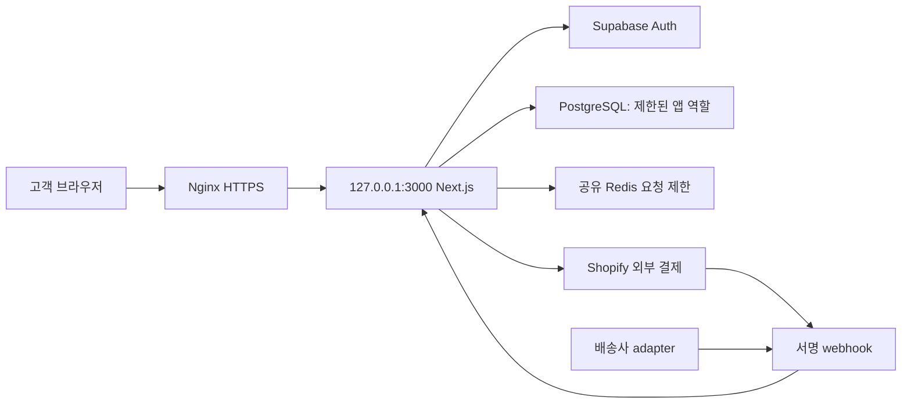

# Linux 출시 실행서

작성·근거 확인: 2026-10-12. 실행 대상은 Ubuntu 24.04 LTS, Node.js 24 LTS, Nginx, systemd입니다. 현재 호스트·도메인·SSH·DB 접근 정보는 정해지지 않았으므로 이 문서를 작성한 작업에서 원격 배포·DB 변경을 실행하지 않았습니다.

이 문서를 받은 에이전트는 대상과 값이 확인된 단계만 실행하고 각 결과를 기록합니다. 예제값을 추측해 배포하지 않습니다. 원격 서버 설치·DB 변경·DNS·실결제·활성 보안 검사는 해당 대상에 대한 사용자 권한이 확인되어야 합니다.

## 1. 배포 방식과 완료 범위

기본 경로는 **Linux 앱 서버 + 기존 Supabase PostgreSQL/Auth + 공유 Upstash Redis**입니다. 앱 서버를 Linux에 둔다고 인증을 자체 구현하거나 모든 외부 서비스를 없애는 것은 아닙니다. 별도 PostgreSQL 16을 운영하는 선택 경로는 §6에 있습니다.



출시는 서버 부팅과 별개입니다. 실제 구매·배송 기능을 공개하려면 DB/RLS, 고객·운영자 인증, 결제·배송 제공자, 통관 근거와 창고 운영 검증을 통과해야 합니다. 준비되지 않으면 점검 상태로 유지합니다.

| 준비 값 | 확인 방법 |
| --- | --- |
| 서버 IP·SSH 사용자·키·sudo 권한 | 사용자 제공 대상과 SSH host key 검증 |
| 실제 도메인·DNS·인증서 책임자 | A/AAAA가 해당 서버를 가리키는지 확인 |
| 저장소·40자리 출시 commit | 현재 Git origin과 검토한 SHA |
| DB 이름·호스트·버전·관리자·런타임 역할 | DB 담당자 제공 연결·권한 확인 |
| Supabase 프로젝트·Auth redirect | 정확한 production origin |
| 공유 Redis·Shopify·배송 gateway | production 자격 증명·계약 |
| 암호화 키·백업 위치·복구 책임자 | 기존 키 유지와 복구 시험 |
| 출시 판매국·품목·운영량 | [통관 정책](../COUNTRY_CUSTOMS.md), [운영](../OPERATIONS.md) |

`NEXT_PUBLIC_*` 값은 build에 포함되므로 도메인·Supabase 프로젝트를 바꾸면 다시 build합니다. 여러 앱 서버는 같은 build·환경·암호화 키와 공유 Redis를 사용하고 Next.js cache도 별도로 설계합니다. [Next.js 15 자체 호스팅](https://nextjs.org/docs/15/app/guides/self-hosting)

### 도메인 등록과 DNS 준비

1. 사용자가 선택한 등록기관에서 실제 도메인을 등록합니다. 등록자·복구 이메일·2단계 인증·갱신 책임과 자동 갱신을 확인하고 구매 비용은 사용자 승인 범위를 따릅니다.
2. DNS를 등록기관에서 운영할지 다른 제공자에서 운영할지 정합니다. 다른 제공자를 쓰면 제공자가 발급한 authoritative nameserver를 등록기관에 입력합니다. 기존 메일 도메인의 MX/TXT 레코드는 보존합니다.
3. 서비스 주소 하나를 정합니다. 루트 도메인 또는 subdomain의 A 레코드에 Linux 서버의 공인 IPv4를 입력합니다. 외부 IPv6와 방화벽·Nginx 경로가 준비된 경우에만 AAAA를 추가합니다. DNS 값에 https://, 경로, 3000 포트를 넣지 않습니다.
4. 초기 TTL은 제공자가 지원하면 300초로 설정합니다. Cloudflare 같은 CDN은 초기에는 DNS only로 두고 TLS·origin 검증 후 proxy를 켭니다. CDN에는 아래 신뢰 IP·우회 차단 구성이 추가로 필요합니다.
5. NAT 안의 서버라면 공인 IP·80/443 포트 포워딩·ISP 접근 가능 여부를 확인합니다. 사설 IP·CGNAT 회선이면 직접 DNS 연결 경로를 사용하지 않습니다. 클라우드는 보안 그룹과 서버 방화벽 모두 80/443을 허용합니다.

A/AAAA는 IPv4/IPv6를, CNAME은 다른 hostname을 지정합니다. TTL은 DNS 캐시 시간입니다. [DNS 레코드 공식 설명](https://developers.cloudflare.com/dns/manage-dns-records/reference/dns-record-types/)

```bash
: "${PAYNSHIP_DOMAIN:?Set the registered production domain}"
sudo apt-get install dnsutils
dig +short NS "$PAYNSHIP_DOMAIN"
dig +short A "$PAYNSHIP_DOMAIN"
dig +short AAAA "$PAYNSHIP_DOMAIN"
dig +short CAA "$PAYNSHIP_DOMAIN"
dig @1.1.1.1 +short A "$PAYNSHIP_DOMAIN"
dig @8.8.8.8 +short A "$PAYNSHIP_DOMAIN"
```

subdomain NS 조회가 비면 상위 zone의 NS를 확인합니다. authoritative DNS와 외부 resolver가 기대 IP를 반환해야 인증서를 발급합니다. 기존 CAA는 선택한 인증기관을 허용해야 합니다. Windows는 로컬 개발 환경이며 아래 Linux 명령은 실제 배포 서버의 SSH 세션에서 실행합니다.

## 2. 서버 설치

먼저 OS·시간 동기화·디스크·메모리·기존 서비스·SSH 포트를 확인합니다. 아래 계정·경로가 이미 있으면 소유권과 용도를 점검하고 덮어쓰지 않습니다.

```bash
cat /etc/os-release
uname -m
timedatectl status
df -h
free -h
sudo ss -lntp
sudo apt-get update
sudo apt-get install nginx ufw ca-certificates git postgresql-client-16
sudo useradd --system --user-group --home-dir /srv/paynship --shell /usr/sbin/nologin paynship
sudo useradd --system --user-group --home-dir /srv/paynship --shell /usr/sbin/nologin paynship_deploy
sudo install -d -m 2750 -o paynship_deploy -g paynship /srv/paynship/releases
sudo install -d -m 0700 -o paynship_deploy -g paynship /srv/paynship/npm-cache
sudo install -d -m 0700 -o root -g root /etc/paynship
sudo install -d -m 0700 -o root -g root /var/backups/paynship
```

DB가 PostgreSQL 16보다 새 버전이면 해당 DB 버전 이상의 `pg_dump` 클라이언트를 별도 설치합니다. Ubuntu apt 기본 Node 패키지나 기존 Node 20을 production 런타임으로 선택하지 않습니다. 검토한 Node 24 LTS patch를 공식 배포본·체크섬 검증 후 `/opt/node`에 설치하고 build와 runtime 모두 같은 버전을 사용합니다. [Node.js 지원 상태](https://nodejs.org/en/about/previous-releases)

처음 설치하는 서버에서는 공식 [Node 24 배포 목록](https://nodejs.org/dist/latest-v24.x/)에서 검토한 patch를 `PAYNSHIP_NODE_VERSION=v24.x.y`에 넣습니다. 이미 `/opt/node`가 있으면 기존 서비스 영향부터 확인하며 덮어쓰지 않습니다. 다음은 공식 HTTPS 배포본과 동일 버전의 SHA-256 목록을 대조하는 명령입니다.

```bash
set -euo pipefail
: "${PAYNSHIP_NODE_VERSION:?Set the reviewed exact v24.x.y version}"
[[ "$PAYNSHIP_NODE_VERSION" =~ ^v24\.[0-9]+\.[0-9]+$ ]] || exit 1
test ! -e /opt/node || exit 1
case "$(uname -m)" in
  x86_64) node_arch=x64 ;;
  aarch64) node_arch=arm64 ;;
  *) echo 'Review an official Node build for this architecture'; exit 1 ;;
esac
node_work="$(mktemp -d)"
node_archive="node-$PAYNSHIP_NODE_VERSION-linux-$node_arch.tar.xz"
node_base="https://nodejs.org/dist/$PAYNSHIP_NODE_VERSION"
curl --proto '=https' --tlsv1.2 --fail --location --output "$node_work/SHASUMS256.txt" "$node_base/SHASUMS256.txt"
curl --proto '=https' --tlsv1.2 --fail --location --output "$node_work/$node_archive" "$node_base/$node_archive"
awk -v archive="$node_archive" '$2 == archive {print}' "$node_work/SHASUMS256.txt" > "$node_work/selected.sha256"
test "$(wc -l < "$node_work/selected.sha256")" -eq 1 || exit 1
(cd "$node_work" && sha256sum --check --strict selected.sha256)
sudo install -d -m 0755 -o root -g root /opt/node
sudo tar --extract --xz --file "$node_work/$node_archive" --directory /opt/node --strip-components=1 --no-same-owner
/opt/node/bin/node --version
/opt/node/bin/npm --version
```

UFW 활성화 전에 실제 SSH 포트를 허용하고 다른 SSH 세션으로 접속이 유지되는지 확인합니다. 기본 포트가 22일 때의 예입니다. 클라우드 security group에도 동일한 원칙을 적용합니다. [Ubuntu UFW](https://ubuntu.com/server/docs/how-to/security/firewalls/)

```bash
sudo ufw allow OpenSSH
sudo ufw allow 80/tcp
sudo ufw allow 443/tcp
sudo ufw default deny incoming
sudo ufw default allow outgoing
sudo ufw enable
sudo ufw status verbose
```

3000과 DB 5432를 인터넷에 공개하지 않습니다. DB가 별도 호스트이면 사설망·허용된 앱 IP와 TLS를 사용합니다.

## 3. 출시 파일과 환경

`PAYNSHIP_REPO_URL`, `PAYNSHIP_RELEASE_SHA`, `PAYNSHIP_DOMAIN`을 실제 값으로 지정합니다. 빈 값·임시 문자열은 중단합니다. 토큰이 포함된 Git URL은 쓰지 않습니다.

```bash
: "${PAYNSHIP_REPO_URL:?Set the authorized Git repository}"
: "${PAYNSHIP_RELEASE_SHA:?Set the reviewed 40-character commit}"
: "${PAYNSHIP_DOMAIN:?Set the real production domain}"
[[ "$PAYNSHIP_RELEASE_SHA" =~ ^[a-f0-9]{40}$ ]] || exit 1
[[ "$PAYNSHIP_DOMAIN" =~ ^[a-zA-Z0-9][a-zA-Z0-9.-]+\.[a-zA-Z]{2,}$ ]] || exit 1
release_dir="/srv/paynship/releases/$PAYNSHIP_RELEASE_SHA"
test ! -e "$release_dir" || exit 1
sudo -u paynship_deploy git clone "$PAYNSHIP_REPO_URL" "$release_dir"
sudo -u paynship_deploy git -C "$release_dir" checkout --detach "$PAYNSHIP_RELEASE_SHA"
sudo -u paynship_deploy git -C "$release_dir" status --short
```

`/etc/paynship/app.env`는 root 소유 0600으로 생성하고 비밀 관리 도구로 값을 넣습니다. `.env.example`을 참고하되 migration 관리자 비밀번호는 넣지 않습니다. 런타임 `DATABASE_URL`과 `DIRECT_URL` 모두 제한된 `paynship_app` 연결을 사용합니다. migration용 libpq service/password 파일은 별도로 보관합니다.

- `NODE_ENV=production`, 정확한 HTTPS `NEXT_PUBLIC_APP_URL`
- Supabase URL·anon key: 공개 가능한 Auth 설정이며 service role 비밀키를 대체하지 않음
- DB 앱 연결, `PII_ENCRYPTION_KEY`: 기존 고객정보가 있다면 동일 키 유지
- Redis REST URL/token: production 일반 API에 필수
- `ADMIN_SUPER_ADMINS`, `ADMIN_OPERATORS`, `ADMIN_VIEWERS`: 실제 DB isAdmin 계정만 매핑
- Shopify store·admin token·webhook secret·`SHOPIFY_API_VERSION=2026-07`
- 실제 배송 adapter의 `SHIPPING_WEBHOOK_SECRET`

DB 비밀번호의 특수문자는 연결 URL에 percent encoding합니다. 관리 계정과 앱 계정은 분리합니다. Supabase direct/session/transaction 연결 중 네트워크와 Prisma 요구에 맞는 방식을 검증합니다. [Supabase 역할 관리](https://supabase.com/docs/guides/database/postgres/roles), [DB 연결](https://supabase.com/docs/guides/database/connecting-to-postgres)

systemd는 EnvironmentFile을 shell script로 실행하지 않습니다. 변수 확장·명령을 넣지 않고 단순 UTF-8 할당값으로 관리합니다. shell에서 `source app.env` 또는 전체 환경 출력으로 비밀을 노출하지 않습니다. [Ubuntu systemd 실행 환경](https://manpages.ubuntu.com/manpages/noble/man5/systemd.exec.5.html)

Supabase Auth Site URL·허용 redirect에 실제 도메인과 `/auth/callback`을 등록하고 이메일/OAuth 제공자 설정을 확인합니다. 테스트 계정 두 개와 viewer/operator/super_admin 계정은 production 실제 고객정보와 분리합니다.

## 4. DB 백업·변경 이력·신규 SQL

기존 DB에 신규 6개 테이블을 추가하는 [purchase SQL](../../../prisma/sql/2026-10-11-purchase-flow.sql)입니다. 이미 신규 테이블이 있는 DB나 비어 있는 DB에 무조건 재실행하지 않습니다. 먼저 테이블·컬럼·제약을 점검합니다. `prisma db push`, `migrate reset`, `DROP SCHEMA`, 기존 주문 삭제를 출시 절차로 사용하지 않습니다.

migration 계정의 비밀은 root만 읽는 libpq service/password 파일로 제공하고 `PGSERVICEFILE`, `PGSERVICE`, `PGPASSFILE`로 지정합니다. 서비스에는 실제 DB 호스트·이름·사용자·TLS 설정을 넣고 password 파일 권한은 0600으로 설정합니다. [PostgreSQL service 파일](https://www.postgresql.org/docs/16/libpq-pgservice.html)

```bash
export PGSERVICEFILE=/etc/paynship/migration.pg_service.conf
export PGSERVICE=paynship-migration
export PGPASSFILE=/etc/paynship/migration.pgpass
psql -X -v ON_ERROR_STOP=1 -c 'SELECT current_database(), current_user, version();'
pg_dump --format=custom --file=/var/backups/paynship/pre-purchase.dump
pg_restore --list /var/backups/paynship/pre-purchase.dump
sha256sum /var/backups/paynship/pre-purchase.dump
```

백업 파일이 생성됐다는 사실만으로 복구 완료가 아닙니다. 별도 staging DB에 복원해 사용자·기존 주문·새 요청 구조와 암호화 키 복구를 확인합니다. DB dump와 키는 같은 공개 저장소에 두지 않습니다. custom-format dump는 `pg_restore`로 복구합니다. [pg_dump](https://www.postgresql.org/docs/16/app-pgdump.html), [pg_restore](https://www.postgresql.org/docs/16/app-pgrestore.html)

출시 기록에 SQL SHA256을 적습니다. [적용 도구](../../../deploy/linux/apply-purchase-migration.sh)는 기본적으로 로컬 파일 해시만 확인하고 DB를 변경하지 않습니다. `--apply`일 때만 advisory lock·원자적 변경·`ops.release_migrations` 이력 기록을 실행합니다. 같은 ID와 해시는 재실행하지 않고 해시가 다르면 실패합니다.

```bash
cd "$release_dir"
export PAYNSHIP_MIGRATION_EXPECTED_SHA256=REPLACE_WITH_APPROVED_64_HEX_HASH
bash deploy/linux/apply-purchase-migration.sh
bash deploy/linux/apply-purchase-migration.sh --apply
psql -X -v ON_ERROR_STOP=1 -f deploy/linux/db-audit.sql
```

이전 세션에서 별도 도구로 SQL이 적용됐으면 이력 테이블이 없을 수 있습니다. “테이블 있음”을 무시하고 재실행하지 말고, 정확한 DDL·RLS·제약을 비교한 뒤 관리자가 기존 적용 이력을 검토·기록합니다.

## 5. 런타임 DB 최소 권한

런타임은 `postgres`, schema owner, `service_role`, BYPASSRLS 계정을 쓰지 않습니다. [역할 SQL](../../../deploy/linux/runtime-role.sql)을 DB owner가 검토한 뒤 적용하고 `psql`의 `\password paynship_app` 또는 비밀 관리 도구로 비밀번호를 설정합니다. 초기 역할 생성용이므로 이미 같은 역할이 있으면 권한을 감사하고 중단합니다.

`paynship_app`는 LOGIN, NOSUPERUSER, NOCREATEDB, NOCREATEROLE, NOREPLICATION, NOBYPASSRLS이며 owner 역할 멤버도 아닙니다. 신규 테이블의 필요한 CRUD, users 읽기·비관리자 생성·email 변경, 감사 로그 추가·읽기, 관리자 설정 읽기·운영 컬럼 변경만 허용합니다.

RLS는 활성화만 하면 비owner 앱 역할에 기본 거절이 적용됩니다. 따라서 정책도 `TO paynship_app`으로 명시합니다. 이 역할은 서버 전체 고객 업무를 수행하므로 정책의 true 조건은 **서버 역할에 한정**되며 고객별 소유권은 API에서 검증합니다. anon/authenticated/PUBLIC 정책이나 BYPASSRLS로 해결하지 않습니다. [PostgreSQL RLS](https://www.postgresql.org/docs/16/ddl-rowsecurity.html), [역할 속성](https://www.postgresql.org/docs/16/sql-createrole.html)

```bash
psql -X -v ON_ERROR_STOP=1 -f deploy/linux/runtime-role.sql
psql -X -v ON_ERROR_STOP=1 -f deploy/linux/db-audit.sql
```

중단 조건은 앱 역할의 superuser/BYPASSRLS/owner membership, browser 역할의 앱 테이블 권한, PUBLIC 정책, 실제 필요한 테이블 누락입니다. 스키마·역할 변경은 staging에서 먼저 시험합니다. 앱 역할로 is_admin 변경·DROP·TRUNCATE·과거 주문 접근이 실패하고 필요한 프로필·요청·CS 작업은 성공해야 합니다.

admin_settings는 owner가 한 번 생성합니다. 운영자 계정의 `is_admin=true`도 owner가 실제 인증 ID를 확인하고 설정하며 런타임에는 해당 변경 권한을 주지 않습니다. DB 암호화·RLS만으로 앱이 침해된 경우까지 모든 개인정보를 보호한다는 뜻은 아닙니다.

## 6. 선택 경로: PostgreSQL 16을 Linux에서 운영

이 경로에서도 Supabase Auth는 유지합니다. 처음에는 앱 서버의 loopback DB 또는 별도 사설 DB 호스트 하나만 선택합니다. 관리형 DB를 병행 정본으로 쓰지 않습니다.

```bash
sudo apt-get install postgresql-16
sudo systemctl enable --now postgresql
sudo -u postgres psql -c 'SHOW server_version;'
sudo -u postgres psql -c 'SHOW listen_addresses;'
sudo -u postgres psql -c 'SHOW password_encryption;'
```

앱과 같은 호스트는 listen_addresses=localhost, 별도 DB 서버는 지정 사설 주소만 사용합니다. pg_hba.conf는 해당 DB·역할·앱 IP에 SCRAM 인증을 설정하고 외부 연결에는 TLS 검증을 적용합니다. 공용 5432 또는 trust 인증을 사용하지 않습니다.

**현재 purchase SQL은 기존 users·admin_settings·admin_audit_logs를 포함한 호환 스키마가 필요합니다.** 기존 DB를 옮기면 검토된 public 스키마/백업을 복원한 뒤 §4–5를 적용합니다. 원본 PostgreSQL 버전이 16보다 높으면 같은/높은 지원 버전을 선택합니다.

고객 데이터가 없는 최초 설치는 과거 스키마 commit `5c7e7abadb81367588a7fd380a602771eb5f693a`를 baseline으로 사용합니다. 해당 commit을 조회할 수 없으면 중단합니다. PGSERVICE는 별도 생성한 비어 있는 대상 DB의 관리자 연결이어야 합니다. 먼저 Linux에서 npm ci로 pinned Prisma 6 CLI를 설치합니다.

```bash
cd "$release_dir"
psql -X -v ON_ERROR_STOP=1 -c 'SELECT current_database(), current_user;'
existing_tables="$(psql -X -A -t -v ON_ERROR_STOP=1 -c "SELECT count(*) FROM pg_tables WHERE schemaname='public';")"
[[ "$existing_tables" == 0 ]] || { echo 'Target database is not empty; stop.' >&2; exit 1; }
baseline_dir="$(mktemp -d)"
git show 5c7e7abadb81367588a7fd380a602771eb5f693a:prisma/schema.prisma > "$baseline_dir/legacy.prisma"
npx --no-install prisma migrate diff --from-empty --to-schema-datamodel "$baseline_dir/legacy.prisma" --script > "$baseline_dir/legacy.sql"
sha256sum "$baseline_dir/legacy.prisma" "$baseline_dir/legacy.sql"
# Inspect generated DDL and record its hashes before applying.
psql -X -v ON_ERROR_STOP=1 --single-transaction -f "$baseline_dir/legacy.sql"
```

baseline은 테이블만 재현합니다. 이어서 §4 purchase SQL과 §5 제한 역할을 적용하고 외부 Supabase Auth ID로 실제 로그인·프로필 upsert를 검증합니다. [Prisma 6 CLI](https://www.prisma.io/docs/orm/v6/reference/prisma-cli-reference)

복원은 새 staging DB에서 먼저 수행합니다. Supabase 전용 auth/storage schema·extensions·trigger를 무조건 복제하지 않고 실제 의존성을 확인합니다. local DB에서 외부 Supabase Auth 사용자 ID가 profile upsert와 일치하는지 시험합니다. 출처 없는 빈 DB bootstrap이나 전용 extension에 의존한 dump가 해결되지 않으면 이 경로의 출시를 중단하고 기본 관리형 DB 경로를 사용합니다.

백업·PITR·디스크 경보·접속 제한·패치·복구 책임까지 운영자가 맡습니다. 단지 PostgreSQL 패키지를 설치한 상태를 DB 운영 준비 완료로 표시하지 않습니다.

## 7. Build와 systemd

Linux에서 lockfile을 사용해 설치합니다. Windows의 node_modules·Prisma native engine·.next 디렉토리를 복사하지 않습니다.

```bash
sudo -u paynship_deploy env PATH=/opt/node/bin:/usr/bin:/bin npm_config_cache=/srv/paynship/npm-cache npm --prefix "$release_dir" ci
sudo systemd-run --wait --collect --pipe \
  --property=User=paynship_deploy --property=Group=paynship \
  --property=WorkingDirectory="$release_dir" \
  --property=EnvironmentFile=/etc/paynship/app.env \
  --property=Environment=PATH=/opt/node/bin:/usr/bin:/bin \
  --property=Environment=npm_config_cache=/srv/paynship/npm-cache \
  /opt/node/bin/node "$release_dir/scripts/predeploy-check.mjs"
```

predeploy는 type-check → docs:check → test:ci → product:evidence:test → build를 순서대로 실행하고 실패하면 중단합니다. 실제 ESLint 명령을 구성한 경우만 --with-lint를 사용합니다. 소스 검사와 환경 연결 검증은 구분합니다.

systemd [템플릿](../../../deploy/linux/paynship.service)은 별도 paynship 사용자, loopback 3000, root 환경 파일, 읽기 제한과 cache 쓰기 경로를 사용합니다. 메모리 한도는 초기 값이므로 실제 서버에 맞추고 시작·캐시 쓰기·재시작을 staging에서 시험합니다.

```bash
sudo install -d -m 0700 -o paynship -g paynship "$release_dir/.next/cache"
sudo ln -s "$release_dir" /srv/paynship/current
sudo install -m 0644 deploy/linux/paynship.service /etc/systemd/system/paynship.service
sudo systemd-analyze verify /etc/systemd/system/paynship.service
sudo systemctl daemon-reload
sudo systemctl enable --now paynship
sudo systemctl status paynship --no-pager
sudo journalctl -u paynship --since '10 minutes ago' --no-pager
curl --fail --silent http://127.0.0.1:3000/api/health
sudo ss -lntp
```

`/api/health`의 기본 응답은 liveness이며 DB·Redis·결제 readiness가 아닙니다. `?deep=true`는 operator 인증 뒤 DB만 확인합니다. journal과 상태 출력에 비밀값·고객정보가 노출되면 공개 로그로 옮기지 않습니다.

## 8. Nginx·TLS·신뢰 IP

도메인이 서버를 가리키고 80/443이 허용된 뒤 인증서를 발급합니다. 인증서가 없을 때 443 템플릿을 먼저 설치하지 않습니다. 아래 최초 발급 경로는 HTTP bootstrap → 인증서 → HTTPS 설정 순서입니다. [Certbot Nginx](https://certbot.eff.org/instructions?ws=nginx&os=snap)

[Nginx 예제](../../../deploy/linux/nginx.conf.example)의 __DOMAIN__과 certificate 경로를 실제 값으로 렌더링하고 미치환 문자열이 있으면 설치하지 않습니다. [proxy snippet](../../../deploy/linux/nginx-proxy.conf)을 지정 경로로 설치합니다.

```bash
cd "$release_dir"
[[ "$PAYNSHIP_DOMAIN" =~ ^[a-zA-Z0-9][a-zA-Z0-9.-]+\.[a-zA-Z]{2,}$ ]] || exit 1
render_dir="$(mktemp -d)"
sed "s/__DOMAIN__/$PAYNSHIP_DOMAIN/g" deploy/linux/nginx-http.conf.example > "$render_dir/http.conf"
sudo install -m 0644 "$render_dir/http.conf" /etc/nginx/sites-available/paynship
test ! -e /etc/nginx/sites-enabled/paynship || exit 1
sudo ln -s /etc/nginx/sites-available/paynship /etc/nginx/sites-enabled/paynship
sudo nginx -t
sudo systemctl reload nginx
# Inspect existing Certbot packages; install only one distribution.
sudo snap install --classic certbot
sudo /snap/bin/certbot certonly --nginx -d "$PAYNSHIP_DOMAIN"
sudo test -s "/etc/letsencrypt/live/$PAYNSHIP_DOMAIN/fullchain.pem"
sudo test -s "/etc/letsencrypt/live/$PAYNSHIP_DOMAIN/privkey.pem"
sed "s/__DOMAIN__/$PAYNSHIP_DOMAIN/g" deploy/linux/nginx.conf.example > "$render_dir/https.conf"
! grep -q '__DOMAIN__' "$render_dir/https.conf" || exit 1
sudo install -m 0644 deploy/linux/nginx-proxy.conf /etc/nginx/snippets/paynship-proxy.conf
sudo install -m 0644 "$render_dir/https.conf" /etc/nginx/sites-available/paynship
sudo nginx -t
sudo systemctl reload nginx
sudo /snap/bin/certbot renew --dry-run
curl --fail --silent --show-error "https://$PAYNSHIP_DOMAIN/api/health"
curl --silent --show-error --head "https://$PAYNSHIP_DOMAIN"
```

최초 설치용 경로입니다. 같은 site·Certbot이 이미 있으면 설정을 백업하고 절차를 조정합니다. snapd는 공식 절차로 먼저 준비합니다. 자동 갱신 timer·갱신 후 Nginx reload hook·만료 경보를 확인합니다. www도 쓰면 DNS·server_name·인증서 SAN·정규 origin redirect를 함께 구성합니다.

템플릿은 직접 Internet→Nginx→Node 구성이며 x-forwarded-for를 실제 peer IP로 교체합니다. CDN 뒤에서는 검증한 CDN IP만 real_ip 신뢰 목록에 두고 외부가 원본 서버로 우회하지 못하게 구성합니다. 클라이언트가 보낸 IP를 그대로 append하여 rate limit을 우회하게 만들지 않습니다.

API body 8 KiB, webhook 256 KiB, proxy timeout·연결/요청 제한과 cache 비활성화를 적용합니다. query·cookie·authorization은 access log에 기록하지 않습니다. websocket/장시간 SSE는 현재 구매 흐름에 필요하지 않습니다. [Nginx proxy 모듈](https://nginx.org/en/docs/http/ngx_http_proxy_module.html)

## 9. 공개 전 통합·보안·부하 조건

staging에서 다음을 실제 계정과 DB로 검증하고 결과·commit·환경·날짜를 기록합니다.

| 검사 | 통과 기준 |
| --- | --- |
| 고객 소유권 | 계정 A는 B의 요청·배송지·CS를 읽거나 변경할 수 없음 |
| 운영자 역할 | viewer는 PII·수정 불가, operator 업무 가능, super_admin 설정 가능 |
| DB 역할/RLS | browser REST 차단, 앱 is_admin 변경·DDL 차단, 필요한 업무 성공 |
| 암호화 | DB ciphertext·변조 거절·키 누락 차단·백업 복구 |
| 중복·취소 | 동일 키 같은 요청, 다른 payload 409, 결제 후 직접 취소 차단 |
| 병렬 제출 | 여러 프로세스에서도 계정 5개 활성·일일 20·전체 1,000 초과 생성 없음 |
| 동시 상태·CS | 같은 version의 경쟁 변경 중 하나만 성공 |
| Redis/서비스 실패 | rate limiter 실패 시 일반 API 503, 무제한 fallback 없음 |
| 결제 | 서명·store·주문·draft·금액·통화·버전 확인, replay·timeout·만료 보류 |
| 배송 | 실제 adapter 서명·송장·중복·역순·예외·완료 테스트 |
| 개인정보 요구 | 도착국 별 필드·불필요 ID 미수집·형식 확인과 실제 검증 구분 |
| 표면 검사 | 인증된 역할 범위·API를 포함한 ZAP, dependency audit·TLS·보안 헤더 |

병렬 검사는 staging의 합성 계정·테스트 상품으로 작은 동시성부터 늘립니다. 실결제·실발주·실배송을 부하 검사에 사용하지 않습니다. DB CPU·lock·connections, 409/429/503, 응답 지연, Redis·외부 호출 비용을 기록합니다. 실제 DB 병렬 시험 전 전 세계 50,000건 처리 검증을 주장하지 않습니다.

비로그인 ZAP는 private API·DB 권한·결제 정산을 증명하지 않습니다. production Active Scan은 실제 데이터에 영향을 줄 수 있으므로 staging 결과와 별도 실행 범위가 확인되어야 합니다. 정식 공개에는 [출시 조건](PRODUCTION_CUTOVER_CHECKLIST.md), [보안](../SECURITY.md), [운영](../OPERATIONS.md)도 필요합니다.

## 10. 전환·복구·기록

GitHub CI는 임시 paynship_ci PostgreSQL 16에 pinned baseline → 신규 migration(동일 해시 2회 실행) → 제한 역할을 적용하고 [DB smoke](../../../scripts/security/db-smoke.sql)를 실행합니다. 정상 앱 쓰기와 browser 차단·is_admin 변경·DDL·TRUNCATE·이벤트 삭제 금지·DB 제약을 검사하고 합성 fixture를 rollback합니다. 코드 commit 4c9874b의 실제 Ubuntu CI가 통과했으며 [실행 기록](../Testing/SECURITY_CHECKS.md)에 근거를 남겼습니다. 실제 출시 DB의 인증·병렬 처리·제공자 검증은 별도입니다. Windows 로컬에서 Linux DB를 실행한 것으로 기록하지 않으며 출시할 SHA의 Actions 결과를 확인합니다.

1. 현재 symlink·Git SHA·build·환경 public 값·SQL hash·백업·DB 이력을 기록합니다.
2. 새 release는 별도 경로와 staging 포트에서 검증합니다.
3. Nginx 점검 화면으로 신규 접수를 막고 필요한 실제 webhook은 계속 수신하도록 구성합니다.
4. 검증된 release로 symlink를 원자적으로 전환하고 systemd를 재시작합니다.
5. HTTPS liveness·인증된 업무·제공자 webhook을 확인한 뒤 신규 접수를 엽니다.

앱 문제가 생기면 **호환성이 확인된 이전 구매 흐름 release**로 symlink를 되돌리고 재시작합니다. 이전 AI/무권한 endpoint를 다시 활성화하는 commit으로 돌아가지 않습니다. DB 추가 테이블·기존 데이터·결제 기록을 자동 삭제하는 down migration은 없습니다. 이미 받은 결제·운송장을 대조하고 DB 사고 복구는 별도 DB로 복원해 확인한 뒤 수행합니다.

해시 이력, 승인된 판매국, 설치 버전, 테스트 결과, 미연결 제공자, 복구·연락 책임자를 release 기록에 남깁니다. 실제 완료한 단계와 아직 필요한 계정·계약·현장 운영을 구분합니다.
