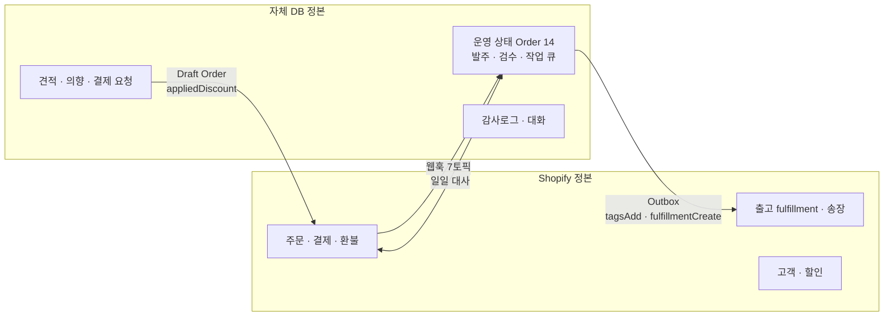
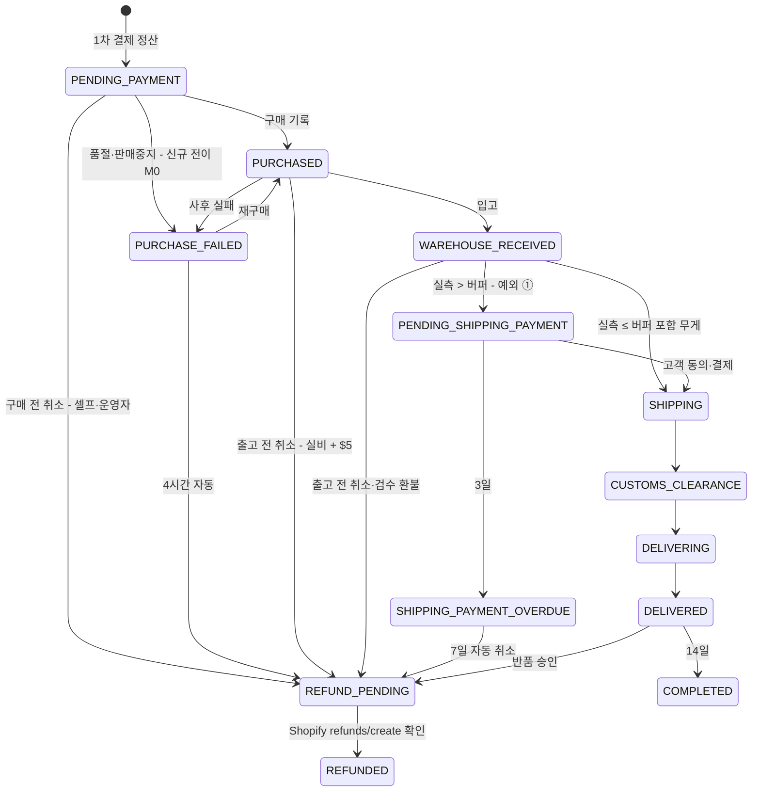
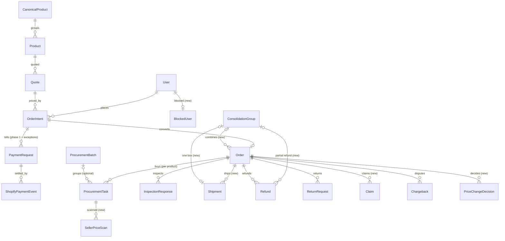
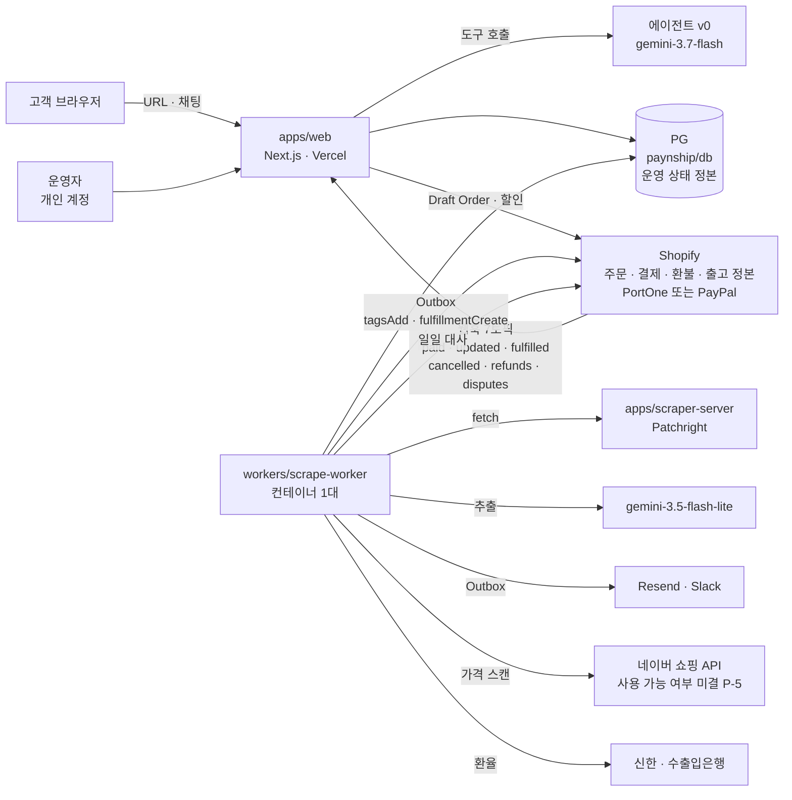

# 통합 PRD — PayNShip MVP (rebuild 기반 · 미국 소프트런칭)

| | |
|---|---|
| **Document Ver.** | v.0.3 |
| **Last Update** | 2026. 10. 07 |
| **In Charge** | 박요한 |

표기: `[실측]` 코드·스키마·운영화면을 직접 확인한 것 · `[가설]` 검증하지 않은 추정 · `[가정]` 계산을 위해 둔 값(실측으로 바꿀 것) · `[미조사]` 아직 안 본 것 · `[확인 필요]` 외부(법무·세무·계약) 확인이 필요한 것.
결정 표기: `S0~S9` · `D1~D10` 은 [머지 계획](plans/261006_rebuild_통합_머지계획.md) 번호, `P-n` 은 정책 값(정책서 §10 과 같은 번호). **모든 결정은 확정(261007)이다. 최종 결정 = 박요한(D10).**
v0.3 의 단일 기준은 [v0.3 변경 시트](plans/261007_v0.3_변경시트.md) 이고, 근거는 [전략·정책 반영 점검 4건](researches/261007-전략정책-반영점검/) 이다. 요구·FR ID 는 변경 시트 §3.2 배정을 따른다.

관련 문서: [정책서(01)](01_정책서_PayNShip-MVP.md) · [요구정의·기능목록(02)](02_요구정의_기능목록.md) · [레드팀 사전 QA(89)](89_레드팀_사전QA_261006.md) ·
[비교](261006_kbuyer-v2_vs_rebuild_비교.md) · [스토리보드·어드민](261006_스토리보드_비교_고객_운영자.md) · [Gemini 재평가](261006_gemini_모델_재평가.md) · [미국 관세 연구](researches/261006-us-de-minimis/README.md) ·
약관 6종(시행 2026-03-10): `kbuyer-v2/docs/external-inputs/2026-04-15-policies/terms/` — 약칭 CJ(고객여정 매핑) · T(이용약관) · OS(주문·배송) · DL(배송) · RR(반품·환불) · PV(개인정보)

### 변경 이력

| 버전 | 날짜 | 내용 |
|---|---|---|
| v0.2 | 2026-10-06 | 레드팀 사전 QA(89) 16건 반영 |
| **v0.3** | **2026-10-07** | **261007 결정 전부 확정 반영.** S4 Shopify 하이브리드 원장(§7.1 · §8.1) · S1 1회 결제 + 예외 3종(§8.2) · P-1 가격 상승 추가 결제 · P-2 무게 버퍼 +20% · P-3 반품(약관대로) · P-4 판매처 실비 · P-8 Shopify 할인 · P-9 구매 전 즉시 셀프 취소 P1 · 검수(기본 미개봉 / 디테일 $7 P1) · 관세 초과 고객 부담 · 수익원 4종 · 법인 · 인허가. B 동작 오기 정정(E2 · E3 · E5 · E7 · E8 · E11 · E13). 신규 FR 반영(§6). §10.2 단위 경제 신설. §11 일정(첫 실매출 2027-01 하순). §12 리스크 7건 추가. §13 결정 전부 확정 |
| v0.3 (오후 보강) | 2026-10-07 | **261007 오후 추가 확정 반영(변경 시트 §1.0).** 합포장 MVP 포함(D-g — 요구 27.0 · FR-C-048 · FR-O-049 · FR-B-019, §2.1 · §5.7 · §6.4 · §7.2 `ConsolidationGroup` · §8.2 #3 부분 환불 상한) · 디테일 검수 결과 항상 고객 확정(D-a) · 검수 환불 시 판매처 반품비(D-b) · 창고 분실·파손 전액(D-c) · 금지품목 폐기 환불(D-j) · 반품 환불 기준액(D-k) · 장기 보류 보관 처리기(D-f, FR-B-063) · 구매 약속 1~3영업일(D-e) · 증빙 보관 1년(D-h) · DPO 박요한(D-i) · 배송 마크업 10% · 환율 마진 0.5% 확정(§10.2) · D3 현행 유지. §11 일정(M3 11/23~12/24 · M4 12/28~2027-01-29 · 첫 실매출 2027-01 말, G0 후 약 16주). §13 에 D-a~D-k · D3 추가 |
| v0.3 (저녁 보강) | 2026-10-07 | **261007 저녁 추가 확정 3건 반영(변경 시트 §1.0).** 합포장 배송비 = 묶은 상자 실측 그대로(버퍼 없음) · 합포장 허용 = 고객 총액(배송비 + 관세 변화) 기준(§5.7 예시 환불 $8.80 → $11.62 · FR-C-048 · O-049 · B-019 · §7.2 · §8.2 #3 · §10.2) · 장기 보류 보관료 = 환불 건 차감 / 출고 건 출고 전 추가 결제 `STORAGE_FEE`(FR-B-037 · B-063 · §8.2 #3 각주). §13 D-f · D-g 갱신 |

---

## 0. 한 문장

**해외 K-팬이 한국 상품 URL 하나로, 결제 전에 확정된 관세 포함 총액을 보고, 대화로 사서 받는다** — 운영자는 시스템이 만든 작업만 처리한다.

**고객 약속 문구(정본)**: "Duties & taxes prepaid at checkout (DDP). Only if customs reclassifies your item and charges more will we bill the difference."
"No extra charges at the border" 같은 무조건 문구는 쓰지 않는다(약관 T§4.2 · DL§1.2 — 세관 재분류로 생긴 초과분은 고객 부담).

**끝났다고 말할 수 있는 조건**: 미국 고객의 **실결제 주문 1건 이상**이 URL → 견적 → 결제 → 발주 → 입고·검수 → 특송 출고 → 배송 완료까지
**국경에서 고객에게 추가 청구 없이(DDP)** 끝나고, 그 주문의 모든 운영 변경이 **감사로그로 재구성**되며, **Shopify 주문 · 결제 · 환불 · 출고 기록과 DB 가 일일 대사에서 일치**하고,
견적 관세와 특송사가 청구한 관세의 차이가 **주문당 $1 이내(관세가 0 보다 크면 5% 이내)** 다. 관세 대조는 특송사 청구서 수령 후 판정한다.

---

## 1. 배경과 문제

### 1.1 지금 어떻게 하고 있나 `[실측 261006]`

| 코드 | 상태 |
|---|---|
| **A** kbuyer-v2 (`paynshipcompany/paynship-v2`) | 운영 중(`paynship-v2.vercel.app`). 결제는 mock(`ENABLE_MOCK_CHECKOUT=true`). **운영 DB 주문 0 · 견적 0 · 사용자 1** |
| **A'** 김도윤 레거시 루트 (`maybedy/kbuyer` main) | 6월에 운영 화면 보강(구매 기록·ops inbox·환불 완료). 7/14 마지막 커밋. 배포본 없음 |
| **B** rebuild (`maybedy/kbuyer` `rebuild/`) | 모노레포. 상태 기계·감사로그·기한 감시·Outbox. **배포 전**, 화면 거의 없음 |

운영 A 를 직접 써 보면 상품 URL 을 넣었을 때 상품명·가격까지는 나오지만 상세 로딩이 끝나지 않아 **장바구니 버튼이 비활성**이고,
키워드 검색은 영어·한국어 모두 `No results for "products"` 다 `[실측: 운영 화면 261006]`.

### 1.2 그래서 무엇이 문제인가

| 문제 | 근거 |
|---|---|
| **팔 수 있는 상태가 아니다** | 운영 A 는 장바구니까지 못 간다. B 는 배포본이 없다 `[실측]` |
| 돈의 흐름이 세 갈래다 | A 결제 경로 2개 + 브라우저가 보낸 가격으로 Draft Order 생성(변조 가능) `[실측]` |
| 관세 견적이 틀린다 | A 는 미국 $800 면세를 가정한다. 면세는 **2025-08-29 정지** `[실측: 1차 출처]` |
| 운영 기록이 남지 않는다 | A·A' 운영 변경 대부분에 감사로그·상태 검사가 없다 `[실측]` |
| 첫 매출 마일스톤을 놓쳤다 | 전략 문서의 첫 매출 2026-08-12 — 달성 기록 없음 `[실측: 문서·커밋]` |

**문제는 "기능이 없다" 가 아니라 "돈이 흐르는 한 줄이 끝까지 이어지지 않는다" 이다.**

### 1.3 이미 진행 중인 것 — 이 프로젝트의 자리 `[실측]`

| 출처 | 이미 있는 것 | 이 PRD 의 처리 |
|---|---|---|
| B (rebuild) | 견적 게이트 · 가격 엔진(7개국) · 주문/의향/결제 상태 기계 · 기한 감시 15종 · Outbox · 환불 · 반품/검수/포기/차지백 서비스 · 작업 큐 · 2차 결제 차액 계산(차액 0 이면 바로 출고) | **뼈대로 쓴다** |
| A (kbuyer-v2) | 2-pane 채팅 · 장바구니 · 표시 통화 · 상담 연결 · 창고 검수 화면 · 카탈로그 엔진 · 환율 provider | **화면·모듈 이식** |
| A' (레거시) | 구매 기록 모달 · ops inbox · 주문 상세 · 의향 검토 · 환불 완료 · NextAuth | **운영 화면 이식** |
| 신규 | 에이전트 v0 · 판매처 추천 · 관세 301 규칙 · 고객 응답 화면 · **Shopify 하이브리드 동기화(웹훅 · 태그 · fulfillment · 대사)** · **예외 결제 단계(가격 상승 · 관세 초과)** · **셀프 취소** · **디테일 검수** · **분실·파손 클레임** · **수익원 설정** · **합포장** · **장기 보류 보관 처리기** | **새로 만든다** |

**이 PRD 는 git merge 계획서가 아니다.** 코드는 B 로 단일화하고 A·A' 는 동결한 뒤 기능 단위로 옮긴다(이식 규칙은 머지 계획 §1.3).

### 1.4 차별점과 경쟁 대안

| 항목 | 일반 구매대행 | PayNShip MVP |
|---|---|---|
| 견적 시점 | 주문 후(검수 후 후정산) | **결제 전 확정 총액(Landed Cost).** 추가 결제는 예외 3종뿐(§8.2) |
| 견적 방식 | 운영자 수동 | URL + AI 채팅(에이전트 v0) |
| 관세 | 도착국에서 따로 낸다 | **DDP 사전 결제.** 세관 재분류로 생긴 초과분만 사후 청구 |
| 검수 | 일률 · 비쌈 | 기본 미개봉 재포장 $0 / **디테일 검수 $7(판매처당) 선택** |
| 운영 | 엑셀 · 메모 | 상태 기계 · 감사로그 · 기한 감시 · Shopify 대사 |

MVP 에서 뺀 차별점: HS 자동 분리 · 위험물 박스 자동 격리(견적 단계 박스 분리 배송비 반영만 함), 자연어 검색 · 추천.
외부 문구는 **"결제 전 확정 총액"** 중심으로 쓴다. 속도("5분 이내", "견적 5초")는 §9 실측값으로만 말한다.

| 경쟁 대안 | 가격 구조 | 약점(우리 관점) | 출처 |
|---|---|---|---|
| KoreanBuddies 등 구매대행 | 수수료 5~12% | 결제 전 확정 총액 없음 | `[문서: 경쟁 브리프 2026-03]` |
| Harumio | $5 정액 + 환율 마진 | 채팅 UX 없음 | `[문서: 경쟁 브리프 2026-03]` |
| Coupang 로켓직구 글로벌 | 판매가 포함 | 상품 한정 | `[문서: v2.2 §8]` |
| Amazon Global | 판매가 포함 | 한국 상품 없음 | `[문서: v2.2 §8]` |

**경쟁 표는 2026-03 기준이다. 미국 면세 폐지(2025-08) 이후 경쟁사가 DDP 로 바꿨는지는 `[미조사]`** — 소프트런칭 전(M4) $30 · $80 주문 총액 비교표를 새로 만든다.

### 1.5 법인 · 인허가

| 항목 | 상태 |
|---|---|
| 표기 | **Next Commerce Inc.(넥스트커머스아이앤씨) d/b/a Pay N Ship** — 약관 T · PV 머리말과 같다 |
| 사업자등록 | **완료** (261007 박요한 확인) |
| 통신판매업 신고 | **완료** (261007 박요한 확인) |
| 법인 등기 여부 · 사업자 유형 | `[확인 필요]` — 영세율 환급(수익원 ③)의 전제 |
| 예창패 협약 | 해당 없음 |
| 개인정보 보호책임자(DPO) | **박요한**(D-i 확정 261007) — 현 처리방침의 김도윤 표기는 개정 대상([약관 개정안 목록](plans/261007_약관_개정안_목록.md) PV-07) |
| Shopify 스토어 · 결제 디스크립터 법인명 일치 | `[확인 필요]` — 결제 가입(M4) 전 |

---

## 2. 범위

### 2.1 In scope (P1 — MVP)

1. **견적** — URL 수집 · 검증 게이트 · 관세 포함 확정 총액(USD, 표시 통화 8) · 검토 중 처리 · 24시간 유효 · **무게 버퍼 +20%(배송비에만)** · **수익원 설정(배송 마크업 · 환율 마진)** · **디테일 검수 선택($7/판매처)** · 관세 고지 문구
2. **AI 채팅 v0** — 도구 호출 에이전트(견적 · 옵션 · 장바구니 · 결제 안내 · 주문 조회 · **취소(`cancel_order` — 구매 전 실행, 이후 접수)** · 상담원). **판매처 스캔 가격은 응답에 쓰지 않는다**(S7)
3. **장바구니 · 로그인 · 결제** — 결제 전 로그인 필수, Shopify Draft Order(PortOne · PayPal 중 **먼저 끝난 하나로 출시**), **1회 결제 + 예외 3종**, **Shopify 할인(서버 적용분만)**, **결제 완료 페이지**
4. **발주** — 결제 시 상품별 작업 자동 생성 · 판매처 추천 상위 3(운영자 전용) · 카탈로그 매칭 · 구매 기록(**쿠폰 · 포인트 · 캐시백 · 판매처 반품비 · 매입 증빙**) · **가격 상승(P-1: 허용분 흡수, 초과분 추가 결제)** · 구매 실패 자동 환불
5. **창고** — 입고 · **기본 = 미개봉 재포장(외박스 사진)** · **디테일 검수(개봉 · 결과를 이상 여부와 관계없이 항상 고객에게 보내 확정받음 · 이상 시 3선택: 그대로 발송 / 판매처 교환 / 환불, 72시간 무응답 = 확정(그대로 발송))** · 실측(버퍼 포함 무게 대비) · **합포장(결제가 끝난 여러 주문을 출고 전 한 상자로 — 고객 요청, 배송비 = 묶은 상자 실측 그대로(버퍼 없음), 고객 총액(배송비 + 관세 변화)이 줄 때만: 미리보기에서 총액이 늘면 요청 불가, 실측에서 늘면 미승인 · 개별 출고, 줄어든 차액은 출고 때 부분 환불)** · 특송 DDP 출고(**Shopify fulfillment 정본**) · **장기 보류 보관(45일 무료 → 하루 $1 → 75일 후 폐기 · 보관료는 환불 건 차감 / 출고 건 출고 전 추가 결제 `STORAGE_FEE`)**
6. **예외** — **구매 전 즉시 셀프 취소** · 출고 전 취소(판매처 실비 + $5) · 회사 취소(가격 오류) · 환불(**Shopify 확인 후 완료**) · 반품(약관대로) · **분실·파손 클레임(창고 안 회사 과실 = 결제액 전액)** · **창고 금지품목 폐기(폐기 실비 차감 후 환불)** · **관세 초과 청구** · 차지백 · **차단 사용자**
7. **Shopify 하이브리드 원장** — 웹훅 7토픽 동기화 · 태그 미러 · 일일 대사 · 연동 상태 화면
8. **운영 기반** — 오늘 할 일 · 감사로그(**운영자 개인 계정 인증**) · 요율/환율/수수료/수익원 설정 · **재무 대사** · **영세율 환급 증빙(M4)** · 출시 KPI · **퍼널 이벤트** · **CS 1차 응답 24시간** · 보안 최소셋 · 인프라(월 $100 이하 — Shopify 구독료 · 결제 수수료 제외)

### 2.2 Out of scope (사유는 정책서 §10)

다국어 화면 / **자연어 검색** · 추천 · 선호 기억 / **유료 구독(프리미엄 멤버십)** / **제휴(affiliate) 수수료** / AcrossB API 자동 연동 / 위험물 박스 자동 분리(견적 단계 박스 분리 배송비 반영은 범위 안) /
통관 거부 · 장기 미수령 화면(관세 초과 청구와 고지 · 동의는 범위 안) / 마진 리포트 · 엑셀(재무 대사 1장은 범위 안) / 미국 주 판매세 징수 / 우편(EMS) 기본 배송 / 일반(Standard) 배송 / 재주문 / 네이티브 앱

### 2.3 확장 범위 (P2 — M5)

| # | 범위 | 핵심 규칙 | 근거 |
|---|---|---|---|
| 9 | 다국어 · 일본 확대 | KO · ZH · JA, 일본 관세(¥10,000 per parcel) | v2.2 국가 순서 10 → 30 → 54 |
| 10 | 에이전트 고도화 | 자연어 검색 · 추천 · 선호 기억 · 멀티턴 · 대체상품 제안 | 차별점 1위 |
| 11 | 운영 자동화 | 배치 자동 묶기 · 엑셀 · 마진 리포트(원가 = 실구매가) · 발주 칸반 | 운영 처리 ≤8분 KPI |
| 12 | 물류 자동화 | AcrossB API · 박스 자동 분리 · 통관 거부 · 장기 미수령 화면 | 계약 이후 |
| 13 | 수익 확장 | 유료 구독 · 제휴 수수료 | 사업계획 |

---

## 3. 이용자와 기기

| 이용자 | 기기 | 빈도 | 특성 |
|---|---|---|---|
| 해외 K-팬 (주문당 상품가 $35~150 가정 — §10.2 시나리오) | 모바일 브라우저 | 컴백 · 굿즈 발매 시 몰림 | **영어**, 한국 사이트 사용 불가, 관세 걱정이 이탈 원인 `[가설]` |
| 운영자 (1인 가정 `[문서]`) | 데스크톱 | 매일 | 구매 · 검수 · 출고를 손으로 한다. 놓치면 바로 지연 |
| 공동창업자 2인 | — | 주 1회 | 정책 · 요율 · 결제 설정 (super_admin) |

**해외 거주 한국인은 1차 비대상이다** — 영어 UI, 의약품 금지, 검역 때문이다.

### 3.1 출시 시장 — 미국 (S0~S9 확정 261007)

| 항목 | 값 |
|---|---|
| 첫 시장 | **미국** — 역직구 비중 38% `[문서: PSST]`, B 랜딩 기본값 US `[실측]` |
| 카테고리 | K-pop 앨범 · 굿즈, K-뷰티 `[문서]` |
| 언어 · 통화 | 영어 · USD 결제 + 표시 8종 (S6) |
| 배송 | 특송 DDP — 우편 간이통관은 한국산 301 대상 물품 불가 `[실측: FR 2026-12669]`. 리드타임 = 출고 후 5~7영업일(국내 이동 제외, DL§2) |
| 결제 | PortOne · PayPal 병행 준비, **먼저 끝난 하나로 출시** (S9 · P-7) |
| 모집 | Reddit · Discord 소규모 `[문서: GTM 1단계]` |

---

## 4. 도메인 × 동작 매트릭스

| 도메인 (B 모델) | 생성 | 조회 | 수정 | 확정·전이 | 삭제 |
|---|---|---|---|---|---|
| 상품·증거 (`Product`) | 수집 워커 | 고객(견적) · 운영자 | **운영자 보정(근거 필수 — 근거 필드 신규, E9)** | 검증 게이트 | 불가 |
| 견적 (`Quote`) | 시스템 | 고객 · 운영자 | **불가**(스냅샷) | 24시간 만료 | 불가 |
| 주문 의향 (`OrderIntent`) | 고객(결제 요청) | 고객 · 운영자 | 재견적으로만 | 자동 승인 · **운영자 승인/거절(P-6, 승인 시 견적 재검증)** | 불가 |
| 결제 요청 (`PaymentRequest`) | 시스템(1차 · 예외 ①②③) | 고객 · 운영자 | 재발행(새 요청) | 웹훅 정산 | 만료 시 Draft 삭제 |
| 주문 (`Order`) | **Shopify `orders/paid` 정산 시 미러 생성** | 고객(본인) · 운영자 | 운영자(허용 전이만) | 상태 기계 14상태(운영 상태 = DB 정본) | 불가 |
| 발주 작업 (`ProcurementTask`) | **결제 정산 시 상품별 자동** ← 지금 없음(스키마 변경, E8) | 운영자 | 구매 기록 | QUEUED → … → PURCHASED/FAILED | 취소만 |
| 발주 배치 (`ProcurementBatch`) | 운영자 | 운영자 | 운영자 | 자동 집계(PARTIALLY_PURCHASED) | 취소만 |
| 가격 변동 (`PriceChangeDecision` 신규) | 구매 기록 시 시스템 | 고객 · 운영자 | 고객 동의/거절 | 48시간 → 무응답 취소 · 전액 환불 | 불가 |
| 판매처 가격 스캔 (신규) | 워커 | **운영자만** | 불가 | — | 보존 기간 후 |
| 카탈로그 매칭 (신규 · A 이식) | 워커 | 운영자 | **운영자 확인(0.60~0.84)** | 자동(≥0.85) | <0.60 은 새 카탈로그 항목 |
| 검수 (`InspectionResponse`) | **운영자(디테일 검수 완료 시 항상 — 이상 여부 무관, D-a)** ← 생성 경로 없음 | 고객(본인) · 운영자 | 고객 응답(확정 / 이상 시 3선택) | 72시간 무응답 = 확정(발송) | 불가 |
| 합포장 묶음 (`ConsolidationGroup` 신규) | 고객(결제 완료 · 출고 전 주문 2개 이상, 같은 배송지) | 고객(본인) · 운영자 | 고객 철회 · 운영자 포장 · 실측 | 미리보기(고객 총액이 늘면 요청 불가) → 입고 후 실측 판정(총액이 줄면 승인 · 같거나 늘면 미승인 → 개별 출고) → 출고 1개 | 불가(철회 · 거부 · 해제는 상태로) |
| 국제 출고 (`Shipment` 신규) | 운영자(송장 입력) | 고객 · 운영자 | 운영자 | **Shopify fulfillment 정본** — 합포장이면 출고 1개에 주문 N개 | 불가 |
| 환불 (`Refund`) | 고객 셀프 취소 · 운영자 · 시스템 · **합포장 차액(시스템, 출고 시)** · **Shopify Admin 직접 환불(웹훅)** | 고객 · 운영자 | — | **`refunds/create` 확인 후 COMPLETED** | 불가 |
| 반품 (`ReturnRequest`) | 고객(5영업일 · 영상) | 고객 · 운영자 | — | 운영자(수동 승인만) | 불가 |
| 분실·파손 클레임 (신규) | 고객(5영업일 · 사진/영상) · **운영자(창고 안 사고)** | 고객 · 운영자 | 운영자 | 운영자(환불/재발송 — 창고 회사 과실이면 결제액 전액, 고객 선택) | 불가 |
| 장기 보류 보관 (`Order` 보관 기한 필드 신규) | 시스템(보류 시작 시) | 고객 · 운영자 | 운영자(보류 해제) | sweeper: 45일 → 보관료 시작 · 75일 → 폐기 작업 | 불가 |
| 차지백 (`Chargeback`) | 운영자 · **`disputes/*` 웹훅(신규, FR-B-056)** | 운영자 | 운영자 | 운영자 | 불가 |
| 차단 사용자 (신규) | 시스템(차지백 · 관세 미납) · super_admin | 운영자 | super_admin(사유) | 해제 | 불가 |
| 작업 (`OpsTask`) | 시스템 · sweeper | 운영자 | 맡기 · 해결 | — | 불가 |
| 요율·설정 (`ExchangeRate` 등 · `AppConfig`) | super_admin · 환율 워커 | 운영자 | super_admin(이력) | 유효기간 | 불가 |
| 감사로그 (`AdminAuditLog`) | 시스템 | 운영자 | **불가** | — | **불가** |

빈칸 판정: 판매처 스캔 · 카탈로그 · 검수 생성 경로 · 발주 자동 생성 · 국제 출고 · 클레임 · 차단 사용자 · 합포장 묶음 · 장기 보류 보관은 **이번에 만든다**(FR). 견적 · 감사로그 수정은 **만들지 않는다**(원장 불변).

---

## 5. 화면

### 5.1 고객 — 채팅 (핵심 화면)

```
┌─────────────────────────────────────┬──────────────────────────────┐
│ PayNShip        [USD ▾]  [Sign in]  │  Quote                        │
├─────────────────────────────────────┤  ┌─────────────────────────┐ │
│ 🧑 https://www.musinsa.com/...      │  │ [img] ESCAPEFROM tee    │ │
│ 🤖 Which size? (S / M / L / XL)     │  │ Size  [ M ▾ ]           │ │
│ 🧑 M please, ship to Texas          │  ├─────────────────────────┤ │
│ 🤖 Here's your total. Duties &      │  │ Item            $21.36  │ │
│    taxes are prepaid (DDP).         │  │ Pay & svc fee    $5.00  │ │
│    [ Add to cart ]                  │  │ Shipping in KR   $0.00  │ │
│                                     │  │ Shipping KR→US* $14.10  │ │
│                                     │  │ Duty (12.5%)     $2.67  │ │
│                                     │  │ Sales tax   not charged │ │
│                                     │  │ Customs fee      $2.69  │ │
│                                     │  │ ─────────────────────── │ │
│                                     │  │ Total (USD)     $45.82  │ │
│                                     │  │ [ ] Detail check +$7    │ │
│ ┌─────────────────────────────┐ [→] │  │ Valid 23h 59m           │ │
│ │ Paste a link or ask…        │     │  └─────────────────────────┘ │
│ └─────────────────────────────┘     │  [ Talk to a person ]         │
└─────────────────────────────────────┴──────────────────────────────┘
```

- 예시 검산: 21.36 + 5.00 + 0.00 + 14.10 + 2.67 + 2.69 = **$45.82**(관세는 KORUS 신고 가정 12.5%, MPF 의 KORUS 면제 여부는 `[미확인]`). 항목은 센트 반올림 후 합산한다(FR-B-015). 배송비는 버퍼 · 마크업이 들어간 예시 값이다.
- **화면 문구(정본, FR-C-021)** — 와이어는 줄여 적었다.
  - 수수료 라벨: **"Payment & service fee"**(약관 OS§1 "결제 및 대행 수수료" 명칭).
  - 관세: "Duties & taxes prepaid at checkout (DDP). Only if customs reclassifies your item and charges more will we bill the difference."
  - 배송비(\*): "Shipping is based on estimated weight +20%. If the actual weight doesn't exceed it, there's no extra charge."
  - 리드타임: "Delivered 5–7 business days after dispatch from our Korea warehouse (excludes domestic transit to our warehouse)."
  - 디테일 검수: "Detail inspection +$7 per seller — we open the box, check it matches your order and look for visible defects."
- 숫자는 **오른쪽 견적 카드가 정본**이다. 채팅 말풍선은 숫자를 다시 쓰지 않고 카드를 가리킨다(AI 가 숫자를 만들지 않게).
- 견적 상품가 = **고객이 준 URL 의 판매가**다. 판매처 스캔 · 최저가는 카드와 채팅 어디에도 나오지 않는다(S7).
- 화면의 `#PNS-1042` 같은 번호는 **사람용 주문번호(신규 필드)** 다. B 의 주문 ID(cuid)와 달리 URL 에는 쓰지 않는다.
- 검토 중이면 카드 자리에 "We're verifying this item — usually within N hours" + 처리 예정 시각.

### 5.2 고객 — 검수 응답 (디테일 검수 주문만)

```
┌──────────────────────────────────────────────┐
│ Inspection result — order #PNS-1042          │
│ Seller: Olive Young · Detail check ($7)      │
│ [photo] [photo] [photo]                      │
│ Opened: OK · Matches order: OK               │
│ Visible defect: small scratch on the case    │
├──────────────────────────────────────────────┤
│ ( ) Confirm and ship as is                   │
│ ( ) Exchange with the seller (free)          │
│ ( ) Refund (seller return fee may apply)     │
│ Respond within 71h 12m. If we don't hear     │
│ from you, we'll treat it as confirmed and    │
│ ship it.                                     │
│ [ Submit ]                                   │
└──────────────────────────────────────────────┘
```

- **디테일 검수 결과는 이상 여부와 관계없이 항상 고객에게 간다(D-a).** 이상이 없으면 선택지 대신 `[ Confirm and ship ]` 버튼 하나와 상담 연결만 보인다. 이상이 있으면 위처럼 3선택이다.
- 고객이 확정하거나 **72시간 무응답(= 확정 간주)** 이면 출고한다. 화면 하단 고지(정본): "Once you confirm (or 72 hours pass), we ship. Issues found after delivery — even within the inspection scope — follow our standard return policy." — 출고 후 문제는 일반 하자 반품 규칙(국제 반송비 고객 선불 · −DDP −$10, FR-B-055)을 따른다.
- 환불을 고르면 판매처 반품비는 회사가 판매처와 교섭하고, 판매처가 부담하지 않으면 **실비를 환불액에서 뺀다(D-b)** — 그래서 선택지에 "seller return fee may apply" 를 적는다.
- 기본(미개봉) 주문은 고객 검수 요청이 없다. 외박스가 파손돼 있으면 운영자가 보류하고 작업을 만든다.
- 마감 24시간 전에 리마인드 메일이 1회 간다(FR-B-058).

### 5.3 고객 — 추가 결제 동의 (FR-C-045, 예외 ①②③ 통합)

```
┌──────────────────────────────────────────────┐
│ Additional payment for order #PNS-1042       │
│ Reason: The seller raised the price          │
│   Quoted item  $21.36 → Now  $27.10          │
│   We cover     $3.00                         │
│   You pay      $3.46  (duty included)        │
│ Pay within 47h 10m. If you decline or don't  │
│ respond, we cancel and fully refund.         │
│ [ Pay $3.46 ]   [ Cancel & refund ]          │
└──────────────────────────────────────────────┘
```

- 사유별 문구와 기한: ① 실측 무게 초과 — 3일(연체 후 7일 자동 취소) ② 가격 상승 — **48시간, 무응답 · 거절 = 취소 · 전액 환불** ③ 관세 초과 — 특송사 청구 증빙 첨부, **7일, 미납 = 계정 차단**.
- 예시 차액 = 동결 환율로 `computeQuote` 를 다시 돌린 총액 − 기수납 − 허용분(수수료 · 관세 · VAT 함께 반영). §5.1 견적 기준 검산: 재계산 총액 27.10 + 5.00(최소 수수료 유지) + 14.10 + 3.39(관세 12.5%) + 2.69 = $52.28 → 52.28 − 45.82 − 3.00(허용분 = max(21.36 × 5%, $3)) = **$3.46**.

### 5.4 운영자 — 오늘 할 일

```
┌ 오늘 할 일 ───────────────────────────────────────────────────┐
│ 유형          대상           기한         상태       담당   [맡기] │
│ 의향 검토     PNS-1050 $382  2h 남음      대기       -      [맡기] │
│ 발주          3건(올리브영)   🔴 1h 초과   진행       박요한  [열기] │
│ 추가 결제 대기 PNS-1047 가격 31h 남음     고객 대기   -            │
│ 검수 응답     PNS-1042       71h 남음     고객 대기   -            │
│ 웹훅 실패     refunds/create  🔴 재처리     대기       -      [맡기] │
│ 환불 실패     PNS-1031       🔴 상위 보고  대기       -      [맡기] │
└───────────────────────────────────────────────────────────────┘
```

### 5.5 운영자 — 구매 기록 (발주 배치 > 모달)

```
┌ 구매 기록 — 배치 #B-77 (올리브영 · 3건) ─────────────────────┐
│ 판매처 추천   ① 올리브영 공식 ₩22,000  ② 네이버 A ₩21,500  ③ … │
│ 선택 판매처   [ 올리브영 공식 ▾ ]  (추천과 다르면 사유 필수)    │
│ 판매처 주문번호 [ __________ ]   실구매가(필수) [ ₩ ______ ]    │
│ 쿠폰 [ ₩ ___ ]  포인트 [ ₩ ___ ]  캐시백 [ ₩ ___ ]              │
│ 판매처 반품비(왕복) [ ₩ ___ ]   매입 증빙 [ 파일 첨부 ]         │
│ 결제 수단     [ 법인카드 ●●12 ▾ ]   영수증 [ 파일 첨부 ]        │
│ ⚠ 견적가 ₩21,000 대비 +4.8% — 허용 한도 max(5%, $3) 안(흡수)    │
│                                   [ 취소 ]  [ 구매 완료 저장 ]  │
└───────────────────────────────────────────────────────────────┘
```

- 허용 한도를 넘으면 저장 시 해당 작업이 보류되고 가격 변동 결정(`PriceChangeDecision`)과 고객 추가 결제 요청이 생긴다(FR-O-035).
- 판매처 추천 · 쿠폰 · 포인트 · 캐시백 값은 운영자 화면에만 있다(S7).

### 5.6 상태별 화면

| 상황 | 고객 문구(요지) |
|---|---|
| 검토 중 | "We're verifying this item" + 처리 예정 시각 |
| 처리 불가 | "We can't buy this item" + 이유(금지품목 · 판매 중지 · 사이트 미지원) |
| 견적 만료 | "Prices may have changed — get a new quote" |
| 결제 링크 만료 | "This payment link expired — we sent you a new one" (운영자 재발행) |
| 결제 완료 | 주문번호 · 다음 단계 · **구매 완료 1~3영업일**(D-e) · 리드타임(국내 이동 제외) (FR-C-036) |
| 구매 전 취소 | "Cancelled — full refund issued" (즉시 셀프 취소) |
| 구매 후 취소 요청 | "We've received your request. Seller return shipping + $5 will be deducted" |
| 구매 실패 | "The seller sold out — full refund within 4 hours" |
| 가격 상승 초과 | "The seller raised the price. Pay the difference within 48h, or we'll cancel and fully refund" |
| 실측 무게 초과 | "Your package weighs more than our estimate +20%. Please pay the shipping difference" |
| 관세 초과 | "Customs charged more than we prepaid. Here's the carrier's bill — please pay within 7 days" |
| 디테일 검수 결과 도착 | "Your inspection result is ready — confirm within 72h, or we'll ship as confirmed" (이상 없음 · 있음 모두) |
| 합포장 요청 불가 | "Combining these orders wouldn't lower your total (shipping + duties), so we'll ship them separately" |
| 합포장 승인 · 출고 | "Your orders ship together. We'll refund $X.XX of shipping when the box leaves our warehouse" → 출고 시 "Refunded $X.XX" |
| 합포장 미승인(실측) | "After weighing, combining wouldn't lower your total (shipping + duties), so we'll ship your orders separately" |
| 장기 보류 | "Your order has been on hold for 45 days. Storage is $1/day from now, and items are disposed of after 75 days" |

화면 목록 전체는 [02 §2 메뉴구조](02_요구정의_기능목록.md) 를 따른다. **B 실측 경로** `[실측]`: `/` · `/quote/[ref]` · `/quote/error` · `/pay/[id]` · `/orders/[id]` · `/admin` · `/admin/orders` · `/admin/login` · `/terms` · `/privacy` · `/refund-policy`. 나머지는 신규·이식이다(신규 고객 화면: 결제 완료 · 배송·주문 안내 · 추가 결제 동의 · 클레임 접수 · 합포장 요청).

### 5.7 고객 — 합포장 요청 (FR-C-048, D-g)

```
┌──────────────────────────────────────────────┐
│ Combine orders into one box                  │
│ Ship to: Austin, TX 78701                    │
├──────────────────────────────────────────────┤
│ [x] #PNS-1042  in warehouse   paid $15.14    │
│ [x] #PNS-1047  purchasing     paid $19.36    │
│ [ ] #PNS-1039  shipped — can't combine       │
├──────────────────────────────────────────────┤
│ International shipping paid      $34.50      │
│ Combined box (estimate)          $22.88      │
│ Duties change (estimate)          $0.00      │
│ Estimated refund at dispatch     $11.62      │
│ Final refund is set after we weigh the box.  │
│ [ Request combined shipping ]                │
└──────────────────────────────────────────────┘
```

- 고를 수 있는 주문 = **같은 계정 · 같은 배송지 · 결제 완료 · 아직 출고(특송사 인계) 전**. 출고된 주문 · 다른 배송지 주문은 회색으로 이유를 보인다.
- 예시 검산(§10.2 공통 가정): 낸 국제 배송비 = 15.14(0.6kg 추정) + 19.36(1.0kg 추정) = $34.50. 묶음 = 추정 무게 합 1.6kg 그대로(**버퍼 없음** — 승인 단계에서도 실측 그대로) → 특송 원가 8 + 8 × 1.6 = $20.80 → × 1.1 = **$22.88**. 관세 변화 = $0(신고 단위가 바뀌어도 관세가 같다고 가정). 예상 환불 = 34.50 − 22.88 = **$11.62** = 기본 운임 한 번분 $8.80(상자 하나라 한 번만 붙는다) + 각 주문 견적에 붙었던 버퍼분 $2.82(0.32kg × 8 × 1.1).
- **고객 총액 차액(배송비 감소 + 관세 변화)이 0 이하면 요청 버튼이 비활성**되고 "wouldn't lower your total" 이유가 보인다 — 묶음은 고객이 내는 총액이 줄 때만 허용한다. 관세가 늘어도 총액이 줄면 요청할 수 있다.
- 화면 금액은 추정(미리보기)이다. 승인은 묶음 상품이 모두 입고된 뒤 **실측으로 판정**한다(FR-O-049). 묶은 상자 실측 그대로(버퍼 없음) 계산한 배송비 + 재계산 관세가 낸 금액보다 줄면 승인하고 확정 차액을 **출고 때 부분 환불**한다(FR-B-019). **실측에서 총액이 같거나 늘면 승인하지 않고 주문별로 개별 출고**한다(각 주문은 일반 실측 규칙 · 예외 ①을 그대로 따른다).
- 관세: 신고 단위가 바뀌면 관세를 다시 계산한다(신고 단위는 `[관세사 확인]`). **관세가 늘어도 배송비 감소가 더 커서 고객 총액이 줄면 허용**하고, 관세 증가분은 부분 환불에서 뺀다 — 묶음 때문에 새 결제를 만들지 않는다(§8.2 #3).

---

## 6. 기능 요구사항과 수용 조건

기능 ID 는 [02_요구정의_기능목록.md](02_요구정의_기능목록.md) 를 따른다(v0.3 배정 = 변경 시트 §3.2). `v0.3` 표시는 이번에 새로 생기거나 바뀐 항목이다.
**FR-C-046 은 삭제했다**(FR-C-045 "추가 결제 동의"로 통합).

### 6.1 견적 · 에이전트

| FR | 수용 조건 (Given / When / Then) |
|---|---|
| FR-B-002 검증 게이트 | 필수 값 하나라도 검증되지 않은 상품에는 **견적 금액이 나가지 않는다.** 대신 운영 작업(기한 포함)이 생기고 고객 화면에 처리 예정 시각이 보인다. 필수 4필드 = 무게 · HS · 원산지 · 국내 배송비, 선행 = 가격 · 카테고리 `[실측: canon §4]` |
| FR-C-021 항목 분해 `v0.3` | 모든 견적에 7개 항목(+선택 시 디테일 검수)과 합계가 보이고, 합계 = 항목 합이다(1센트 오차 없음). 수수료 라벨은 "Payment & service fee". **§0 관세 문구와 무게 버퍼 고지 문구가 있고, "No extra charges at the border" 같은 무조건 문구는 없다** |
| FR-B-010 수수료 `v0.3` | 상품가 $30 → 수수료 $5(최소), 상품가 $80 → $8. 배송비 · 관세 · 버퍼에는 수수료가 붙지 않는다. 라벨 = "결제 및 대행 수수료(Payment & service fee)". 요율(10%, 최소 $5)은 약관 · 안내 페이지에 공개한다(D-d) |
| FR-B-011 관세(미국) | 한국산 화장품 $50 → 관세 $6.25, 한국산 앨범(CD) $40 → 301 관세 $0, 한국산 면 티셔츠 $150(KORUS 신고) → $18.75. **$800 이하라는 이유로 0 이 되는 경로가 없다.** B 불변식 canon §12.5 `dutyRate = min(fta, mfn)` 를 바꾸는 **canon 개정 ADR(M2)** 이 선행된다(E13) |
| FR-B-017 무게 버퍼 `v0.3` | 견적 청구 무게 = 추정 청구 무게 × 1.2(AppConfig). 버퍼는 **배송비에만** 적용되고 관세 신고가 · 수수료는 변하지 않는다. 골든 테스트에 버퍼 전 · 후 값이 있다 |
| FR-B-018 수익원 `v0.3` | 배송 마크업 `shipping.markupRate`(**10% 확정** 261007) · 환율 마진 `fx.spreadRate`(**0.5% 확정** 261007) — 둘 다 설정값으로 바꿀 수 있다 — 이 RateContext 로 들어가 견적에 반영되고, 견적 스냅샷에 적용값이 남는다. 값 0 이면 기존 결과와 같다 |
| FR-C-026 디테일 검수 선택 `v0.3` | 판매처마다 $7 체크박스가 있고, 체크하면 견적 · Draft Order 에 판매처당 $7 줄이 생긴다 |
| FR-C-011 에이전트 `v0.3` | 도구 7종(`cancel_order` — 구매 전 실행, 이후 접수). 벤치마크 10문항(영·한·중, 금지품목, 맥락)을 통과한다. **응답 텍스트의 모든 금액이 견적 엔진 결과와 같다**(불일치 0건). **판매처 스캔 · 최저가 금액이 응답에 0건** |
| FR-C-012 금지품목 | 금지품목 요청에는 도구 호출이 0건이고 이유를 설명한다 |
| FR-O-038 카탈로그 매칭 `v0.3` | 신뢰도 ≥0.85 자동, 0.60~0.84 운영자 확인, **<0.60 은 매칭 후보를 버리고 새 카탈로그 항목을 만든다** |
| FR-O-061 증거 보정 `v0.3` | 근거(출처 · 메모) 없이 보정이 저장되지 않는다. B 보정 라우트에는 근거 필드가 없어 **신규**다(E9) |

### 6.2 결제 · Shopify 하이브리드

| FR | 수용 조건 (Given / When / Then) |
|---|---|
| FR-C-031 결제 전 견적 확인 `v0.3` | 체크아웃은 **저장된 견적의 유효기간만** 확인한다(B 는 판매처 재수집 없음 `[실측]`, E10). 견적이 만료됐으면 재견적 후 바뀐 금액을 고객이 다시 확인해야 결제로 간다. 판매가 변동은 구매 시점(P-1)에 처리한다 |
| FR-C-032 로그인 `v0.3` | 비로그인 고객은 결제 화면에 들어갈 수 없다. 로그인 후 장바구니가 유지되고, 이전 전에 **게스트 토큰 HMAC 과 소유를 검증**한다 |
| FR-C-036 결제 완료 `v0.3` | 결제 후 주문번호 · 다음 단계 · **구매 완료 약속 1~3영업일**(D-e — 내부 기한은 12시간 그대로) · 리드타임(국내 이동 제외)이 보인다. 주문 상세에도 같은 약속이 보인다 |
| FR-B-031 Draft Order `v0.3` | Shopify 주문에 상품 · 수수료 · 배송 · 관세 · 세금 · 통관 수수료 · (선택 시) 디테일 검수 $7 이 **항목별 줄**로 남는다. 줄 합계 − 서버가 넣은 `appliedDiscount` = `PaymentRequest.amountUsd`. **브라우저가 보낸 금액은 쓰이지 않는다** |
| FR-B-038 Shopify 할인 `v0.3` | 할인은 서버가 Draft Order 에 `appliedDiscount` 로 넣고 `amountUsd` 에 **할인 후 금액**을 기록한다. 할인 주문이 `AMOUNT_MISMATCH` 로 멈추지 않는다(B 는 지금 멈춘다 `[실측]`). 고객이 인보이스 결제 화면에서 코드를 직접 넣을 수 있는지는 `[미조사]` |
| FR-B-015 반올림 | 항목별 센트 반올림 후 합산한 값이 총액이다. 반올림 경계 골든 케이스(예: x.xx5)에서 화면 · Shopify · 원장 금액이 같다 |
| FR-B-016 자동 승인 규칙 `v0.3` | **결제 총액 > $300 · 동일 상품 수량 > 5 · 위험물 · 금지 의심 · 차단 사용자** 중 하나면 `PENDING_REVIEW` 로 남고 검토 기한 작업이 생긴다(기준값 AppConfig). 나머지는 자동 승인. 승인 시 견적 유효성을 다시 보고, 만료면 재견적 |
| FR-O-011 의향 승인 `v0.3` | 운영자가 승인하면 **PaymentRequest · Draft Order 가 생성되고**(B `review()` 는 상태만 바꿈 → 신규) 결제 링크가 열리며 감사로그에 전·후 상태 · 행위자가 남는다. 거절하면 결제 링크가 무효화되고 고객에게 메일이 간다 |
| FR-B-030 결제 정산 `v0.3` | 같은 웹훅을 두 번 받아도 주문 · 발주 작업이 1번만 생긴다(멱등). 중간 실패는 재전송으로 복구된다. **결제 확인 1분 내 상품별 발주 작업이 생긴다.** 전제: `ProcurementTask` 에 `productId` · `lineIndex` · `quantity` 추가, `orderIntentId @unique` 해제, `createTask` 의 배치를 선택값으로(E8) |
| FR-B-032 웹훅 수신 `v0.3` | `orders/paid` · `orders/updated` · `orders/fulfilled` · `orders/cancelled` · `refunds/create` · `disputes/create` · `disputes/update` 7토픽을 HMAC 검증 후 `ShopifyWebhookEvent` 에 남기고 처리한다. 같은 이벤트 2회 = 1회 처리 |
| FR-B-033 예외 결제 연결 `v0.3` | 예외 결제(①②③)는 별도 Draft Order 로 만들고 1차 주문번호를 tag · note 로 단다. Shopify 주문 편집(order edit)으로 한 주문에 붙일 수 있으면 그 방식을 우선한다(`[미조사]`) |
| FR-B-034 출고 · 태그 `v0.3` | 운영 상태가 바뀌면 Outbox 로 CJ 태그(§7.3)가 `tagsAdd` 되고, 출고 시 `fulfillmentCreate`(송장 포함)가 실행된다. Shopify 고객 알림은 끄고 출고 메일은 우리 메일 1회 |
| FR-B-035 하이브리드 동기화 `v0.3` | Shopify Admin 에서 직접 한 환불 · 취소가 웹훅으로 DB 에 반영되고 감사로그 행위자가 `shopify:admin` 으로 남는다. 웹훅 실패는 재처리 큐와 운영 작업이 된다 |
| FR-B-036 일일 대사 `v0.3` | 매일 Shopify 주문 · 결제 · 환불 합계와 DB 를 주문 단위로 비교하고, 불일치마다 운영 작업이 생긴다. 불일치 0 이 출시 관문이다 |
| FR-B-037 예외 결제 단계 `v0.3` | `PaymentPhase` · `ShopifyPhase` 에 `PRICE_ADJUSTMENT` · `TAX_OVERAGE` 가 있다. 단계별 유니크 제약이 실측 2차 결제와 충돌하지 않고, 정산 분기(가격 조정 결제 → 해당 발주 작업 보류 해제 / 관세 초과 결제 → 차단 해제 / **보관료 결제 `STORAGE_FEE` → 출고 보류 해제**)가 동작하며, 여러 Shopify 주문에 나눠 환불된다. `STORAGE_FEE` 는 같은 예외 결제 경로를 쓰는 고객 귀책 부수 청구라 "예외 3종" 에 세지 않는다(§8.2 #3 각주) |
| FR-B-053 결제 링크 만료 `v0.3` | 결제 링크 만료 = min(48시간, 견적 만료). **만료되면 Draft Order 를 삭제한다(`draftOrderDelete` 신규).** 만료 후 들어온 입금은 B 대로 **정산한 뒤**(money reality wins) 운영 큐에서 환불 여부를 판단한다(E3) |
| FR-O-076 Shopify 연동 화면 `v0.3` | 연결 상태 · 최근 웹훅 실패 · 재처리 버튼 · 일일 대사 결과가 한 화면에 있다 |

### 6.3 발주 · 가격 변동

| FR | 수용 조건 (Given / When / Then) |
|---|---|
| FR-O-032 구매 기록 `v0.3` | 실구매가 없이는 저장되지 않는다. 판매처 주문번호 · 결제 수단 · 국내 송장 · **판매처 반품비(왕복) · 쿠폰 · 포인트 · 캐시백 · 매입 증빙**이 **전용 칸**에 저장된다(메모 JSON 아님) |
| FR-O-034 판매처 추천 | 결제된 상품의 80% 이상에서 추천 1곳 이상이 나온다 `[가설 — 측정 후 확정]`. 추천과 다른 선택은 사유 없이 저장되지 않는다. 추천은 운영자 화면에만 있다 |
| FR-O-035 가격 상승 `v0.3` | 실구매가 ≤ 견적 상품가 + **max(견적 상품가 × 5%, $3)** 이면 고객 화면 변화 없이 회사가 흡수한다. 넘으면 해당 작업(또는 줄)이 보류되고 **고객 추가 결제 요청**이 간다. 차액 = 동결 환율로 `computeQuote` 재계산 총액 − 기수납 − 허용분(수수료 · 관세 · VAT 함께 반영) |
| FR-B-052 가격 변동 응답 기한 `v0.3` | 고객 동의 기한 **48시간**. 무응답 · 거절이면 해당 주문(또는 줄)이 취소되고 **전액 환불**된다(구매 전이라 비용 0). 처리기는 기한 필드와 짝이다 |
| FR-O-036 · FR-B-046 구매 실패 | 결제 직후(`PENDING_PAYMENT`) 주문도 `PURCHASE_FAILED` 로 갈 수 있다. 실패 기록 즉시 고객 메일, 4시간 안에 Shopify 환불이 실행된다. 일부 상품만 실패하면 그 줄 상품가 + 관세 몫 + 수수료 재계산 차액만 환불되고 나머지는 진행된다 |
| FR-B-049 구매 시각 | 발주 roll-up 으로 `PURCHASED` 가 된 주문에 `purchasedAt` 이 기록되고, 48시간 뒤 입고가 없으면 작업이 생긴다 |

### 6.4 창고 · 검수 · 출고

| FR | 수용 조건 (Given / When / Then) |
|---|---|
| FR-O-042 검수 등록 `v0.3` | **기본 주문은 미개봉 재포장 — 입고 시 외박스 사진만** 남고, 외박스 파손이면 운영자 보류 작업이 생긴다. **고객 검수 요청은 디테일 검수 주문에만** 만들 수 있다. 디테일 검수 완료 시 사진(최대 5장)과 고객 응답 기한 72시간이 생기고, 기한이 지나면 **확정 간주 → 그대로 발송**(행위자 `system:cron`) |
| FR-O-047 디테일 검수 `v0.3` | 디테일 검수 주문은 개봉 · 주문 일치 · 육안 하자 체크리스트와 사진을 모두 채워야 검수 완료가 된다. **검수 완료 = 이상 여부와 관계없이 고객 확정 요청 생성**(D-a). 이상 없음이면 선택지는 "확정" 하나, 이상 있음이면 3선택이다 |
| FR-O-048 판매처 교환 `v0.3` | 고객이 교환을 고르면 판매처 교환 대행 기록(요청 · 발송 · 재입고)이 생기고, 재입고 후 다시 검수한다(다시 고객 확정). 교환 비용은 고객에게 청구하지 않는다(OS§3.2) |
| FR-B-043~045 검수 응답 · 후속 · 차단 `v0.3` | 응답 3종: `SHIP_AS_IS`(= 확정) → 출고 해제, `EXCHANGE` → 판매처 교환(FR-O-048), `RETURN_REFUND` → `REFUND_PENDING`. **디테일 검수 주문은 고객 확정(또는 72h 기본값) 전에는 출고 전이가 거부된다.** `RETURN_REFUND` 의 판매처 반품비(D-b): 운영자가 판매처 교섭 결과를 기록해야 환불이 실행되고, 판매처가 부담하지 않으면 **실비(근거 첨부)를 해당 상품 환불액에서 뺀다** — 출고 전이라 관세 몫은 그대로 환불된다 |
| FR-B-041 검수 기본값 | B 상수 `INSPECTION_DEFAULT_VERDICT = 'ACCEPT'` 를 유지하고, 기본값 적용 시 **확정 기록(`confirmedBy = system:cron`) + 출고 해제 후속 전이**가 일어나는 회귀 테스트가 있다(지금은 상태만 바뀐다 `[실측]`). 이상이 없는 검수에도 기본값이 같은 방식으로 적용된다 |
| FR-C-042 검수 응답 `v0.3` | 고객이 확정(이상 없음) 또는 3선택 중 하나로 응답하면 그 즉시 운영자 화면에 반영되고, 기한 이후 응답은 받지 않는다. 확정 화면에 "출고 후 문제는 일반 반품 규칙" 고지가 있다(§5.2) |
| FR-O-046 창고 보류 · 금지품목 `v0.3` | 외박스 파손 · 오배송 · 위조 의심 · **금지품목 발견**은 운영자가 출고 보류하고, 보류 중에는 72시간 기본값을 적용하지 않는다. 금지품목이면 고객 연락 작업이 생기고 **14일 무응답 → 폐기**, 환불 = **국제 배송비 + 관세 몫(세금 · 통관 수수료 포함) − 폐기 실비**(출고 전이라 국제 배송비 · 관세는 돌려주고, 상품가 · 수수료 · 국내 배송비는 환불하지 않는다, D-j). 폐기 실비는 근거 첨부 필수 · 감사로그 |
| FR-C-048 합포장 요청 `v0.3` 신규 | 같은 계정 · 같은 배송지 · 결제 완료 · 출고 전 주문이 2개 이상이면 내 주문에서 묶을 주문을 고를 수 있다. 고르면 낸 국제 배송비 합 · 묶음 추정 배송비(버퍼 없음) · 관세 변화 · 예상 환불액이 보이고(§5.7), **고객 총액 차액이 0 이하면 요청이 거부**된다(이유 표시). 관세가 늘어도 총액이 줄면 요청된다. 출고된 주문 · 다른 배송지 주문 · 이미 다른 묶음에 든 주문은 고를 수 없다 |
| FR-O-049 합포장 처리 `v0.3` 신규 | 묶음의 모든 주문이 입고되고(디테일 검수 주문은 고객 확정까지) 나서야 묶음 실측을 기록할 수 있다. **실측 기록 = 승인 판정**(FR-B-019): 고객 총액(배송비 + 관세)이 줄면 승인, 같거나 늘면 미승인 → 묶음이 풀리고 주문별 개별 출고 작업이 생기며 고객에게 이유 메일이 간다. 승인된 묶음을 출고하면 **`Shipment` 1개에 묶인 주문 N개**가 연결되고, 각 Shopify 주문에 같은 송장으로 fulfillment 가 생긴다. 묶음에 든 주문은 개별 출고가 거부된다. 묶인 주문 하나가 출고 전 취소 · 환불되면 남은 주문으로 묶음을 다시 계산한다(1개만 남으면 묶음 해제). 모든 처리는 감사로그 |
| FR-B-019 합포장 배송비 재계산 · 부분 환불 `v0.3` 신규 | 차액 = (묶인 주문들이 낸 국제 배송비 + 관세 합) − (묶음 배송비 + 묶음 관세). **요청 시**: 묶을 주문의 추정 청구 무게 합을 **버퍼 없이** 견적 엔진(같은 요율 · 마크업)에 넣어 묶음 추정 배송비를 내고, 신고 단위가 바뀌면 관세도 다시 계산해 차액 ≤ 0 이면 거부한다. **승인 단계(실측)**: 묶은 상자 실측 청구 무게를 **버퍼 없이 그대로** 견적 엔진에 넣어 확정 재계산하고 관세도 재계산 → 차액 > 0 이면 승인하고 **출고 때 부분 환불**(주문별로 낸 국제 배송비 + 관세 비율로 나눠 각 Shopify 주문에 환불, 센트 잔차는 금액이 가장 큰 주문), 차액 ≤ 0 이면 **승인하지 않고(`REJECTED`, 사유 `NO_SAVING_AT_MEASURE`) 개별 출고**로 돌린다 — 이때 각 주문은 일반 실측 규칙(버퍼 포함 무게 대비 · 예외 ①)을 따른다. **관세가 늘어도 차액(고객 총액 감소)이 0보다 크면 승인**하고 관세 증가분은 환불에서 뺀다. 묶음 때문에 생기는 결제는 없다. 주문별 부분 환불 ≤ 그 주문이 낸 국제 배송비 + 관세(§8.2 #3). 환불은 `refunds/create` 확인 후 완료. 신고 단위는 `[관세사 확인]`. 묶음 배송비에는 버퍼가 없으므로 묶인 주문들의 버퍼 잔여는 부분 환불로 고객에게 돌아가고, FR-B-048 집계에는 묶음 단위 차액 · 관세 변화로 남는다 |
| FR-O-043 실측 `v0.3` | 실측 청구 무게 ≤ **버퍼 포함 견적 무게**면 추가 청구 없이 출고된다. 넘으면 2차 결제(예외 ①) 승인 작업만 생기고 **고객 동의 전에는 청구되지 않는다** |
| FR-B-047 실측 → 2차 결제 `v0.3` | 실측 입력 시 B `phase2-billing` 이 **자동 호출**된다. 차액 0 이면 바로 `SHIPPING`(B 에 이미 있음 `[실측]`, E7) — 신규는 버퍼 반영과 자동 호출뿐이다. canon §9 express 0.5kg 가드는 "실측 > 버퍼 포함 무게"로 바뀐다 |
| FR-B-048 버퍼 잔여 · 초과 기록 `v0.3` | 주문마다 (버퍼 포함 무게 − 실측) 잔여분과 초과분이 기록되어 주간 집계된다(§10.2 단위 경제 원천) |
| FR-O-044 출고 `v0.3` | 송장 입력 → Shopify fulfillment 생성(정본) → DB `Shipment` 와 연결된다(일반 = 주문 1 : 출고 1, 합포장 = 주문 N : 출고 1, FR-O-049). 출고 메일은 우리 메일 1회. 검수 대기(디테일 검수 고객 확정 전) 중이면 출고 불가 |
| FR-C-041 리드타임 `v0.3` | 고객 화면의 예상일은 **출고 후 5~7영업일(국내 이동 제외)** 기준으로 계산하고 그 기준을 함께 보인다 |
| FR-B-051 신규 메일 `v0.3` | 구매 완료 · 입고 · 검수 결과 확정 요청 · 검수 마감 리마인드 · 출고 · 배송 완료 · 구매 실패 · **추가 결제 요청(사유 3종 + 보관료 `STORAGE_FEE`)** · 합포장 승인 · 거부 · 부분 환불 · 장기 보류 45일 안내 메일이 각 사건마다 **정확히 1회** 나간다 |

### 6.5 취소 · 환불 · 반품 · 클레임 · 관세 초과 · 차지백

| FR | 수용 조건 (Given / When / Then) |
|---|---|
| FR-C-043 셀프 취소 `v0.3` | 발주 작업이 **전부 `QUEUED`** 인 주문은 고객이 즉시 취소할 수 있고 전액 환불된다(P1). 하나라도 구매가 시작됐으면 취소 **요청**이 접수되고 비용(판매처 왕복 배송 · 반품비 실비 + $5)이 표시된다 |
| FR-B-054 셀프 취소 실행 `v0.3` | 한 트랜잭션에서 발주 작업 전부 `QUEUED` 확인 + 행 잠금 → 즉시 환불 + Shopify `orderCancel`. **운영자 구매 기록과 동시에 실행하면 둘 중 하나만 성공한다**(경합 e2e) |
| FR-O-024 운영자 취소 `v0.3` | 구매 후 ~ 출고 전 취소는 판매처 실비 + $5 를 뺀다(판매처별 입력). 판매처 반품 불가 상품은 거절 사유 코드로 거절할 수 있다. **특송사 인계(출고) 후 취소는 취소 경로 가드로 거부된다**(B 는 지금 막지 않음 `[실측]`). 환불은 판매처 환불 완료 후 |
| FR-O-025 회사 취소 `v0.3` | 가격 오류(T§3.2)로 취소하면 사유 `PRICING_ERROR` · 감사로그와 함께 **전액 환불**된다 |
| FR-B-039 환불 확정 `v0.3` | 환불은 Shopify `refunds/create` 를 확인한 뒤에만 `COMPLETED` 가 된다(B 는 확인 전 COMPLETED + 주문 REFUNDED 로 바꿈 — M2 필수 수정, E4) |
| FR-O-052 다주문 환불 | 1차 · 예외 결제가 모두 있는 주문을 전액 환불하면 Shopify 주문 여러 건 모두에서 환불이 실행되고 합계가 결제 합계와 같다 |
| FR-O-053 환불 실패 `v0.3` | 실패 → `FAILED` → 재시도 또는 Shopify Admin 수동 환불. 수동 환불은 `refunds/create` 웹훅으로 COMPLETED 가 되고, 웹훅 없이 강제 완료하지 않는다 |
| FR-C-044 반품 접수 `v0.3` | **수령 후 5영업일(한국 영업일)** 안에 **언박싱 영상**을 붙여야 접수된다. 사유 = 하자 · 오배송만(교환 · 단순변심 불가) |
| FR-B-055 반품 기한 · 환불 계산 `v0.3` | 기한 3종(접수 5영업일 · 승인 후 7역일 발송 · 발송 후 14역일 도착) 중 하나라도 넘으면 승인이 철회된다. 환불 = 초기 결제액 − DDP 기납부 세금 − $10(`RETURN_PROCESSING_FEE_USD`), 국제 반송비는 고객 선불. **"초기 결제액" = 1차 + 예외 결제(①②③) 합계, "DDP 기납부 세금" 에는 관세 초과 추가 납부분(예외 ③)이 포함된다(D-k).** 합포장 부분 환불을 이미 받았으면 그만큼 뺀다. 디테일 검수 주문도 고객 확정 후 출고된 뒤에는 같은 공식이다(D-a). 반품이 열려 있으면 14일 자동 완료가 보류된다 |
| FR-C-047 · FR-O-058 분실·파손 클레임 `v0.3` | **운송 중**: 수령일(또는 배송 완료 예정일)부터 5영업일 안에 사진 · 영상으로 접수된다. 운영자가 특송사 클레임 · 결과(환불/재발송)를 기록한다. 보상은 특송사 보험 약관을 따른다. **창고 안(D-c)**: 운영자가 사고를 등록하고, 회사 과실이면 **결제액 전액** — 고객이 환불 또는 재구매 발송 중 고른다(재구매 비용은 고객에게 청구하지 않는다). 클레임 증빙은 종결 후 1년 보관(D-h, FR-B-081) |
| FR-O-059 · FR-B-059 관세 초과 청구 `v0.3` | 특송사 청구 증빙을 입력하면 고객에게 추가 결제 요청(예외 ③)이 가고, **7일** 안에 안 내면 계정이 차단된다(다음 주문 불가) |
| FR-C-045 추가 결제 동의 `v0.3` | 사유(실측 · 가격 · 관세) · 금액 근거 · 기한 · 거절 시 결과가 한 화면에 보이고, 동의 전에는 청구되지 않는다 |
| FR-O-056 예외 결제 승인 `v0.3` | 예외 ①②③ 결제 요청은 운영자 승인(사유 필수) 후에만 고객에게 간다 |
| FR-O-055 · FR-B-056 차지백 `v0.3` | `disputes/*` 웹훅으로 차지백이 생기고, 분쟁 중 환불이 막히며, 증빙 묶음(견적 · 결제 · 출고 · 배송 · 감사로그)을 내려받을 수 있다. 사용자는 **영구 차단**된다(T§6.2) |
| FR-O-077 차단 사용자 `v0.3` | super_admin 이 사유와 함께 차단 · 해제한다. 차단 사용자는 결제 의향이 자동 승인되지 않는다 |

### 6.6 운영 · 기한 · 보안 · 지표

| FR | 수용 조건 (Given / When / Then) |
|---|---|
| FR-O-022 상태 변경 | 운영자 화면에서 허용되지 않은 상태는 선택지에 나오지 않고, API 로 보내도 `InvalidTransitionError` 로 거부된다 |
| FR-B-040 기한 감시 `v0.3` | 기한 15종 + 신규(반품 3종 · 가격 변동 48h · 관세 초과 7일 · CS 1차 응답 24h · 검수 리마인드 · **장기 보류 45일 · 75일**)을 시계를 돌려 넘기면 작업 · 알림 · 자동 처리 · 감사로그가 생긴다(B 테스트 방식) |
| FR-B-057 CS 1차 응답 `v0.3` | 상담 요청 후 24시간 안에 사람 응답이 없으면 작업 · Slack 경보가 생긴다 |
| FR-B-063 장기 보류 보관 처리기 `v0.3` 신규 | 장기 보류 건(검수 보류 · 가격 동의 대기 · 추가 결제 연체 · 금지품목 연락 대기)은 보류 시작 시각이 기록된다. 시계를 돌려 **45일**을 넘기면 하루 $1 보관료가 쌓이기 시작하고(고객 메일 1회 · 작업), **75일**을 넘기면 폐기 작업이 생긴다(운영자 폐기 기록 · 감사로그). 보류가 풀리면 기한 필드가 비워진다(B 규칙: `*DeadlineAt` ↔ 처리기). 보관료는 **환불로 끝나는 건(75일 폐기 포함)은 환불액에서 차감**하고, **출고되는 건은 출고 전 추가 결제로 청구**한다(예외 결제 경로 재사용, 사유 `STORAGE_FEE` — FR-B-037, §8.2 #3 각주). 보관료 결제 요청은 보류가 풀려 출고가 가능해질 때 누적액으로 만들고, **미납이면 출고를 보류**한다(보관료는 계속 쌓이고 75일이 지나면 폐기). 결제가 확인되면 출고 보류가 풀린다 |
| FR-B-058 검수 리마인드 `v0.3` | 검수 응답 마감 24시간 전에 고객 메일이 1회 간다 |
| FR-B-081 파일 저장 `v0.3` | 사진 · 영상 · 영수증 · 매입 증빙은 서명 URL 로만 열리고, 본인 · 운영자 외 접근은 거부된다. 종류별 보관 기간이 있다 — **클레임 증빙(언박싱 영상 · 사진)은 클레임 종결 후 1년**(D-h) 뒤 삭제된다 |
| FR-B-042 워커 감시 | 워커가 5분 이상 멈추면 Slack 긴급 알림이 간다 |
| FR-B-020 환율 | 매일 1회 환율이 갱신되고, 신한 실패 시 수출입은행 값이 들어간다. 둘 다 실패하면 전날 값 유지 + 경보. 고시 환율 · 환율 마진 · 적용 환율이 함께 저장된다 |
| FR-O-075 수익원 설정 `v0.3` | super_admin 만 배송 마크업 · 환율 마진을 바꿀 수 있고 변경 이력이 남는다 |
| FR-O-084 재무 대사 `v0.3` | 일별 결제액 합계 vs 실구매가 합계 · 법인카드 사용액과 한도가 보인다 |
| FR-O-085 영세율 증빙 `v0.3` | 주문별 매입 증빙 · 수출 신고 목록을 기간 단위로 내보낼 수 있다(M4) |
| FR-B-062 퍼널 이벤트 `v0.3` | URL 입력 → 견적 → 장바구니 → 결제 이벤트가 세션 단위로 남아 §10 깔때기 지표를 계산할 수 있다 |
| FR-B-072 운영자 개인 인증 `v0.3` | 공용 `ADMIN_API_TOKEN` · 자기 신고 `x-actor-email` 이 제거되고, 감사로그 행위자 = 로그인한 개인 계정이다. **M3 수용 테스트 전 필수**(E11) |
| FR-O-004 출시 KPI `v0.3` | §10.1 지표 8종이 매일 갱신되어 보인다(관세 오차는 청구서 대조분만) |

---

## 7. 데이터

### 7.1 어디에 무엇을 두는가 — Shopify 하이브리드 원장 (S4 확정 261007)

| 정본 = **Shopify** | 정본 = **자체 DB (B `@paynship/db`)** |
|---|---|
| 주문(판매 기록) · 결제 · 환불 · 출고(fulfillment · 송장) · 고객 · 할인 | 견적 · 주문 의향 · 결제 요청 · 발주 · 검수 · **운영 상태(Order 14)** · 작업 큐 · 감사로그 · 대화 · 요율 · 환율 · 설정 |

| 규칙 | 내용 |
|---|---|
| 동기화 | 웹훅 `orders/paid` · `orders/updated` · `orders/fulfilled` · `orders/cancelled` · `refunds/create` · `disputes/create` · `disputes/update` 를 모두 받아 DB 에 반영한다. Shopify Admin 에서 직접 한 환불 · 취소도 웹훅으로 반영된다 |
| 태그 미러 | 운영 상태 → Shopify 태그(CJ 태그명, §7.3 표). Outbox 로 `tagsAdd` |
| 출고 | Shopify fulfillment 가 정본. **블로커**: B Draft Order 줄이 `requiresShipping:false` → fulfillment 가능 여부 M2 첫 주 조사(불가 시 항목별 줄을 `requiresShipping:true` 로) |
| 예외 결제 | ①②③은 별도 Draft Order + 1차 주문번호 태그 · note. Shopify 주문 편집으로 한 주문에 붙이는 방식은 `[미조사]` — 되면 우선 |
| 환불 확정 | Shopify `refunds/create` 확인 후에만 `COMPLETED` |
| 대사 | 매일 Shopify 주문 · 결제 · 환불 합계 ↔ DB. 불일치 = 운영 작업 |
| 고객 알림 | 출고 알림은 **우리 메일 단일**(RT-05 유지). Shopify 고객 알림은 끈다 |
| 요율 · 환율 · 설정 | PG 테이블 + `AppConfig`. 2026년에만 미국 관세 규칙이 4번 바뀌었다 — 코드 상수로 두면 배포해야 고친다 |
| 상품 증거 | `Product.evidence`(필드별 출처 · 신뢰도) — 보정 근거 · 견적 재평가 |
| 감사로그 | `AdminAuditLog` — 누가 무엇을 바꿨는지(전·후). Shopify 발 변경은 행위자 `shopify:admin` · `shopify:webhook` |

B 규모: 약 1.5~2.5주 `[추정]`. B 설계(canon §7 "로컬 상태를 먼저 저장하고 Shopify 와 분리", §5)와 부딪히므로 ADR `rebuild/docs/01_Architecture/ADR/2026-10-07_shopify-hybrid-ledger.md`(canon §5 · §7 개정 포함)로 정리한다.
v0.2 의 "1·2차 결제가 두 건으로 보여 Shopify 는 원장이 될 수 없다"는 판정은 **철회**한다 — 결제 건 연결은 태그 · note(또는 주문 편집)로, 운영 상태는 DB 로 나눠 해결한다.



### 7.2 핵심 테이블

B 스키마 `[실측]`: 모델 38 · enum 22. 주요 모델 — `User` `Product` `CanonicalProduct` `Quote` `OrderIntent` `PaymentRequest` `Order` `ShopifyPaymentEvent`
`ProcurementBatch` `ProcurementBatchIntent` `ProcurementTask` `AsyncJob` `OpsTask` `ReturnRequest` `InspectionResponse` `AbandonmentLog` `Chargeback` `Refund`
`AppConfig` `ExchangeRate` `ShippingRate` `HsCodeRate` `CountryCustoms` `FtaRate` `FeeCapRule` `AdminAuditLog` `Outbox` `ShopifyWebhookEvent` `ChatSession` `Message` `LlmUsage`.

**추가 · 변경 (이 PRD)**

| 대상 | 변경 | FR |
|---|---|---|
| **Shopify ID** `v0.3` | `User.shopifyCustomerId` · `Order.shopifyOrderId`(1차) · `PaymentRequest.shopifyDraftOrderId` · `Refund.shopifyRefundId` · `confirmedAt` · `Chargeback.shopifyDisputeId` | FR-B-032 · 035 · 039 · 056 |
| **Shopify 상태 · 태그 미러** `v0.3` | `Order.shopifyFinancialStatus` · `shopifyFulfillmentStatus` · `mirroredTag` · `mirroredAt` | FR-B-034 · 036 |
| **국제 출고 `Shipment`** (신규) `v0.3` | 주문 · 박스 번호 · 운송사 · 국제 송장 · 청구 무게 · 실측 무게 · 출고 시각. 박스 여러 개 대비(위험물 분리 포함). **합포장이면 `consolidationGroupId` 로 주문 N개와 연결**되고 Shopify fulfillment 는 주문마다 1개씩(`ShipmentFulfillment`: 주문 · `shopifyFulfillmentId`) | FR-O-044 · O-049 · B-034 |
| **합포장 묶음 `ConsolidationGroup`** (신규) `v0.3` | 고객 · 배송지 · 상태(`REQUESTED` → 실측 판정 `APPROVED` / `REJECTED` → `SHIPPED`, 출고 전 취소로 1개만 남으면 `DISSOLVED`) · 요청 시각 · **낸 국제 배송비 합 · 낸 관세 합** · 묶음 추정 배송비(미리보기, 버퍼 없음) · 묶음 확정 배송비(실측 그대로) · 묶음 관세(재계산) · 실측 청구 무게 · 차액(고객 총액 기준) · 미승인 사유(`NO_SAVING_AT_MEASURE` — 관세 증가를 합친 총액 기준이라 관세 단독 사유는 두지 않는다. 미리보기에서 안 되는 묶음은 요청 자체가 만들어지지 않는다) · `Shipment` 참조. 주문 쪽 `Order.consolidationGroupId`(주문 N → 묶음 1 → 출고 1) | FR-C-048 · O-049 · B-019 |
| **부분 환불 기록** `v0.3` | `Refund` 에 사유 enum(`CONSOLIDATION_SAVING` · `INSPECTION_REFUND` · `PROHIBITED_DISPOSAL` · `WAREHOUSE_CLAIM` 등) · `consolidationGroupId` · **배분 근거(주문별 낸 국제 배송비 · 관세 · 배분액)** · 차감 항목(판매처 반품비 · 폐기 실비 · 보관료, 근거 파일). 주문별 환불 합계 ≤ 그 주문 결제 합계를 저장 시 검사 | FR-B-019 · B-043~045 · O-046 · O-058 |
| **예외 결제 단계** `v0.3` | `PaymentPhase` · `ShopifyPhase` 에 `PRICE_ADJUSTMENT` · `TAX_OVERAGE` · `STORAGE_FEE`(장기 보류 보관료, 출고 건). `PaymentRequest @@unique([orderIntentId, phase])` · `ShopifyPaymentEvent @@unique([orderId, phase])` 재설계(같은 단계 여러 건 허용 여부 포함). 1차 주문 참조 | FR-B-033 · 037 · O-052 |
| **차단 사용자 `BlockedUser`** (신규) `v0.3` | 사용자 · 사유(`CHARGEBACK` / `UNPAID_TAX_OVERAGE` / `ABUSE`) · 차단자 · 시각 · 해제 | FR-O-077 · B-056 · 059 |
| **분실·파손 클레임 `Claim`** (신규) `v0.3` | 주문 · 유형 · **발생 위치(창고 / 운송)** · 회사 과실 여부 · 증빙 파일 · 접수 기한 · 특송사 클레임 번호 · 결과(환불 / 재발송 / 재구매 발송) · 종결 시각(증빙 보관 1년 기산, D-h) | FR-C-047 · O-058 · B-081 |
| `ExchangeRate` `v0.3` | KRW/USD 한 쌍 → 다통화 + 출처(신한/KEXIM) + **고시 환율 · 환율 마진 · 적용 환율** 분리 저장 | FR-B-020 · 018 |
| `Quote` · `PriceBreakdown` `v0.3` | 통관 수수료 `customsFeeUsd` · 센트 반올림 · **추정 청구 무게 · 버퍼율 · 버퍼 포함 무게 · 배송 마크업 적용값** · 디테일 검수 줄 | FR-B-014 · 015 · 017 · 018 · C-026 |
| `Product` `v0.3` | **위험물 · 검역 플래그**(견적 단계 박스 분리 배송비 반영 근거) | FR-B-016 |
| `ProcurementTask` `v0.3` | **`productId` · `lineIndex` · `quantity` 추가 · `orderIntentId @unique` 해제 · `batchId` 선택값**(E8). `sellerOrderNo` · `paymentMethodRef` · `domesticTrackingNo` · **`sellerReturnFeeKrw` · `couponKrw` · `pointsKrw` · `cashbackKrw` · 매입 증빙 파일**. 지금은 `actualPriceKrw` · `purchaseReceiptUrl` · `purchasedAt` 만 있다 `[실측]` | FR-B-030 · O-032 |
| `PriceChangeDecision` (신규) `v0.3` | 주문 · 줄 · 견적가 · 실구매가 · 허용분 · **추가 결제 요청(PRICE_ADJUSTMENT)** · 고객 응답 · 기한(48h, + sweeper) | FR-O-035 · B-052 |
| `InspectionResponse` `v0.3` | 검수 등급(기본/디테일, 판매처 단위) · 사진 파일 참조 · **이상 여부** · **고객 응답(`SHIP_AS_IS`(= 확정)/`EXCHANGE`/`RETURN_REFUND`)** · `confirmedAt` · `confirmedBy`(고객 / `system:cron`) · 판매처 반품비 교섭 결과(D-b) · 기본값(ACCEPT) 후속 전이. 디테일 검수 주문은 이상이 없어도 생성(D-a). 지금은 운영자 verdict 모델 `[실측]` | FR-O-042 · 047 · B-041~045 |
| `ReturnRequest` `v0.3` | 사유 enum(`DEFECT` / `WRONG_ITEM`) · 기한 3종 · 언박싱 영상 · 환불 계산값 | FR-C-044 · B-055 |
| `Order` | 사람용 주문번호 `displayNo` · `purchaseFailedAt` · `consolidationGroupId`. **장기 보류 필드 `holdReason` · `holdStartedAt` · `storageFeeStartsAt`(+45일) · `disposalDeadlineAt`(+75일) · 누적 보관료** — 처리기 FR-B-063 과 짝. `domesticShippingKrw` 는 구매 기록 때 채운다(지금 아무도 안 씀 `[실측]`) | FR-C-040 · B-046 · O-032 · B-063 |
| 파일 객체 (신규) | 저장 키 · 소유 주문 · 종류(검수/반품 영상/클레임/영수증/매입 증빙) · 보관 기한 | FR-B-081 |
| `SellerPriceScan` (신규 · A `ProductCrossPlatformScan` 이식) | 상품 · 판매처 · 가격 · 배송비 · 공식몰 여부 · 스캔 시각. **운영자 전용** | FR-B-060 · O-034 |
| `CatalogEntry` · `CatalogMatch` (A 이식) | 매칭 신뢰도 · 확인 상태 | FR-B-061 · O-038 |
| `AnalyticsEvent` (신규) `v0.3` | 세션 · 이벤트 종류(URL 입력 · 견적 · 장바구니 · 결제) · 시각 | FR-B-062 |
| `AppConfig` 키 `v0.3` | `shipping.markupRate`(0.10 확정) · `fx.spreadRate`(0.005 확정) · `quote.weightBufferRate` · 가격 상승 허용(5% · $3) · 자동 승인 기준($300 · 5개) · `RETURN_PROCESSING_FEE_USD`($10) · 장기 보류(무료 45일 · 일 $1 · 폐기 75일) · 검수 응답 72h | FR-B-016 · 017 · 018 · 055 · 063 |

### 7.3 상태 전이 — 주문 (B `OrderStatus` 14 `[실측]`)



- **E2 정정**: 수금된 주문의 취소는 **`→ REFUND_PENDING → REFUNDED`** 다. `CANCELLED` 는 미수금 주문에만 쓴다(B 전이 표에 `PENDING_PAYMENT → CANCELLED` 가 있으나 수금된 주문 취소에 쓰지 않는다 `[실측: state-machine.ts · deadline-sweeper-handlers.ts]`). v0.2 의 `PENDING_PAYMENT → CANCELLED: 구매 전 취소` 는 틀렸다.
- **E7 정정**: 실측 ≤ 수납액이면 차액 0 → 바로 `SHIPPING` 으로 가는 로직은 **B 에 이미 있다**(`phase2-billing` `[실측]`). 이 PRD 의 신규는 ① 견적에 버퍼(×1.2) 반영 ② 실측 입력 시 2차 결제 요청 자동 호출 ③ canon express 0.5kg 가드를 "실측 > 버퍼 포함 무게"로 바꾸는 것뿐이다(FR-B-047).
- `PENDING_PAYMENT → PURCHASE_FAILED` 는 B 에 없어 추가한다(RT-02). 검수 `PENDING` 이면 `→ SHIPPING` 금지(FR-B-045). 출고 후 취소는 상태 기계가 아니라 **취소 경로 가드**로 막는다(차지백 · 반품이 `SHIPPING 이후 → REFUND_PENDING` 를 쓰기 때문).
- 예외 ② 가격 상승은 주문 상태를 바꾸지 않는다 — 해당 발주 작업만 보류된다(`PENDING_PAYMENT`/`PURCHASED` 중). 예외 ③ 관세 초과는 출고 후(`CUSTOMS_CLEARANCE` 이후)에 생기고 주문 상태와 별도로 결제 요청 · 차단으로 처리한다.
- `REFUND_PENDING` 은 결제 후 모든 진행 상태에서 들어갈 수 있고, 거절 시 이전 상태로 돌아간다 `[실측]`.
- **합포장은 주문 상태 기계를 바꾸지 않는다.** 묶인 주문은 각자 상태를 갖고, 승인된 묶음이 출고되면 함께 `WAREHOUSE_RECEIVED → SHIPPING` 으로 간다(실측 판정이 묶음 단위로 대신하므로 주문별 `PENDING_SHIPPING_PAYMENT` 는 생기지 않는다). 부분 환불은 주문 상태를 `REFUND_PENDING` 으로 보내지 않는 별도 `Refund` 행이다. 미승인 묶음의 주문은 일반 실측 경로로 돌아간다.
- **디테일 검수 주문**은 고객 확정(또는 72h 기본값) 전에는 `→ SHIPPING` 이 거부된다(D-a). **장기 보류**는 상태가 아니라 보관 기한 필드 + 처리기(FR-B-063)다.
- 의향: `PENDING_REVIEW` `AUTO_ACCEPTED` `ACCEPTED` `REQUOTE_REQUIRED` `REJECTED` `CANCELLED` `CONVERTED` `[실측]`. 발주 작업: `QUEUED` `RESEARCHING` `READY_TO_BUY` `PURCHASED` `FAILED` `CANCELLED` `[실측]`.

**운영 상태 ↔ Shopify 상태 · 태그 매핑** (태그명 = 약관 CJ 정본)

| 운영 상태 (DB) | Shopify 결제 | Shopify 출고 | 태그 |
|---|---|---|---|
| `PENDING_PAYMENT` · `PURCHASED` | Paid | Unfulfilled | `New Order` |
| `WAREHOUSE_RECEIVED` (입고 · 검수 완료) · `PENDING_SHIPPING_PAYMENT` · `SHIPPING_PAYMENT_OVERDUE` | Paid | Unfulfilled | `Sourcing Inspected` |
| `SHIPPING` · `CUSTOMS_CLEARANCE` · `DELIVERING` | Paid | Fulfilled | `Shipped_Intl` |
| `DELIVERED` · `COMPLETED` | Paid | Fulfilled | `Delivered` |
| 반품 접수(`ReturnRequest` REQUESTED · APPROVED) | Paid | Fulfilled | `Return_Requested` |
| 반품 반송 중 | Paid | Fulfilled | `Return_Shipped` |
| 반품 환불 완료 | Refunded / Partially refunded | Fulfilled | `Resolved` |
| 구매 후 ~ 출고 전 취소(P-4) | Partially refunded | Unfulfilled · 주문 Cancelled | `Canceled_Penalty` |
| 구매 전 취소 · 구매 실패 · 가격 변동 거절 · 회사 취소(전액 환불) | Refunded | Unfulfilled · 주문 Cancelled(`orderCancel`) | CJ 태그 없음 — `Canceled_Penalty` 를 붙이지 않는다 |
| 예외 결제 Draft Order(①②③) | 별도 주문 | — | 1차 주문번호 태그 + 사유 note |

### 7.4 ERD (요약)



### 7.5 권한

운영자 역할 `viewer < operator < super_admin` (env 목록, 미등록은 viewer) `[실측]`. 모든 운영 변경은 `adminMutation` 래퍼 → 상태 검사 → `recordAdminAuditLog` `[실측]`.
**E11 정정**: B 의 운영자 인증은 공용 `ADMIN_API_TOKEN` + **자기 신고 `x-actor-email`** 이다 `[실측: admin-auth.ts]` — 감사로그 행위자를 위조할 수 있다. **M3 수용 테스트 전에 운영자 개인 계정 인증(FR-B-072)이 필수**다.
고객 데이터는 로그인 세션의 `userId` 로만 조회(주문 번호만으로 남의 주문 조회 불가 — B `/orders/[id]` 는 지금 링크만 알면 열린다 `[실측]`, 세션 바인딩 신규). 상세는 정책서 §2 역할표.

---

## 8. 아키텍처



### 8.1 Shopify 플랜과 한계

**현행 요금표 확인 필요** — 아래 값은 `kbuyer-v2/yohan-docs/v2.2/migration/SHOPIFY_PLAN_MATRIX.md`(2026-05) `[문서]` 이고, 같은 원천 안에서도 Basic 월 요금이 $25 · $39 로 다르다. M2 첫 주에 현행 요금표로 다시 확인한다.

| 항목 | Basic (출시 플랜 `[가정]`) | 우리 처리 |
|---|---|---|
| 실시간 배송 요율(Carrier Calculated) | 없음(Advanced 부터) | 자체 견적 엔진 → Draft Order 줄 |
| 관세 계산 · 결제(Duties at Checkout) | 없음(Advanced 부터). 있어도 301 하한 미지원 `[추정]` | 자체 관세 엔진 → Draft Order 줄 |
| Shopify Flow(자동화) | 없음 `[문서 — 현행 확인]` | 태그 · 알림은 자체 Outbox |
| 직원 계정 | 2명 | 운영 권한은 자체 어드민(viewer · operator · super_admin) |
| 외부 결제사 거래 수수료 | Shopify Payments 를 못 쓰면 주문당 추가 수수료 `[미조사]` — §10.2 에서 2% 로 가정 | 단위 경제에 반영, 플랜 전환 판단 근거 |
| 전환 트리거 | Basic → Grow: 월 매출 $5K · Grow → Advanced: $15K · Advanced → Plus: $80K `[문서]` | 월 매출 · 거래 수수료 절감액으로 판단 |

**출고(fulfillment) 블로커** — B Draft Order 줄은 `requiresShipping:false` 다 `[실측: shopify-gateway.ts]`. 배송이 필요 없는 줄만 있는 주문은 Shopify 에서 fulfillment 를 만들 수 없을 수 있다 `[미조사]`.
**M2 첫 주에 실제 스토어로 확인**하고, 안 되면 항목별 줄을 `requiresShipping:true` 로 바꾼다(수수료 · 관세 줄 처리 포함). 이 결과가 S4 출고 정본 규칙의 전제다.

**외부 연동 지점**

| 연동 | 방식 | 상태 |
|---|---|---|
| Shopify Admin GraphQL | `draftOrderCreate`(항목별 줄 · `appliedDiscount`) · `draftOrderDelete` · `refundCreate` · `orderCancel` · `fulfillmentCreate` · `tagsAdd` | `[실측]` B 는 `draftOrderCreate`(한 줄 총액) · `refundCreate` 만, API 2025-01 → **나머지 신규 · API 버전 상향** |
| Shopify 웹훅 | 7토픽(§7.1) | `[실측]` B 는 `orders/paid` 만 정산, 나머지 202 무시 → **6토픽 신규** |
| Gemini | `@google/genai` 1.52, AppConfig `llm.model` · `llm.thinkingLevel`, 에이전트용 `llm.agentModel` | `[실측]` 추출 모델 ADR Accepted(D8) · 에이전트 키 신규 |
| Resend · Slack | Outbox dispatcher(템플릿 12종 + 신규), 키 없으면 PENDING. Slack env `SLACK_OPS_WEBHOOK_URL` | `[실측]` |
| 네이버 쇼핑 API | 가격 스캔(운영자 전용) | `[미조사]` 이용 약관 · 쿼터 — P-5 미결 |
| 신한 · 수출입은행 | 환율 | `[실측]` A provider |
| PortOne · PayPal | Shopify 결제 앱. 먼저 끝난 하나로 출시 | `[미조사]` 가입 전 |
| 특송사(AcrossB · DHL 등) | 1차 수동 송장 입력 | `[미조사]` 계약 전 |

### 8.2 불변식 — 깨지면 돈이 틀린다

1. **금액은 서버 견적에서만 온다.** 브라우저 · AI 응답 · 운영자 메모의 숫자로 결제를 만들지 않는다. **할인은 서버가 Draft Order 에 넣은 `appliedDiscount` 만 인정한다**(그 밖의 할인이 붙은 결제는 대사 불일치로 운영 작업).
2. **결제 1건 = 주문 1건 + 상품별 발주 작업.** 멱등 + 재전송 복구로 보장한다(B 는 의도적으로 다중 트랜잭션 + 복구 seam `[실측]`). 웹훅 중복에도 1회. 상품별 작업은 B 스키마 변경 후에만 성립한다(E8).
3. **결제 경로 = 1차 결제 + 예외 3종뿐이다** — ① 실측 무게 > 버퍼 포함 견적 무게(2차 결제) ② 구매 시점 가격 상승 > 허용 범위(P-1) ③ 특송사 관세 초과 청구. 그 밖의 추가 결제는 없다 — 합포장은 새 결제를 만들지 않는다(관세가 늘어도 총액이 줄 때만 묶고, 증가분은 환불에서 뺀다). *각주: 장기 보류 보관료는 출고되는 건에 한해 같은 예외 결제 경로로 출고 전 청구한다(사유 `STORAGE_FEE`, FR-B-063). 고객 귀책 부수 청구라 "예외 3종" 에 세지 않는다. 환불로 끝나는 건은 환불액에서 차감한다.* **환불 합계 ≤ 결제 합계**(모든 단계 합). **합포장 부분 환불도 이 상한 안에서만 한다**: 묶음 부분 환불 ≤ 묶인 주문들이 낸 국제 배송비 + 관세 합, 주문별 배분액 ≤ 그 주문이 낸 국제 배송비 + 관세, 그 주문의 이후 환불(반품 · 클레임 등)은 이미 나간 부분 환불을 뺀 나머지 안에서만 한다.
4. **Shopify ↔ DB 대사.** 주문 · 결제 · 환불 · 출고는 Shopify 가 정본이고 DB 는 웹훅으로 따라간다. 매일 금액 · 상태를 대사하고 불일치는 운영 작업이 된다. 환불은 Shopify 확인 전에 완료로 보지 않는다.
5. **원장은 추가만** — DB 의 견적 · 감사로그 · 결제 이벤트는 수정 · 삭제하지 않는다. Shopify 주문은 환불 · 취소 · 출고로만 바뀐다.
6. **기한 필드는 sweeper 와 짝** — `*DeadlineAt` 을 만들면 처리기도 만든다(B 규칙).
7. **판매처 스캔 · 최저가는 고객에게 나가지 않는다** — 견적 상품가 = 고객 URL 판매가(S7).

---

## 9. 비기능 요구

| 항목 | 요구 | 현재 |
|---|---|---|
| 견적 속도 | 단계별: 미리보기 ~3초 → 기본 견적 10초 이내(구조화 데이터 있는 상품) → 장바구니 시점 심층 확인 ~30초 | `[미조사]` — 코퍼스로 측정 |
| 수동 처리율 | 견적 중 운영자 검토로 넘어가는 비율 < 10% | `[미조사]` |
| 수집 비용 | 상품당 ≤ $0.03 `[문서: KPI]` | 추출 LLM $0.33/1천 콜 `[실측: 벤치]` |
| 관세 견적 오차 | ≤ 5% `[문서: KPI]` | `[미조사]` |
| 가용성 | 워커 정지 5분 내 감지 · 가동 감시(외부 핑) · 오류 추적(서버 · 클라이언트) | 감시 없음 → FR-B-042 · FR-B-080 |
| 보안 | 세션 · IDOR · 웹훅 HMAC · 레이트리밋(에이전트 포함) · CRON_SECRET · **CSRF · 보안 헤더(CSP · HSTS)** · 운영자 개인 인증 · 수집 HTML = 적대적 입력(프롬프트 인젝션) | B Phase 7 미완 `[실측]` · FR-B-071 · 072 |
| 백업 | PG 일 1회 자동 백업 · 복구 시험 1회 | GAP `[실측: DEPLOYMENT §8]` |
| 비용 | 인프라 월 $100 이하 (S8 · D9) — Vercel 상용 · 워커 · PG · 백업 · 객체 저장소 포함. **Shopify 구독료 · 결제 수수료는 제외** | `[미조사]` M4 전 실견적 |
| 파일 | 사진 · 영상 · 영수증 · 매입 증빙 서명 URL, 본인 · 운영자만, 종류별 보관 기간 | 저장소 없음 `[실측]` → FR-B-081 |
| 테스트 | 출시 게이트 = Playwright e2e(고객 · 운영 흐름 + 셀프 취소 경합 · 예외 결제 3종 · 할인 정산 · 반품 기한 · 디테일 검수 항상 확정 · 3선택 · 클레임 · 대사 · 합포장 부분 환불 · 장기 보류 처리기 — 89 §3.7) | B 단위 테스트 다수 통과, e2e 없음 `[실측]` |

---

## 10. 지표와 단위 경제

### 10.1 지표

| 지표 | 정의 | 현재 | 재는 법 |
|---|---|---|---|
| URL → 장바구니 | 견적 받은 세션 중 장바구니 담은 비율 | 기준선 없음 | 목표 ≥25% `[문서]` — **출시 4주 실측 후 재확정**. 원천 = 퍼널 이벤트(FR-B-062) |
| 장바구니 → 결제 | 장바구니 세션 중 결제 완료 비율 | 기준선 없음 | 목표 ≥60% `[문서]` — 같은 조건 |
| 관세 견적 오차 | 주문 단위 \|견적 관세 − 청구 관세\| ≤ $1, 관세 > $0 이면 ≤ 5% (앨범은 관세 $0 이라 비율을 쓰지 않는다) | 없음 | 특송사 청구서 수령 후 대조 |
| 통관 실패율 `v0.3` | 통관 거부 · 반송 · 폐기 건 / 출고 건 | 없음 | 목표 ≤0.5% `[문서: v2.2 KPI]` · 특송사 상태 |
| 가격 변동률 `v0.3` | 구매 줄 중 허용 범위를 넘어 추가 결제(예외 ②)가 생긴 비율. 허용분 흡수액은 따로 집계 | 없음 | 목표 ≤3% `[문서: v2.2 KPI — 정의는 이 PRD]` · `PriceChangeDecision` |
| CS 1차 응답 `v0.3` | 상담 요청 중 24시간 안에 사람이 처음 응답한 비율 | 없음 | 목표 ≥95% `[문서]` · FR-B-057 |
| 상품당 수집 비용 | LLM + 관리형 크롤 비용 / 견적 상품 수 | 없음 | `LlmUsage` · `ApiUsage` |
| 주문당 운영 시간 | 운영자가 실제로 손댄 시간 합 | 없음 | M3 수용 테스트는 스톱워치, 운영 후엔 작업 claim → resolve 합 — 목표 ≤8분 `[문서]` |

### 10.2 단위 경제 `v0.3 신설` — 수수료(S3) · 배송 마크업 10% · 환율 마진 0.5% 는 **확정(261007)**, 나머지 값은 `[가정]` 이고 실주문으로 바꾼다

**계산식**

| 항목 | 계산식 | 근거 |
|---|---|---|
| 고객 결제 총액 T | 상품가 P + 수수료 F + 국내 배송비 + 국제 배송비 S + 관세 + 통관 수수료 | 견적 엔진 |
| ⓐ 결제 및 대행 수수료 F | max(P × 10%, $5) | S3 확정 |
| ⓑ 배송 마크업 | S − 특송 원가(버퍼 포함 무게). S = 특송 원가(추정 무게 × 1.2) × (1 + 10%) | 수익원 ①, 마크업 **10% 확정**(261007, `shipping.markupRate` 설정값으로 변경 가능 · 사업계획 범위 5~15%) |
| ⓒ 버퍼 잔여 | 특송 원가(버퍼 포함 무게) − 특송 원가(실측 무게). 실측 > 버퍼면 2차 결제라 음수가 되지 않는다 | P-2 확정(잔여분 회사 보유) |
| ⓓ 환율 마진 | P − P ÷ 1.005 (P 는 마진이 붙은 환율로 환산한 견적 상품가) | 수익원 ②, **0.5% 확정**(261007, `fx.spreadRate` 설정값으로 변경 가능) |
| ⓔ 최저가 결제 차익 | (P ÷ 1.005) × 3% — 쿠폰 · 캐시백 · 포인트 · 최저가 판매처 | 수익원 ④, 차익률 3% `[가정]`([핵심] §6 "구매 마진 ~3%") |
| ⓕ 부가세 영세율 환급 | 실구매가 ÷ 11 = (P ÷ 1.005) × 97% ÷ 11 | 수익원 ③, 국내 매입 부가세(가격의 1/11). 견적에 넣지 않는다 |
| ⓖ 결제 수수료 | T × 3.49% + $0.49 | PayPal 표준 요율 `[가정]` — 한국 법인 계정의 국제 수취 · 환전 수수료는 `[미조사]` |
| ⓗ Shopify 외부 결제 거래 수수료 | T × 2% | Basic 플랜 `[가정]` — §8.1 `[미조사]` |
| ⓘ 가격 상승 흡수 손실(기대값) | 발생률 10% × max(P × 5%, $3) | P-1 허용분. 발생률 `[가정]`, 발생 시 한도 전액 흡수(보수) |
| ⓙ 변동비 | 포장재 $1.00 + 수집 · AI $0.10 | `[가정]` |
| **공헌이익** | (ⓐ + ⓑ + ⓒ + ⓓ + ⓔ + ⓕ) − (ⓖ + ⓗ + ⓘ + ⓙ) | 운영자 · 개발 인건비는 고정비로 뺀다 |

**공통 가정** `[가정]`: 특송 원가 = $8.00 + $8.00 × 청구 kg(특송 계약 전 — 연속값으로 단순화) · 실측 무게 = 추정 무게 · 판매처 무료 배송(국내 배송비 $0) · 통관 수수료 = MPF $2.69(특송사 통관 수수료는 원가 그대로 넘겨 0 마진) · 관세는 원가 그대로 넘긴다(DDP) · 상품은 모두 부가세 과세 상품.

**시나리오** — 시나리오 금액은 견적 상품가 P 다(주문당 상품가 $35 = 사업계획 평균, $80 = PSST Y1 평균, $150 = 고가 주문).

| 항목 | 계산 | A — $35 앨범 1장 | B — $80 K-뷰티 | C — $150 의류 |
|---|---|---|---|---|
| 추정 무게 → 버퍼 포함 무게 | × 1.2 | 0.6 → 0.72kg | 1.0 → 1.2kg | 1.5 → 1.8kg |
| 특송 원가(버퍼 / 실측) | 8 + 8 × kg | $13.76 / $12.80 | $17.60 / $16.00 | $22.40 / $20.00 |
| 고객 배송비 S | 버퍼 원가 × 1.1 | $15.14 | $19.36 | $24.64 |
| 관세 | 앨범 301 예외 0% · 그 외 12.5% | $0.00 | $10.00 | $18.75 |
| **고객 결제 총액 T** | P + F + S + 관세 + $2.69 | **$57.83** | **$120.05** | **$211.08** |
| ⓐ 수수료 | max(10%, $5) | $5.00 (실효 14.3%) | $8.00 | $15.00 |
| ⓑ 배송 마크업 | S − 버퍼 원가 | $1.38 | $1.76 | $2.24 |
| ⓒ 버퍼 잔여 | 버퍼 원가 − 실측 원가 | $0.96 | $1.60 | $2.40 |
| ⓓ 환율 마진 | P − P/1.005 | $0.17 | $0.40 | $0.75 |
| ⓔ 최저가 차익 | 3% | $1.04 | $2.39 | $4.48 |
| ⓕ 영세율 환급 | 실구매가 ÷ 11 | $3.07 | $7.02 | $13.16 |
| **수익 합계** | | **$11.62** | **$21.17** | **$38.03** |
| ⓖ 결제 수수료 | 3.49% + $0.49 | −$2.51 | −$4.68 | −$7.86 |
| ⓗ Shopify 거래 수수료 | 2% | −$1.16 | −$2.40 | −$4.22 |
| ⓘ 흡수 손실(기대값) | 10% × max(5%, $3) | −$0.30 | −$0.40 | −$0.75 |
| ⓙ 변동비 | | −$1.10 | −$1.10 | −$1.10 |
| **공헌이익** | | **$6.55** | **$12.59** | **$24.10** |
| 공헌이익 ÷ T | | 11.3% | 10.5% | 11.4% |

**민감도 — 불확실한 수익원을 빼면**

| 경우 | A $35 | B $80 | C $150 |
|---|---|---|---|
| 기본(위 표) | $6.55 | $12.59 | $24.10 |
| 영세율 환급 0 (세무 요건 미충족) | $3.48 | $5.57 | $10.94 |
| 영세율 · 최저가 차익 0 | $2.44 | $3.18 | $6.46 |
| 보수 — 수수료 · 마크업 · 환율만(버퍼 잔여도 0) | $1.48 | $1.58 | $4.06 |
| Shopify 거래 수수료 없음(확인 시) | +$1.16 | +$2.40 | +$4.22 |

**손익분기(월 주문 수 = 월 고정비 ÷ 주문당 공헌이익, 올림)** `[가정]`

| 월 고정비 | 근거 | A 기준 | B 기준 | C 기준 |
|---|---|---|---|---|
| $139 | 인프라 $100(D9) + Shopify Basic $39 `[가정]` — 인건비 제외 | 22건 | 12건 | 6건 |
| $3,000 | 기존 문서의 "서버 + API + 2인 운영" 고정비 `[문서, 낡음]` | 459건 | 239건 | 125건 |
| $3,000 · 보수 공헌이익 | 위와 같음, 수수료 · 마크업 · 환율만 | 2,028건 | 1,899건 | 739건 |

인수 개발자 비용은 `[미조사]` 라 넣지 않았다. 운영 후에는 실제 고정비와 주문 믹스로 다시 낸다(D5).

**읽는 법**

- **영세율 환급이 공헌이익의 약 절반이다**(A 47% · B 56% · C 55%). 사업자 유형 · 수출 증빙(매입 증빙 · 수출신고) 요건을 세무사가 확인하기 전에는 이 몫을 믿을 수 없다 `[확인 필요]`. FR-O-085 증빙 관리가 M4 에 있는 이유다.
- 수수료 · 마크업 · 환율만으로는 결제 수수료(약 5.5% + $0.49)와 변동비를 겨우 넘는다(주문당 $1.5~4). **가격 구조는 수익원 ③④ 가 실제로 나와야 성립한다.**
- $35 주문은 최소 수수료 $5 덕에 실효 수수료율이 14.3% 지만, 고정 결제 수수료 · 포장재 비중이 커서 공헌이익률은 다른 시나리오와 비슷하다.
- Shopify 외부 결제 거래 수수료(2%)가 실제로 붙으면 공헌이익의 18~19% 를 먹는다. 플랜 전환(§8.1)과 결제 수단 선택의 판단 근거로 쓴다.
- 무게는 버퍼(+20%)와 예외 ① 때문에 회사 손실이 생기지 않는다. 대신 **2차 결제 미납(7일 자동 취소)** 이 나면 이미 쓴 구매 · 국내 배송비가 손실이다 — 미납률 `[미조사]`.
- 관세 초과는 고객 부담(예외 ③)이지만, 회사가 특송사에 먼저 내고 고객이 미납하면 손실이다(계정 차단으로만 막는다).
- **합포장은 줄어든 특송 원가 · 버퍼 잔여와 그 마크업을 고객에게 돌려준다.** 묶음 배송비는 실측 그대로(버퍼 없음)다. §5.7 예시(A + B 묶음, 실측 = 추정, 관세 변화 0)에서 부분 환불 $11.62 = 특송 원가 절감 $8.00(상자당 기본 운임 1회분) + 버퍼 잔여 $2.56 + 그 마크업 $1.06. 회사 배송 몫은 따로 보낼 때 $5.70(마크업 3.14 + 버퍼 잔여 2.56)에서 묶으면 $2.08(실측 원가 20.80 의 마크업)로 $3.62 줄어든다. 묶음 배송비는 실측 원가에 마크업을 붙인 값이라 회사 손실은 생기지 않는다. 합포장 비율은 `[미조사]` — 출시 후 주문 믹스로 다시 계산한다.
- 약관 Landed Cost 고지(OS§1)에 마크업 · 환율 마진 · 영세율 환급을 어떻게 적을지는 법무 확인이 필요하다 `[확인 필요]`.

### 10.3 확인 안 된 가설

| 가설 | 영향 | 확인 방법 |
|---|---|---|
| 결제 전 확정 총액이 이탈을 줄인다 | 차별점 1순위 | 견적 화면 이탈률 vs 장바구니 |
| AI 채팅이 URL 폼보다 전환이 높다 | 에이전트 우선순위(S2) | 채팅 / 폼 진입 비교 |
| 버퍼 +20% 로 2차 결제(예외 ①)가 드물다 | 1회 결제 경험(S1) · 버퍼 잔여 수익 | 주 단위 실측 ÷ 추정 분포 · 2차 결제 발생률(FR-B-048) |
| 최저가 · 쿠폰 · 포인트로 실구매가가 견적보다 평균 3% 낮다 | 수익원 ④ · S7 MVP 포함 근거 | 견적 상품가 vs 실구매가(쿠폰 · 포인트 · 캐시백 포함) |
| 가격 상승 허용 초과는 구매 줄의 3% 이하 | 고객 추가 결제 빈도 | 가격 변동률(§10.1) |
| 영세율 환급을 받을 수 있다 | 공헌이익의 약 절반 | 세무사 확인 · 첫 분기 신고 |
| K-팬 주문당 상품가 $35~150 | 단위 경제 | 실주문 |

**미조사** — 특송 계약 요율 · 특송사 통관 수수료 · Shopify 현행 요금과 외부 결제 거래 수수료 · PayPal 한국 법인 계정 수수료 · 네이버 API 약관 · PortOne/PayPal 가입 기간 · 판매처 반품비 실비 · 경쟁사 미국 가격(면세 폐지 후).

---

## 11. 일정

WBS 정본 = `tools/deckgen/gen_xlsx.py`. **G0 = 2026-10-07 완료.**

| 단계 | 기간 | 내용 | 끝 |
|---|---|---|---|
| **G0** | **2026-10-07 완료** | 박요한 확정 결정(이 문서 §13) | 확정 |
| **M0** | 10/08~10/16 | 교착 수정 4건(정산 시 발주 작업 · 의향 승인/거절 API · 구매 실패 전이 · `purchasedAt`) + 릴리스 블로커 4건 + CI Postgres. **완료 후 D2 main 교체**(백업 태그 `a-final` + Vercel 자동 배포 해제 후 force push) | CI 전체 통과 |
| **M1** | 10/19~10/23 | 메이저 업그레이드 | 동작 변화 없음 |
| **M2** | 10/26~11/20 (4주) | MVP 코어 + **S4 하이브리드 원장**(fulfillment 블로커 첫 주 조사) + 예외 결제 단계(P-1 · 관세 초과) + Shopify 할인(P-8) + 무게 버퍼(P-2) + 수익원 설정 + 관세 canon 개정 ADR | e2e: URL → 결제(mock) · 할인 정산 |
| **M3** | 11/23~12/24 (약 5주) | 운영 최소셋 + 디테일 검수 $7(항상 고객 확정) · 교환 + 셀프 취소(P-9) + 반품 기한 · 계산기(P-3) + 분실·파손 클레임 + 재무 대사 · 차단 사용자 · Shopify 연동 화면 + 운영자 개인 인증 + **합포장(D-g)** + **장기 보류 보관 처리기(D-f)** | e2e: 의향 → 출고 · 환불 · 예외 결제 3종 · 합포장 부분 환불 |
| **M4** | 12/28~2027-01-29 (약 5주, 연말 포함) | 출시 준비(보안 · 인프라 · KPI · 영세율 증빙 · 경쟁 가격 비교) + 미국 소프트런칭 | **실결제 1건** |
| **첫 실매출** | **2027-01 말 (G0 후 약 16주)** | 외부 계약 · 법무가 실제 출시일을 좌우한다 | |

v0.2 대비 +약 5주: S4(+1.5~2.5주) · 디테일 검수(+3~5일) · 셀프 취소(+3일) · 예외 결제 단계(+3일) · 클레임 · 대사 · 차단(+3일) · **합포장(+약 1주, 261007 오후)**.

**외부 트랙(병행 · 출시 관문)**: 결제 가입(PortOne · PayPal — **먼저 끝난 하나로 출시**) · 특송 계약(DDP 요율 · 통관 수수료) · 관세사(관세 골든 · 미국 식품 · 합포장 신고 단위) · 변호사(약관 개정안 · 개인정보 · 광고 문구) · 세무사(영세율 환급 요건). 사업자등록 · 통신판매업 신고는 완료.

| 역할 (D10) | 담당 |
|---|---|
| 최종 결정 · 정책 · 외부 계약 · 법무 · 운영 수용 테스트 · GTM | 박요한 |
| 개발 | 인수 개발자(GitHub `DongHeeKw`) + AI |
| 자문 · 리뷰(선택) | 김도윤 |
| 운영자 1인 | `[확인 필요]` — 창고 결정 항목(주소 · 운영자 · 촬영 장비 · 포장재)과 함께 정한다 |

---

## 12. 리스크

| # | 리스크 | 영향 | 대응 |
|---|---|---|---|
| 1 | **B 코드 원본이 개인 레포**(`maybedy/kbuyer`) | 법인 귀속 불명 · 이식 코드 권리 분쟁 | 법인 귀속(양도 또는 라이선스)을 서면으로 확인 `[확인 필요]`. 인수 개발자와 비밀유지 · IP 양도 계약 |
| 2 | 결제 수단 가입 지연(S9) | 출시 지연 | **먼저 끝난 하나로 출시**(확정). 둘 다 늦으면 M4 범위 안에서 기다린다 |
| 3 | 관세 규칙 재변경 | 견적 오차 · 손실 | 요율 DB + 유효기간 · 관세사 SLA · 오차 지표 · 초과분은 예외 ③ |
| 4 | 무게 추정이 크게 빗나감 | 2차 결제 증가 · 고객 불만 · 미납 손실 | 버퍼 +20% · 버퍼 잔여 · 초과 기록(FR-B-048) · 주 단위 분포 점검 후 버퍼율 조정 |
| 5 | 판매처 스캔 품질 · 약관 | S7 · 수익원 ④ 효과 없음 | 운영자 최종 선택 · 추천 정확도 측정 · 네이버 API 사용 가능 여부(P-5) |
| 6 | 워커 정지 = 기한 감시 정지 | 자동 환불 · 경보 누락 | FR-B-042 · 가동 감시 |
| 7 | 수집 커버리지 부족(쿠팡 403 등) | 검토 중 비율 ↑ · 운영 부담 | 코퍼스 측정 · 관리형 크롤 마지막 단계 `[실측: 쿠팡 단순 요청 403]` |
| 8 | 레포 main 교체(D2) | 히스토리 혼선 · 되돌리기 어려움 | **M0 완료 후** 백업 태그 `a-final` + Vercel 자동 배포 해제 후 force push |
| 9 | 시크릿 노출 | 계정 탈취 | kbuyer-v2 원격 주소의 PAT 폐기 · 재발급 |
| 10 | 약관 미검토 게시 · 약관과 결정의 불일치 | 법적 리스크 | 변호사 검토 전 게시 금지. 약관 원본은 고치지 않고 [약관 개정안 목록](plans/261007_약관_개정안_목록.md) 으로 법무에 넘긴다 |
| 11 | S4 · 예외 결제 · 합포장 등으로 M2 · M3 범위 증가 | 일정 지연 | M2 4주 · M3 약 5주(합포장 +1주). 넘치면 신규 메일 일부를 운영자 수동 메일로 대체. 합포장 관세 재계산은 관세사 회신 전 "관세 변동 없는 묶음만" 으로 좁힐 수 있다 |
| 12 | **Shopify 의존** — 장애 · 웹훅 지연 · 플랜 한도 · fulfillment 블로커 | 결제 · 환불 · 출고 정체, DB 불일치 | 웹훅 재처리 큐 · 일일 대사 · 연동 화면(FR-O-076) · M2 첫 주 블로커 조사 · 플랜 전환 트리거(§8.1) |
| 13 | **스크래핑 약관 · 합법성** | 판매처 차단 · 법적 분쟁 | 수집 대상 약관 검토 · 요청 빈도 제한 · 공식 API 우선(P-5) · 법무 확인 |
| 14 | **특송 계약 지연** | DDP 출고 불가 · 단위 경제 원가 미확정 | 외부 트랙 최우선 · 후보 2곳 병행 견적 |
| 15 | **경쟁 진입**(쿠팡 글로벌 확대 · AI 구매대행) | 차별점 약화 · 가격 압박 | "결제 전 확정 총액" 메시지 · 소프트런칭 전 경쟁 가격 비교(M4) |
| 16 | **K-뷰티 미국 FDA 규제(MoCRA)** | 화장품 통관 보류 · 반송 | 관세사 · 특송사 확인 · 문제 품목은 금지품목 가이드에 올린다 |
| 17 | **영세율 환급 요건 미충족** | 공헌이익 약 절반 감소(§10.2) | M4 전 세무사 확인 · 매입 증빙 · 수출신고 수집(FR-O-085) |

---

## 13. 결정 — 전부 확정(261007)

최종 결정 = 박요한(D10). G0 = 2026-10-07 완료. 상세는 [v0.3 변경 시트 §1](plans/261007_v0.3_변경시트.md).

| # | 결정 | 확정 내용 | PRD 위치 |
|---|---|---|---|
| S0 · D1 | 기반 코드 | B(rebuild) 단일 기반, 기능 단위 이식 | §1.3 |
| S1 | 결제 횟수 | **1회 결제 + 예외 3종**(실측 초과 · 가격 상승 초과 · 관세 초과) | §8.2 #3 |
| S2 | 에이전트 | v0 MVP 포함 | §2.1 |
| S3 | 수수료 | 상품가 × 10%, 최소 $5. 라벨 "결제 및 대행 수수료(Payment & service fee)" | FR-B-010 |
| S4 | Shopify 역할 | **하이브리드 원장** — 주문 · 결제 · 환불 · 출고 · 고객 · 할인 = Shopify, 운영 상태 등 = DB | §7.1 |
| S5 | 관세 구조 | 국가별 면세 구조 유지 · 미국 = 면세 없음 · 한국산 max(MFN, 12.5%) · 앨범 · CD 예외 | FR-B-011 |
| S6 | 통화 | USD 결제 + 표시 통화 8 | §3.1 |
| S7 | 최저가 · Catalog Pivot | MVP 포함. **스캔 결과는 운영자 전용** | §8.2 #7 |
| S8 · D9 | 인프라 예산 | 월 $100 이하(Shopify 구독료 · 결제 수수료 제외) | §9 |
| S9 · P-7 | 결제 수단 | PortOne + PayPal 병행 준비, **먼저 끝난 하나로 출시** | §11 |
| D2 | 정본 레포 | paynship-v2 재사용. **main 교체는 M0 완료 후**(`a-final` 태그 + Vercel 자동 배포 해제) | §11 · §12 #8 |
| D3 | 커밋 작성자 · 훅 | **현행 유지** — 작성자 `paynshipcompany` + pre-commit 훅. main 교체(D2) 때 새 main 에 훅 재설치 | 머지 계획 §3 |
| D5 | 마일스톤 | ~~첫 실매출 2027-01 하순(G0 후 약 15주)~~ → **2027-01 말(G0 후 약 16주)** — 합포장 +1주(261007 오후). 손익분기는 §10.2 로 재산정 | §11 |
| D6 | 검수 무응답 | 72시간 = 그대로 발송 | FR-O-042 |
| D7 | 인증 | 결제 전 로그인 필수 | FR-C-032 |
| D8 | LLM | Gemini ADR **Accepted** — 추출 `gemini-3.5-flash-lite`(thinking low). 에이전트 `gemini-3.7-flash` 는 에이전트 스펙에서 확정 | §8 |
| D10 | 역할 | 개발 = 인수 개발자(`DongHeeKw`) + AI · **최종 결정 = 박요한** · 김도윤 = 자문(선택) | §11 |
| P-1 | 가격 상승 | 허용 max(5%, $3) 회사 흡수, 초과분만 고객 추가 결제(48h, 무응답 · 거절 = 취소 · 전액 환불). 결제 단계 `PRICE_ADJUSTMENT` | FR-O-035 · B-052 |
| P-2 | 무게 버퍼 | 견적 청구 무게 = 추정 × 1.2(배송비에만). 잔여분 회사 보유, 초과 = 예외 ① | FR-B-017 · 047 |
| P-3 | 반품 | 약관대로 — 하자 · 오배송만 · 5영업일 · 언박싱 영상 · 반송비 고객 선불 · 환불 = 결제액 − DDP − $10 | FR-C-044 · B-055 |
| P-4 | 취소 비용 | 구매 전 무료 · 구매 후 ~ 출고 전 판매처 왕복 배송 · 반품비 실비 + $5 · 출고 후 불가 | FR-O-024 |
| P-5 | 네이버 쇼핑 API | **미결 — 박요한 확인 중**(불가 시 수집 사다리 재사용) | §8.1 |
| P-6 | 자동 승인 예외 | 결제 총액 > $300 · 동일 상품 > 5 · 위험물 · 금지 의심 · 차단 사용자 → 검토(AppConfig) | FR-B-016 |
| P-8 | 초기 할인 | **Shopify 할인 기능**(서버 `appliedDiscount`, 할인 후 금액 정산). 수수료율 플래그 삭제 | FR-B-038 |
| P-9 | 셀프 취소 | **구매 전 즉시 셀프 취소 P1**(행 잠금 · `orderCancel` · 즉시 환불), 구매 후는 요청 접수 | FR-C-043 · B-054 |
| 검수 | 검수 정책 | 기본 미개봉 재포장 $0 · **디테일 검수 $7/판매처 P1** · 결과 항상 고객 확정(D-a) · 이상 시 3선택 · 72h 무응답 = 확정(발송) | FR-O-042 · 047 |
| 관세 초과 | 초과 관세 부담 | 약관대로 고객 부담 — 예외 ③(`TAX_OVERAGE`, 7일, 미납 = 차단). 무조건 문구 금지 | §0 · FR-O-059 |
| 수익원 | 수익 구조 | 4종 MVP — 배송 마크업 · 환율 마진 · 영세율 환급 · 최저가 차익. **마크업 10% · 환율 마진 0.5% 확정**(설정값으로 변경 가능, 261007 오후) | §10.2 · FR-B-018 |
| 법인 | 인허가 | 사업자등록 · 통신판매업 신고 완료. 등기 여부 · 사업자 유형 `[확인 필요]` | §1.5 |

**추가 확정 (261007 오후 · 저녁 — 약관 운영값 · 합포장 · D3)** — 원문 = [변경 시트 §1.0](plans/261007_v0.3_변경시트.md), 약관 반영 = [약관 개정안 목록 §3](plans/261007_약관_개정안_목록.md)

| # | 결정 | 확정 내용 | PRD 위치 |
|---|---|---|---|
| D-a | 디테일 검수 확정 | 검수 결과를 이상 여부와 관계없이 **항상 고객에게 보내 확정받는다**. 고객 확정 또는 72h 무응답 = 확정 → 출고. 출고 후 검수 범위 안의 문제도 **일반 하자 반품 규칙**(국제 반송비 고객 · −DDP −$10) | §5.2 · FR-O-047 · B-043~045 · B-055 |
| D-b | 검수 환불 시 판매처 반품비 | 판매처와 교섭, 안 되면 **실비를 고객 환불액에서 차감** | FR-B-043~045 |
| D-c | 창고 안 분실 · 파손 | 회사 과실이면 **결제액 전액** — 환불 또는 재구매 발송(고객 선택) | FR-C-047 · O-058 |
| D-d | 수수료율 공개 | 상품가 × 10%, 최소 $5 를 약관 · 안내 페이지에 공개 | FR-B-010 · C-021 |
| D-e | 구매 완료 약속 | 결제 후 **1~3영업일**(내부 기한 12h 유지) | FR-C-036 |
| D-f | 장기 보류 보관 | 검수 보류 · 가격 동의 대기 · 추가 결제 연체 · 금지품목 연락 대기 건: **45일 무료 → 하루 $1 → 75일 후 폐기**. 보관료는 **환불로 끝나는 건은 환불액에서 차감, 출고되는 건은 출고 전 추가 결제**(예외 결제 경로 재사용, 사유 `STORAGE_FEE` — "예외 3종" 표기는 유지하고 각주). 미납이면 출고 보류(261007 저녁) | FR-B-063 · B-037 · §8.2 #3 |
| D-g | 합포장 | **MVP 포함** — 결제 완료 · 출고 전 여러 주문을 한 상자로(고객 요청). 배송비 = **묶은 상자 실측 그대로(버퍼 없음)**. 허용 = **고객 총액(배송비 감소 + 관세 변화)이 줄 때만** — 관세가 늘어도 총액이 줄면 허용(261007 저녁). 미리보기에서 총액이 늘면 요청 불가, 승인 단계 실측에서 늘면 미승인 · 개별 출고. 줄어든 차액은 출고 때 부분 환불. 관세는 신고 단위가 바뀌면 재계산(신고 단위 `[관세사 확인]`) | §2.1 · §5.7 · FR-C-048 · O-049 · B-019 · §8.2 #3 |
| D-h | 클레임 증빙 보관 | 클레임 종결 후 **1년** | FR-B-081 |
| D-i | DPO | **박요한**으로 변경(처리방침 개정) | §1.5 |
| D-j | 금지품목 창고 폐기 | 14일 무응답 폐기 시 **폐기 실비 차감 후 나머지 환불** — 국제 배송비 · 관세는 환불, 상품가 · 수수료 · 국내 배송비 · 폐기 실비는 차감 | FR-O-046 |
| D-k | 반품 환불 기준액 | "초기 결제 금액" = **1차 + 예외 결제 합계**, 관세 초과 추가 납부분은 "DDP 기납부 세금" 에 포함 | FR-B-055 |

P-5 를 빼면 남은 결정은 없다. 나머지는 결정이 아니라 외부 확인 항목(`[미조사]` · `[확인 필요]`, §10.3 · §12)이다. D4 는 머지 계획을 따른다(D4 의 전략 충돌은 위 S 행으로 모두 확정).

---

## 14. 이 문서의 갱신 규칙

1. **기능을 추가하면 §4 도메인 × 동작 매트릭스를 먼저 고친다.** 매트릭스에 없는 FR 은 만들지 않는다.
2. 새 규칙이 생기면 **정책서(01 정본 `deck_policy_pns.py`) → 요구정의·기능목록(02) → 본 PRD** 순으로 반영하고 번호(요구 n.0 · FR-x-nnn · S/D/P)를 맞춘다. 문서끼리 충돌하면 최신 변경 시트를 따른다.
3. `[가설]` · `[가정]` 이 검증되면 `[실측]` 으로 바꾸고 근거(파일 · 쿼리 · 날짜)를 적는다. §10.2 단위 경제는 첫 실주문 10건 후 다시 계산한다.
4. 결정이 바뀌면 §13 에서 지우지 않고 **취소선 + 새 결정 내용**으로 남긴다.
5. B 코드를 새로 확인하면 §7 · §8.1 에 `[실측]` 날짜와 함께 추가한다.
6. 문서를 고치면 `Document Ver.` 와 `Last Update` 를 올리고 변경 이력에 한 줄을 쓴 뒤 HTML 을 다시 굽는다(md 가 단일 출처).
